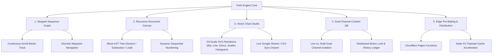

# Folio Engine Technical Documentation

**Folio Engine** (`@devcabs/folio-engine`) is an installable React 19 application engine and component library for rich, data-driven narrative experiences. It provides a parametric stepped sequence graph, recursive document canvas AST, in-browser vector chart studio, dual-channel content persistence, and edge pre-baking.

---

## 🏗️ Core Subsystems

Folio Engine is organized around five modular, decoupled technical subsystems:



---

## 🧭 The Diátaxis Documentation Matrix

| Quadrant | Focus | Description | Documents |
| :--- | :--- | :--- | :--- |
| **Tutorials** | Learning (Hands-on) | Guided step-by-step walkthroughs to get up and running quickly. | • [01. Getting Started with Folio Engine](file:///Users/francisdave/Documents/folio/docs/folio-engine/tutorials/01-getting-started.md)<br>• [02. Building a Stepped Canvas Experience](file:///Users/francisdave/Documents/folio/docs/folio-engine/tutorials/02-building-a-stepped-canvas.md) |
| **How-To Guides** | Problem-Solving (Tasks) | Concrete recipes for solving specific operational and engineering challenges. | • [01. Dual-Channel Content DB Setup](file:///Users/francisdave/Documents/folio/docs/folio-engine/how-to/01-dual-channel-content-db.md)<br>• [02. Google Sheets Chart Synchronization](file:///Users/francisdave/Documents/folio/docs/folio-engine/how-to/02-google-sheets-chart-sync.md)<br>• [03. Edge Pre-Baking & KV Distribution](file:///Users/francisdave/Documents/folio/docs/folio-engine/how-to/03-edge-pre-baking-and-kv-cache.md)<br>• [04. Theming and Design Tokens](file:///Users/francisdave/Documents/folio/docs/folio-engine/how-to/04-theming-and-design-tokens.md)<br>• [05. Diagnostics & Integrity Testing](file:///Users/francisdave/Documents/folio/docs/folio-engine/how-to/05-diagnostics-and-testing.md) |
| **Reference** | Information (Exhaustive) | Dry, accurate specifications, type contracts, component props, and API entry points. | • [01. Public API & Exports Reference](file:///Users/francisdave/Documents/folio/docs/folio-engine/reference/01-public-api-exports.md)<br>• [02. Data Contracts & Schemas](file:///Users/francisdave/Documents/folio/docs/folio-engine/reference/02-data-contracts.md)<br>• [03. Component Catalog & Props](file:///Users/francisdave/Documents/folio/docs/folio-engine/reference/03-components.md)<br>• [04. Hooks & State Contexts](file:///Users/francisdave/Documents/folio/docs/folio-engine/reference/04-hooks-and-contexts.md)<br>• [05. Services & Storage Utilities](file:///Users/francisdave/Documents/folio/docs/folio-engine/reference/05-services-and-utilities.md)<br>• [06. Configuration Reference](file:///Users/francisdave/Documents/folio/docs/folio-engine/reference/06-configuration.md) |
| **Explanation** | Understanding (Concepts) | Architectural discussions, mathematical models, and design trade-offs. | • [01. System Architecture & Data Flow](file:///Users/francisdave/Documents/folio/docs/folio-engine/explanation/01-system-architecture.md)<br>• [02. Dual-Mode Distribution Model](file:///Users/francisdave/Documents/folio/docs/folio-engine/explanation/02-dual-mode-distribution.md)<br>• [03. Stepped Sequence & Bézier Math](file:///Users/francisdave/Documents/folio/docs/folio-engine/explanation/03-stepped-sequence-bezier-math.md)<br>• [04. Recursive Document AST Engine](file:///Users/francisdave/Documents/folio/docs/folio-engine/explanation/04-recursive-document-ast.md)<br>• [05. Coordinator Concurrency & Mutex](file:///Users/francisdave/Documents/folio/docs/folio-engine/explanation/05-coordinator-mode-concurrency.md) |

---

## 📦 Package Distribution Structure

The engine exposes three distinct entrypoints configured in `package.json`:

```json
{
  "exports": {
    ".": {
      "types": "./dist/index.d.ts",
      "import": "./dist/folio.js",
      "require": "./dist/folio.cjs"
    },
    "./edge": {
      "types": "./dist/edge.d.ts",
      "import": "./dist/edge.js",
      "require": "./dist/edge.cjs"
    },
    "./diagnostics": {
      "types": "./dist/diagnostics.d.ts",
      "import": "./dist/diagnostics.js",
      "require": "./dist/diagnostics.cjs"
    },
    "./style.css": "./dist/style.css"
  }
}
```

1. **`@devcabs/folio-engine`**: Full client engine containing React components, hooks, contexts, SVG charts, and interactive canvas authoring.
2. **`@devcabs/folio-engine/edge`**: Zero-DOM, zero-React entry point containing edge prebake serializers, KV transformers, and media URL proxies for Cloudflare Workers / Pages Functions.
3. **`@devcabs/folio-engine/diagnostics`**: Contract testing and pre-flight validation utilities for build pipelines and CI gates.
4. **`@devcabs/folio-engine/style.css`**: Pre-bundled CSS design tokens, reset styles, and scoped CSS module class styles.
