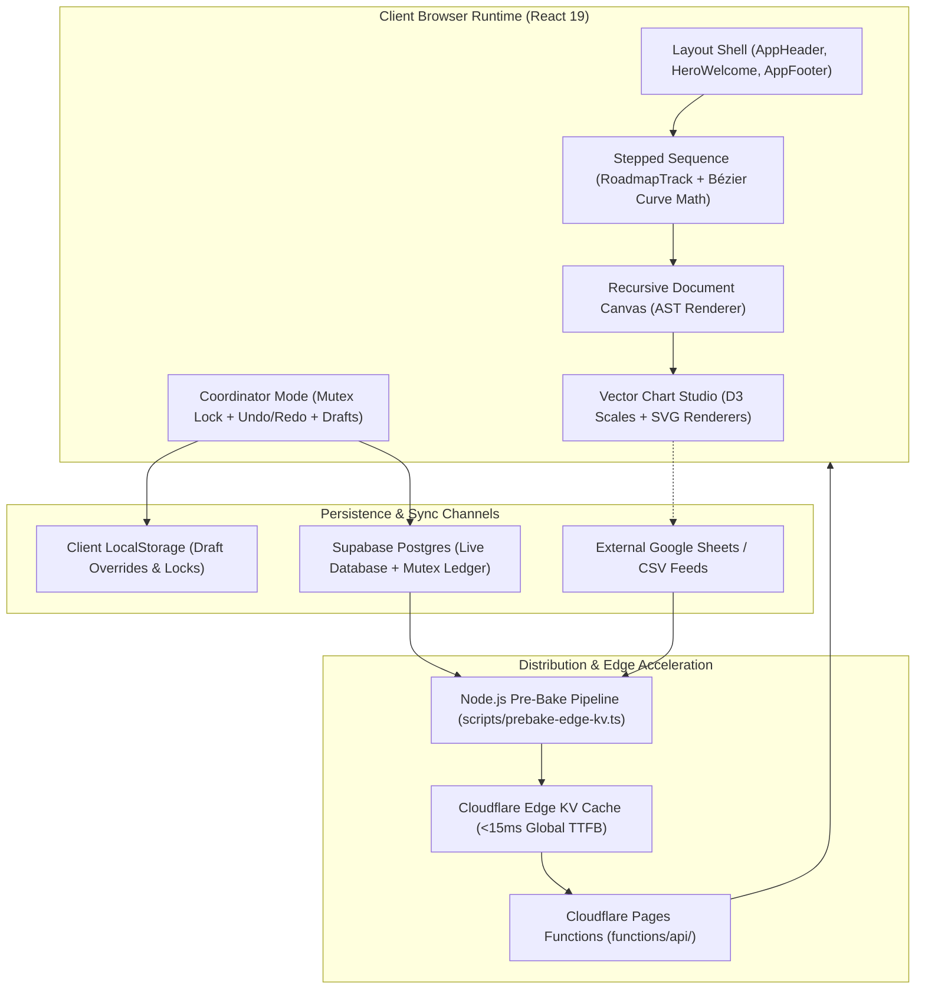

# Explanation: System Architecture & Data Flow

This document provides an in-depth architectural analysis of Folio Engine (`@devcabs/folio-engine`), detailing the end-to-end data pipelines, isolation boundaries, and runtime system design.

---

## 🏛️ High-Level System Architecture

Folio Engine is organized as a client-first, edge-accelerated technical storytelling platform. It decouples authoring, storage, computation, and rendering into distinct layers:

---

## 🔄 End-to-End Data Flow

The lifecycle of data within Folio Engine progresses through three distinct operational phases:

### Phase 1: Authoring & Draft Isolation
1. **Interactive Entry**: A coordinator authenticates using a 6-digit PIN verified via SHA-256 in `devSecurity.ts`.
2. **Distributed Mutex**: `devLockService.ts` claims an exclusive lease in Supabase to prevent concurrent edits across tabs or machines.
3. **Draft Mutations**: Text edits, canvas structural operations, and chart parameter tweaks write immediately to namespaced `localStorage` keys via `contentDb.ts` and `draftService.ts`.
4. **Instant Reactive Feedback**: React contexts (`DeveloperModeContext`, `UndoRedoContext`) push immutable state frames, updating the live DOM at 60fps while public viewers continue seeing unchanged live content.

### Phase 2: Publishing & Ledger Commit
1. **Atomic Publish**: The coordinator triggers `publishAllDrafts()`.
2. **Schema Gate**: All modified `NodeCanvasDocument` ASTs pass through strict Zod validators (`NodeCanvasDocumentSchema`).
3. **Database Upsert**: Verified payloads commit to the live channel in Supabase.
4. **Audit Ledger**: A permanent change record is written to the `engine_history` ledger detailing the author, timestamp, affected document, and diff.
5. **Lock Relinquish**: The distributed mutex lease is released.

### Phase 3: Edge Pre-Baking & Global Distribution
1. **Static Compilation**: The prebake pipeline (`scripts/prebake-edge-kv.ts`) reads live records from Supabase and Google Sheets CSV endpoints.
2. **Asset Pre-Resolution**: Google Drive images are verified and responsive `srcSet` candidates are calculated.
3. **Edge Hydration**: Pre-baked JSON bundles deploy to Cloudflare KV storage.
4. **Zero-Latency Serving**: When public viewers navigate to the site, Cloudflare Pages Functions serve pre-baked payloads from edge memory without touching the primary database.

---

## 🛡️ Architectural Boundaries & Guarantees

1. **Zero-Leak Domain Decoupling**: Core components, hooks, storage adapters, and styles are completely decoupled from any single tenant's branding or institutional domain.
2. **Zero-DOM Edge Boundary**: The `@devcabs/folio-engine/edge` entrypoint guarantees zero references to `window`, `document`, or React primitives, ensuring fail-safe execution in serverless edge runtimes.
3. **Build-Blocking Token Purity**: No ad-hoc colors or inline styling hacks can slip into production; any un-tokenized style immediately fails the CI pipeline.
