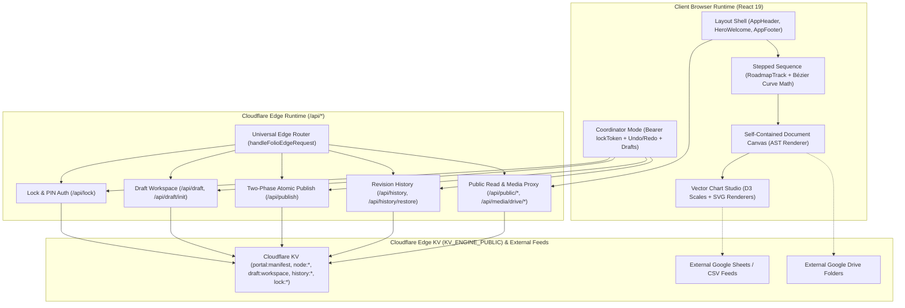

# Explanation: System Architecture & Data Flow

This document provides an in-depth architectural analysis of Folio Engine (`@devcabs/folio-engine`), detailing the end-to-end data pipelines, isolation boundaries, and runtime system design.

---

## 🏛️ High-Level System Architecture

Folio Engine is organized as a strict **Single Source of Truth (SSOT)** platform backed exclusively by **Cloudflare Edge KV** and **Cloudflare Pages Functions**—with zero Supabase dependencies, zero browser-side shadow stores (`localStorage`, `sessionStorage`, `IndexedDB`), and zero silent fallbacks.

---

## 🔄 End-to-End Data Flow

The lifecycle of data within Folio Engine progresses through three distinct operational phases:

### Phase 1: Edge-Authenticated Authoring & Draft Isolation
1. **Edge PIN Authentication**: A coordinator enters a 4-digit PIN, which `POST /api/lock` verifies on the Cloudflare Edge against `env.DEV_SECURITY_SALT` and `env.DEV_PIN_HASH` with brute-force rate limiting stored in KV (`lock:pin_ratelimit`).
2. **Opaque Lock Token**: Upon verification, `lockHandler.ts` claims `lock:coordinator` (60s KV TTL, renewed via 30s `PATCH /api/lock` heartbeats) and issues an opaque `lockToken` passed as `Authorization: Bearer <lockToken>` on all mutating edge requests.
3. **Direct KV Draft Mutations**: `POST /api/draft/init` initializes or loads `draft:workspace` in Cloudflare KV (supporting cold-boot bootstrap when `portal:manifest === null && history:index === null`). Copy edits, self-contained AST block mutations, embedded `ChartElement` configs/datasets, and embedded `GalleryElement` photo lists write directly to `PUT /api/draft` with optimistic concurrency (`expectedRevision` / `expectedUpdatedAt` → HTTP 409 on conflict).
4. **Instant Reactive Feedback**: React contexts (`PortalChromeContext`, `DeveloperModeContext`, `UndoRedoContext`) update the live DOM at 60fps while public visitors continue reading the active published snapshot.

### Phase 2: Two-Phase Atomic Publishing & History Ledger
1. **Authorized Publish**: The coordinator triggers `publishNewSnapshot()` (`POST /api/publish` with `Authorization: Bearer <lockToken>`).
2. **Phase A — Immutable Versioned Staging**: `edgePreBakeService.ts` compiles self-contained `PublicNodePayload` documents (rewriting Google Drive URLs to `/api/media/drive/:fileId?w=...` with responsive `srcSet` candidates and stripping private `ChartElement.config.sheetUrl` values). The handler writes immutable `history:snapshot:${id}`, `node:${id}:${nodeId}`, and `node:${nodeId}` keys first.
3. **Phase B — Atomic Pointer Flip**: Once all immutable keys succeed, `publishHandler.ts` flips `portal:manifest.activeSnapshotId`, updates `history:index`, and resets `draft:workspace` (`dirty: false`), preventing multi-key split-brain on partial failures.
4. **Rollback**: `POST /api/history/restore` atomically restores both `canvases` and `contentOverrides` from any `history:snapshot:${id}` (or `snap-system-baseline`) into `draft:workspace`.

### Phase 3: Fail-Stop Edge Serving & Global Distribution
1. **Zero-Latency Serving**: Public visitors read `GET /api/public/manifest` (`portal:manifest`) and `GET /api/public/node/:nodeId` (`node:${activeSnapshotId}:${nodeId}`) directly from Cloudflare KV via `handleFolioEdgeRequest`.
2. **Strict Fail-Stop**: Missing KV keys or unconfigured bindings fail stop immediately with HTTP `404`/`503` (never returning fabricated HTTP 200 fallback payloads or static bundled JSON). Client contexts surface `<TopErrorBanner />` with explicit retry controls.

---

## 🛡️ Architectural Boundaries & Guarantees

1. **Zero-Leak Domain Decoupling**: Core components, hooks, storage adapters, and styles are completely decoupled from any single tenant's branding or institutional domain.
2. **Zero-DOM Edge Boundary**: The `@devcabs/folio-engine/edge` entrypoint guarantees zero references to `window`, `document`, or React primitives, ensuring fail-safe execution in serverless edge runtimes.
3. **Build-Blocking Token Purity**: No ad-hoc colors or inline styling hacks can slip into production; any un-tokenized style immediately fails the CI pipeline.

---

## Normalized Subpage Tree & Zero-Wait Edge Hydration

Folio Engine models unlimited-depth subpages using three coordinated layers:

1. **Normalized `PageNode` Registry (`src/types/page.ts`)**: Subpage hierarchy (`parentId`, `slug`, `title`, `summary`, `order`) lives in a flat `PageRegistry` map rather than nested inside `NodeCanvasDocument`s. Each `PageNode` pairs 1:1 with a `PageLinkElement` card on its parent canvas, ensuring `PageNode.title` is the single authority across cards, breadcrumbs, and header dropdowns.
2. **Zero-Wait Edge HTML Injection (`src/edge/handlers/htmlManifestInjector.ts`)**: Non-API HTML requests receive `window.__FOLIO_MANIFEST__` (including `pages`) injected inline at the edge, allowing `useHashRoute` and `PortalChromeContext` to resolve deep links like `/node/access/research/interviews/2026-notes/` synchronously at `0ms` with zero 404 flash.
3. **Workspace-Addressed Undo & Atomic Branch Purge**: `createWorkspaceUndoAction` commits `pages`, `canvases`, and `deletedPageIds` directly to `PUT /api/draft` independently of whichever page is currently mounted.
