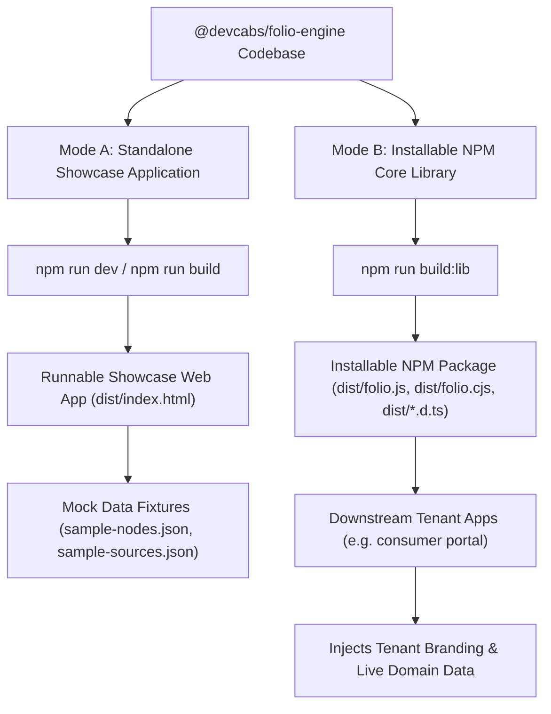

# Explanation: Dual-Mode Engine Architecture & Multi-Tenant Distribution

This document discusses the dual-mode design of Folio Engine, explaining how it functions simultaneously as an independent interactive showcase application and an installable npm library package.

---

## 💡 The Architectural Challenge

When extracting reusable engines from complex web applications, two common architectural failures occur:
1. **Monolithic Entanglement**: Reusable code remains intertwined with tenant-specific branding, domain acronyms, and institutional workflows.
2. **Abstract Isolation**: The extracted library becomes a hollow set of abstract interfaces divorced from a running, testable UI, making local development slow and testing cumbersome.

Folio Engine solves this with a **Dual-Mode Architecture**.

---

## ⚙️ The Dual-Mode Model



---

## Mode A: Standalone Showcase Application

In Mode A, the repository behaves as a self-contained, runnable web application:
- **Command**: `npm run dev` (starts Vite dev server on port `5174`).
- **Entrypoint**: `index.html` &rarr; `src/main.tsx` &rarr; `src/App.tsx`.
- **Data Source**: Uses mock sample datasets (`src/data/sample-nodes.json`, `src/data/baked-charts.json`).
- **Utility**: Enables frontend designers, core maintainers, and reviewers to interactively test Bézier tracks, canvas block reordering, and chart drawer configurations without needing a production tenant environment.

---

## Mode B: Installable Core Library

In Mode B, Vite compiles the codebase into an installable npm package using Vite Library Mode:
- **Command**: `npm run build:lib`.
- **Configuration**: `vite.config.lib.ts` and `tsconfig.lib.json`.
- **Outputs**:
  - `dist/folio.js` (ES Module bundle).
  - `dist/folio.cjs` (CommonJS bundle).
  - `dist/index.d.ts` (TypeScript type declarations).
  - `dist/edge.js` & `dist/edge.cjs` (Zero-DOM edge distribution bundle).
  - `dist/diagnostics.js` & `dist/diagnostics.cjs` (CI diagnostics module).
  - `dist/style.css` (Bundled CSS design tokens and component styles).

---

## 🏢 Multi-Tenant Adoption Model

Downstream applications consume Folio Engine as a pure dependency:

```json
{
  "dependencies": {
    "@devcabs/folio-engine": "file:../folio"
  }
}
```

### Downstream Inversion of Control
The tenant application is responsible for:
1. Providing tenant-specific branding (`appName`, `logoText`, `heroTitle`).
2. Providing tenant-specific waypoints (`NodeItem[]`).
3. Configuring storage credentials (`VITE_SUPABASE_URL`).

Folio Engine provides all interactive scrollytelling mechanics, SVG curve geometry, AST block rendering, modal dialogs, and D3 vector charts.
