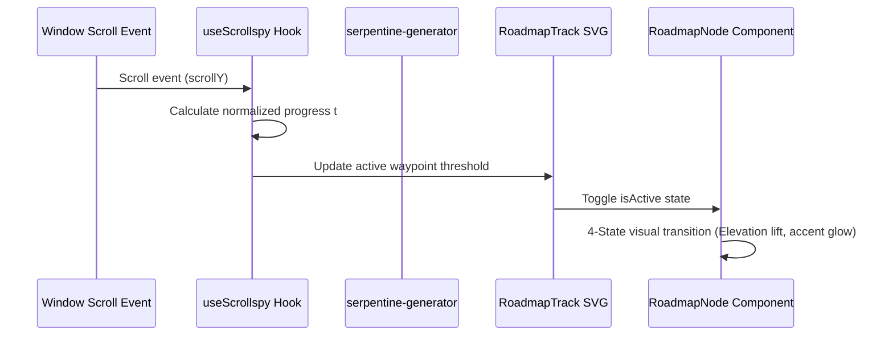

# Explanation: Stepped Sequence Navigation & Parametric Bézier Geometry

This document explains the mathematical foundations and scroll synchronization mechanics of the continuous serpentine track (`serpentine-generator.ts` and `RoadmapTrack.tsx`).

---

## 📐 Geometric Design & Visual Intent

Traditional navigation tracks use straight horizontal timelines or rigid vertical sidebars. Folio Engine employs an undulating **Cubic Bézier Serpentine Track** that snakes down the viewport, guiding the reader through an organic journey:

```
(X0, Y0) ─── Start Waypoint
   \
    \   Cubic Control Points (CP1, CP2)
     \
      (X1, Y1) ─── Waypoint 2 (Right Flank)
     /
    /
   /
(X2, Y2) ─── Waypoint 3 (Left Flank)
```

---

## 🧮 Mathematical Formulation

The curve generator in `src/components/roadmap/serpentine-generator.ts` computes cubic Bézier segments connecting sequential waypoints:

$$\mathbf{B}(t) = (1-t)^3 \mathbf{P}_0 + 3(1-t)^2 t \mathbf{P}_1 + 3(1-t) t^2 \mathbf{P}_2 + t^3 \mathbf{P}_3, \quad t \in [0, 1]$$

Where:
- $\mathbf{P}_0 = (x_0, y_0)$ is the origin waypoint coordinate.
- $\mathbf{P}_3 = (x_1, y_1)$ is the destination waypoint coordinate.
- $\mathbf{P}_1$ and $\mathbf{P}_2$ are vertical tangent control points calculated to ensure smooth curvature without self-intersecting loops:

$$\mathbf{P}_1 = \left(x_0, y_0 + \frac{\Delta y}{2}\right), \quad \mathbf{P}_2 = \left(x_1, y_1 - \frac{\Delta y}{2}\right)$$

### Dynamic Waypoint Placement
1. **Vertical Pitch ($y_i$)**: Vertical distance between waypoints scales with section length and photo aspect ratio:
   $$y_i = y_{i-1} + \Delta y_{\text{node}}$$
2. **Horizontal Flank ($x_i$)**: Waypoints alternate between left and right flanks relative to the center track axis:
   $$x_i = \begin{cases} x_{\text{center}} - \Delta x & \text{if } i \text{ is odd (Left Flank)} \\ x_{\text{center}} + \Delta x & \text{if } i \text{ is even (Right Flank)} \end{cases}$$

---

## 🧭 Reactive Viewport Scroll Synchronization

The sequence track connects vertical scrolling with active waypoint states:



1. **Threshold Trigger**: As the reader scrolls down the page, `useScrollspy` calculates the active viewport intersection (defaulting to the 40% vertical viewport line).
2. **Smooth Transition**: The active waypoint elevates, illuminating its accent color token (`--color-node-i`), while previous nodes settle into completed resting states.
3. **Responsive Breakpoint Collapse**: When viewport width falls below `PHOTO_STACKED_BREAKPOINT` (1024px), the horizontal offset $\Delta x$ collapses to zero, transforming the serpentine curve into a straight vertical spine with stacked cards.
