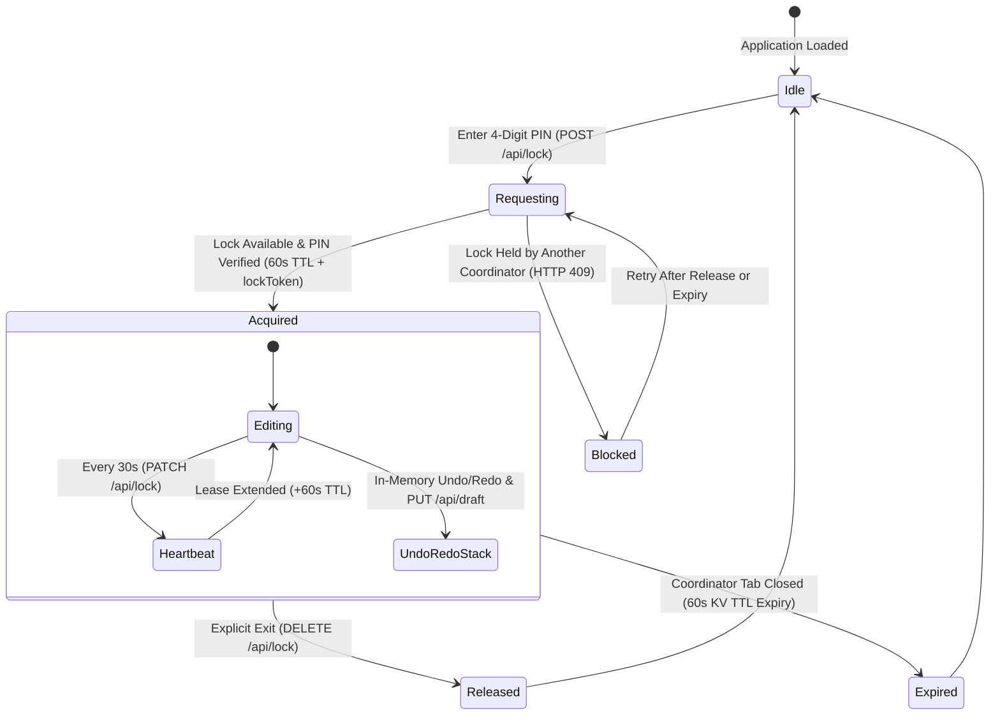

# Explanation: Coordinator Concurrency, Mutex Locks & History Ledger

This document explores how Folio Engine manages multi-tab and multi-user concurrency during live content editing, detailing the distributed mutex lease protocol and transaction ledger.

---

## ⚡ The Concurrency Dilemma

In content editing systems without full realtime CRDT backends, multiple editors making concurrent updates lead to **Lost Updates** (the "last write wins" catastrophe where Editor B overwrites Editor A's changes without realizing it).

Folio Engine addresses this through a lightweight, fail-safe **Edge-Authenticated Mutex Lease Protocol** backed by **Cloudflare Edge KV** (`lock:coordinator` and `lock:pin_ratelimit`).

---

## 🔐 The Mutex Lease Lifecycle



### Mutex Rules
1. **Edge PIN Auth & Rate Limiting**: `POST /api/lock` verifies the 4-digit PIN on the Cloudflare Edge against `env.DEV_SECURITY_SALT` and `env.DEV_PIN_HASH`, persisting brute-force attempt counters in KV `lock:pin_ratelimit` (5 failed attempts trigger a 60-second cooldown).
2. **Opaque `lockToken` Authority**: Upon acquisition, the edge issues an opaque `lockToken` (never exposed on `GET /api/lock`). Every mutating request (`PUT /api/draft`, `POST /api/publish`, `POST /api/history/restore`, `PATCH/DELETE /api/lock`) must present `Authorization: Bearer <lockToken>`.
3. **Heartbeat Extension & Crash Recovery**: An active coordinator sends a `PATCH /api/lock` heartbeat every 30 seconds, extending the 60-second KV TTL (`LOCK_TTL_SECONDS = 60`). If a coordinator closes their browser or loses connectivity, the lease automatically expires after 60 seconds, and re-authenticating with the PIN supersedes stale locks from page reloads.
4. **Collision Modal**: If Coordinator B attempts to enter developer mode while Coordinator A holds the lease, `DevLockBlockedModal` displays the holder label and expiration time.

---

## 📜 In-Memory Undo/Redo & Transaction Ledger

While in Coordinator Mode, every mutation produces a transactional snapshot managed by `undoRedoService.ts` and `UndoRedoContext.tsx` (in-memory only—zero browser storage):

### Transaction Stack Mechanics
```
[ State S0 ] ──(Edit Section 1)──> [ State S1 ] ──(Add Photo)──> [ State S2 ]
                                         │                              │
                                   (Undo Action)                  (Current Head)
                                         │
                                   [ State S1 ]
```
- **Undo (`Ctrl + Z`)**: Reverts the active draft to the previous immutable AST snapshot.
- **Redo (`Ctrl + Y` or `Ctrl + Shift + Z`)**: Advances forward along the future history branch.
- **Stack Branch Truncation**: Pushing a new mutation while in an undone state discards future frames, preserving linear deterministic history.

---

## 🗄️ Cloudflare KV Revision History (`history:index` & `history:snapshot:*`)

When changes are committed via `publishNewSnapshot()` (`POST /api/publish`), an immutable snapshot is persisted in Cloudflare KV:

- **`history:snapshot:${id}`**: Full `PublishedSnapshot` containing all `canvases` (`Record<string, NodeCanvasDocument>`), `contentOverrides` (`Record<string, string>`), `authorSessionId`, `createdAt`, and `summary` metrics.
- **`history:index`**: Ordered `HistoryIndex` manifest tracking `activeSnapshotId` and lightweight `HistoryIndexEntry` summaries for fast listing in `GET /api/history`.

Coordinators can inspect previous snapshots and atomically restore any revision (or `snap-system-baseline`) into `draft:workspace` via `POST /api/history/restore` from `HistoryHubModal`.
