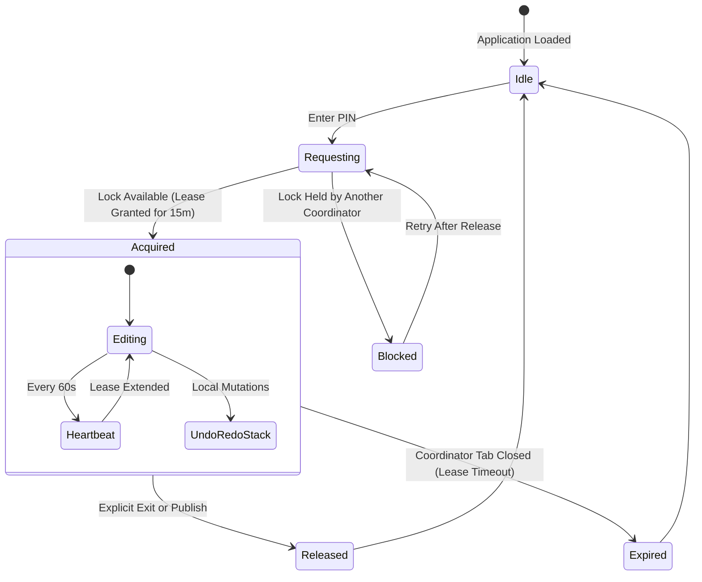

# Explanation: Coordinator Concurrency, Mutex Locks & History Ledger

This document explores how Folio Engine manages multi-tab and multi-user concurrency during live content editing, detailing the distributed mutex lease protocol and transaction ledger.

---

## ⚡ The Concurrency Dilemma

In content editing systems without full realtime CRDT backends, multiple editors making concurrent updates lead to **Lost Updates** (the "last write wins" catastrophe where Editor B overwrites Editor A's changes without realizing it).

Folio Engine addresses this through a lightweight, fail-safe **Distributed Mutex Lease Protocol** backed by Postgres in Supabase.

---

## 🔐 The Mutex Lease Lifecycle



### Mutex Rules
1. **Single Active Coordinator**: Only one coordinator may hold an active lock lease on the document at any given time.
2. **Heartbeat Extension**: An active coordinator sends a heartbeat every 60 seconds, extending the lease expiration timestamp by 15 minutes.
3. **Automatic Expiry**: If a coordinator closes their browser or loses connectivity, the lease automatically expires after 15 minutes, allowing other coordinators to claim the lock without manual database intervention.
4. **Collision Modal**: If Coordinator B attempts to enter developer mode while Coordinator A holds the lease, `DevLockBlockedModal` informs Coordinator B of who holds the lock and when it expires.

---

## 📜 In-Memory Undo/Redo & Transaction Ledger

While in Coordinator Mode, every mutation produces a transactional snapshot managed by `undoRedoService.ts`:

### Transaction Stack Mechanics
```
[ State S0 ] ──(Edit Section 1)──> [ State S1 ] ──(Add Photo)──> [ State S2 ]
                                         │                              │
                                   (Undo Action)                  (Current Head)
                                         │
                                   [ State S1 ]
```
- **Undo (`Ctrl + Z`)**: Reverts the active draft to the previous immutable AST snapshot.
- **Redo (`Ctrl + Y` or `Ctrl + Shift + Z`)**: Advances forward along the future history branch.
- **Stack Branch Truncation**: Pushing a new mutation while in an undone state discards future frames, preserving linear deterministic history.

---

## 🗄️ Permanent Audit Ledger (`engine_history`)

When changes are committed via `publishAllDrafts()`, an append-only audit record is stored in Postgres:

```sql
CREATE TABLE IF NOT EXISTS engine_history (
    id UUID PRIMARY KEY DEFAULT gen_random_uuid(),
    entity_id TEXT NOT NULL,
    action TEXT NOT NULL,           -- 'canvas_update', 'copy_edit', 'chart_reconfig'
    actor_id TEXT NOT NULL,            -- Coordinator identifier or session hash
    diff JSONB NOT NULL,               -- Forward and backward diff delta
    created_at TIMESTAMPTZ DEFAULT NOW()
);
```

Coordinators can inspect previous changes, timestamps, and modification summaries via the `HistoryHubModal`.
