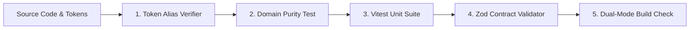

# How-To: Run Diagnostics & Automated Verification Gates

This guide outlines how to execute built-in diagnostic routines, run contract verifications, and wire automated purity checks into your CI/CD pipelines.

---

## 🎯 Verification Framework

Folio Engine employs a multi-tiered verification strategy ensuring data purity, design token integrity, and build reliability before deployment:



---

## 1. Runtime Diagnostic Verification (`verifyEngineSetup`)

The engine provides a runtime pre-flight diagnostic module exported from `@devcabs/folio-engine/diagnostics`:

```typescript
import { verifyEngineSetup } from '@devcabs/folio-engine/diagnostics';

async function checkSystemIntegrity() {
  const result = await verifyEngineSetup({
    checkSupabaseConnection: true,
    validateConfigSchemas: true,
    verifyStorageAccess: true,
  });

  if (!result.isValid) {
    console.error('Diagnostic errors found:', result.errors);
  } else {
    console.log('✅ Engine configuration and persistence verified.');
  }
}
```

---

## 2. Token Purity Verification (`test:tokens`)

The token verifier scans every CSS module, TypeScript file, and HTML template in `src/` to guarantee that all consumed CSS custom properties are formally registered in `src/styles/tokens.css`:

```bash
npm run test:tokens
```

Run during pre-commit hooks to catch typos (e.g. `var(--folio-prmary)`) before code hits version control.

---

## 3. Domain Decoupling & Purity Suite (`test:purity`)

To guarantee that the engine remains generic and devoid of institutional domain baggage, the domain purity test scans all source code and script files against a banned dictionary:

```bash
npm run test:purity
```

Any accidental reintroduction of institutional domain terms halts compilation immediately with file and line numbers.

---

## 4. Complete Test Suite Execution

Run the complete Vitest test suite covering components, hooks, serpentine math, and storage isolation:

```bash
npm test
```

Flags and variants:
```bash
# Run tests in watch mode
npm run test -- --watch

# Run a specific component test
npx vitest run tests/components/vector-chart-studio.test.ts

# Generate test coverage report
npx vitest run --coverage
```

### Storage Isolation & Deterministic Test Ordering

All migration and watermark tests (such as `tests/migration.test.ts`, `tests/services/migration-service.test.ts`, and `tests/utils/watermark-resolver.test.ts`) MUST isolate persistence state between test cases using `createInMemoryAdapter()` in `beforeEach`:

```typescript
import { createInMemoryAdapter, type StorageAdapter } from '../src/utils/storageAdapter';

describe('watermark resolution', () => {
  let storage: StorageAdapter;

  beforeEach(() => {
    storage = createInMemoryAdapter();
  });

  // Pass `storage` explicitly to all service and resolver functions
});
```

- Direct `localStorage`, `window.localStorage`, or `globalThis.localStorage` calls are forbidden in test files.
- `vitest.config.ts` sets `globals: true` and `clearMocks: true` (under `environment: 'node'`) so test state and mock call histories never leak across test ordering or parallel runs.

---

## 5. Wiring CI / GitHub Actions Quality Gate

Add a GitHub Actions workflow (`.github/workflows/ci.yml`) to enforce all verification gates automatically on every pull request:

```yaml
name: Engine CI Quality Gate

on:
  push:
    branches: [main]
  pull_request:
    branches: [main]

jobs:
  verify:
    runs-on: ubuntu-latest
    steps:
      - name: Checkout Repository
        uses: actions/checkout@v4

      - name: Setup Node.js
        uses: actions/setup-node@v4
        with:
          node-version: 20
          cache: 'npm'

      - name: Install Dependencies
        run: npm ci

      - name: Gate 1 - Design Token Purity
        run: npm run test:tokens

      - name: Gate 2 - Domain Decoupling Purity
        run: npm run test:purity

      - name: Gate 3 - Typecheck
        run: npx tsc --noEmit

      - name: Gate 4 - Vitest Unit Suite
        run: npm test

      - name: Gate 5 - Dual-Mode Library Bundle
        run: npm run build:lib
```

---

## 6. CLI Migration Doctor (`folio-engine doctor`)

Consumer repositories and AI coding assistants can audit engine compatibility, breaking code changes, and pending content migrations directly from the terminal via `bin/folio-engine.js` (`src/diagnostics/migrationDoctor.ts`):

```bash
# Run full migration diagnostic report (ANSI terminal output)
npx folio-engine doctor
npx folio-engine check

# Machine-readable JSON output for CI pipelines or AI agents
npx folio-engine doctor --format json

# Audit changes starting from a specific prior engine version
npx folio-engine doctor --from 0.1.2

# Inspect release history or CLI version
npx folio-engine changelog
npx folio-engine version

# Run directly in the engine repository during development
npm run doctor
```

The diagnostic routine uses monorepo-safe resolution (`src/diagnostics/packageResolver.ts`) to locate the consumer's installed `@devcabs/folio-engine` package, consumer `package.json`, and local setup/content files (`sample-nodes.json`, `src/engine-setup.ts`, `engine-setup.ts`, `src/folio/engine-setup.ts`), compares versions against `FOLIO_MIGRATION_LEDGER`, and prints an actionable **Agent Prompt Block** when migrations are pending.

For consumer AI workflows, copy or import `.agents/rules/folio-engine-migration.md` into your consumer application so AI assistants automatically run `npx folio-engine doctor` after every `@devcabs/folio-engine` upgrade.

### Consumer App Migration Checklist (0.1.12 → 0.1.13)

1. **Public Canvas Edge Single-Source Isolation (0.1.13)**:
   - Public page refreshes no longer execute background Supabase cloud sync, eliminating cloud traffic on public visits.
   - Public canvas event subscriptions ignore wildcard live events that carry no document payload, preserving Edge KV document integrity.
2. **EngineConfig Watermark Sync (0.1.13)**:
   - Set `contentVersion: '0.1.13'` in `EngineConfig` (`src/engine-setup.ts` or `src/App.tsx`) to clear doctor and Dev Mode migration notices.

### Consumer App Migration Checklist (0.1.11 → 0.1.12)

1. **Apply Supabase Database Migration (0.1.12)**:
   - Run `supabase/migrations/20261116000000_ensure_chart_sources_node_id.sql` in your Supabase SQL editor to ensure `chart_sources` includes the `node_id` column and index.
2. **Canvas Fetch Error Handling & Dignified Draft Notice (0.1.12)**:
   - `DocumentCanvas` now mounts canonical `TopErrorBanner` on edge fetch failure in public mode with retry capability, rather than showing a false empty notice.
   - `CanvasEmptyNotice` displays minimal dignified draft notice ("This section is currently in draft") when no sections exist and no fetch errors occur.
3. **Draft Baseline Hydration & Storage Cleanup (0.1.12)**:
   - Starting a draft from an active published version pre-hydrates from Edge KV (`/api/public/node/:nodeId`) so local editing does not begin with empty or stale state.
   - Publishing automatically purges local draft storage keys (`folio_draft_canvas_${nodeId}`) and deletes remote active drafts in Supabase `engine_drafts`.
4. **EngineConfig Watermark Sync (0.1.12)**:
   - Set `contentVersion: '0.1.12'` in `EngineConfig` to clear doctor and Dev Mode migration notices.

### Consumer App Migration Checklist (0.1.10 → 0.1.11)

1. **Universal Edge Router Delegation (0.1.11)**:
   - Delete duplicate `functions/api/`, `src/utils/mediaUrl.ts`, and `src/types/edge.ts` in host app.
   - Update `worker.ts` to delegate directly to `handleFolioEdgeRequest` from `@devcabs/folio-engine/edge`.
2. **EngineConfig Watermark Sync (0.1.11)**:
   - Set `contentVersion: '0.1.11'` in `EngineConfig`.

### Consumer App Migration Checklist (0.1.8 → 0.1.10)

1. **Element-Level Photo Gallery Ownership (0.1.8)**:
   - Provide explicit `driveUrl` and `id` on each canvas gallery element (parent node photo sync fallback is eliminated).
2. **Edge KV Single-Source Architecture (0.1.9)**:
   - Route public visitor reads through Cloudflare Edge KV (`/api/public/node/:nodeId`) with zero synchronous localStorage reading or writing.
3. **Pure AST Revision Rollback (0.1.9)**:
   - Revision rollback restores pure Canvas ASTs without re-hydrating flat `_draft_content_overrides`.
4. **EngineConfig Watermark Sync (0.1.10)**:
   - Set `contentVersion: '0.1.10'` in `EngineConfig` to clear doctor and Dev Mode migration notices.
