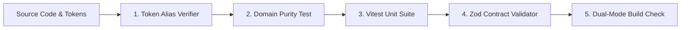

# How-To: Run Diagnostics & Automated Verification Gates

This guide outlines how to execute built-in diagnostic routines, run contract verifications, and wire automated purity checks into your CI/CD pipelines.

---

## 🎯 Verification Framework

Folio Engine employs a multi-tiered verification strategy ensuring data purity, design token integrity, and build reliability before deployment:



---

## 1. Runtime Diagnostic Verification (`verifyEngineSetup`)

The engine provides a runtime pre-flight diagnostic module exported from `@devcabs/folio-engine/diagnostics`:

```typescript
import { verifyEngineSetup } from '@devcabs/folio-engine/diagnostics';

async function checkSystemIntegrity() {
  const result = await verifyEngineSetup({
    checkSupabaseConnection: true,
    validateConfigSchemas: true,
    verifyStorageAccess: true,
  });

  if (!result.isValid) {
    console.error('Diagnostic errors found:', result.errors);
  } else {
    console.log('✅ Engine configuration and persistence verified.');
  }
}
```

---

## 2. Token Purity Verification (`test:tokens`)

The token verifier scans every CSS module, TypeScript file, and HTML template in `src/` to guarantee that all consumed CSS custom properties are formally registered in `src/styles/tokens.css`:

```bash
npm run test:tokens
```

Run during pre-commit hooks to catch typos (e.g. `var(--folio-prmary)`) before code hits version control.

---

## 3. Domain Decoupling & Purity Suite (`test:purity`)

To guarantee that the engine remains generic and devoid of institutional domain baggage, the domain purity test scans all source code and script files against a banned dictionary:

```bash
npm run test:purity
```

Any accidental reintroduction of institutional domain terms halts compilation immediately with file and line numbers.

---

## 4. Complete Test Suite Execution

Run the complete Vitest test suite covering components, hooks, serpentine math, and storage isolation:

```bash
npm test
```

Flags and variants:
```bash
# Run tests in watch mode
npm run test -- --watch

# Run a specific component test
npx vitest run tests/components/vector-chart-studio.test.ts

# Generate test coverage report
npx vitest run --coverage
```

### Storage Isolation & Deterministic Test Ordering

All migration and watermark tests (such as `tests/migration.test.ts`, `tests/services/migration-service.test.ts`, and `tests/utils/watermark-resolver.test.ts`) MUST isolate persistence state between test cases using `createInMemoryAdapter()` in `beforeEach`:

```typescript
import { createInMemoryAdapter, type StorageAdapter } from '../src/utils/storageAdapter';

describe('watermark resolution', () => {
  let storage: StorageAdapter;

  beforeEach(() => {
    storage = createInMemoryAdapter();
  });

  // Pass `storage` explicitly to all service and resolver functions
});
```

- Direct `localStorage`, `window.localStorage`, or `globalThis.localStorage` calls are forbidden in test files.
- `vitest.config.ts` sets `globals: true` and `clearMocks: true` (under `environment: 'node'`) so test state and mock call histories never leak across test ordering or parallel runs.

---

## 5. Wiring CI / GitHub Actions Quality Gate

Add a GitHub Actions workflow (`.github/workflows/ci.yml`) to enforce all verification gates automatically on every pull request:

```yaml
name: Engine CI Quality Gate

on:
  push:
    branches: [main]
  pull_request:
    branches: [main]

jobs:
  verify:
    runs-on: ubuntu-latest
    steps:
      - name: Checkout Repository
        uses: actions/checkout@v4

      - name: Setup Node.js
        uses: actions/setup-node@v4
        with:
          node-version: 20
          cache: 'npm'

      - name: Install Dependencies
        run: npm ci

      - name: Gate 1 - Design Token Purity
        run: npm run test:tokens

      - name: Gate 2 - Domain Decoupling Purity
        run: npm run test:purity

      - name: Gate 3 - Typecheck
        run: npx tsc --noEmit

      - name: Gate 4 - Vitest Unit Suite
        run: npm test

      - name: Gate 5 - Dual-Mode Library Bundle
        run: npm run build:lib
```
