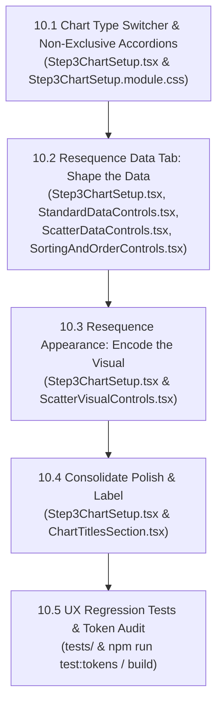

# Epic 10: Chart Configuration UX Realignment — "Shape the Data → Encode the Visual → Polish & Label"

> **Status:** Planned & Ready for Execution  
> **Alignment Directive:** Strictly aligned with [Epic 9 Modal Unification](file:///Users/francisdave/Documents/folio/docs/task/TASKS-EPIC-9.md) (`ChartConfigDrawer` as the single canonical chart authoring surface) and [Design System First](file:///Users/francisdave/Documents/folio/.agents/rules/design-system-first.md).  
> **Prevalence Notice:** Governed by [.agents/skills/karpathy-rules/SKILL.md](file:///Users/francisdave/Documents/folio/.agents/skills/karpathy-rules/SKILL.md), [.agents/skills/feature-dev/SKILL.md](file:///Users/francisdave/Documents/folio/.agents/skills/feature-dev/SKILL.md), [.agents/skills/superpowers/SKILL.md](file:///Users/francisdave/Documents/folio/.agents/skills/superpowers/SKILL.md), and [.agents/rules/ux-psychology.md](file:///Users/francisdave/Documents/folio/.agents/rules/ux-psychology.md).

---

## 🎯 Executive Overview & Root-Cause Diagnosis

An audit of Step 2 (`Chart Setup`) in [ChartConfigDrawer.tsx](file:///Users/francisdave/Documents/folio/src/components/chart/ChartConfigDrawer.tsx) and [Step3ChartSetup.tsx](file:///Users/francisdave/Documents/folio/src/components/chart/drawer/panels/Step3ChartSetup.tsx) across all five supported chart types (`bar`, `line`, `donut`, `scatter`, `histogram`) revealed six structural UX mismatches against the natural authoring mental model (**Shape the Data → Encode the Visual → Polish & Label**):

1. **`Table Orientation` (Transpose) Precedes Primary Mapping (`Step3ChartSetup.tsx#L193-L205`)**:
   - **Diagnosis:** Inside the `Data` sub-tab, `Table Orientation` ("Transpose data: Swap rows and columns") is rendered *above* `StandardDataControls` and `ScatterDataControls`. Users see a collapsed data-prep escape hatch before the primary column mapping (`Category (X-Axis)`, `Axes Mapping`, `Slice Categories`, `Values to Group`).
   - **Solution:** Move `Table Orientation` to the bottom of the `Data` sub-tab so users immediately land on primary column mapping.

2. **Data-Shaping Controls Split Across `Data` and `Appearance` (`Step3ChartSetup.tsx#L372-L384`, `SortingAndOrderControls.tsx`)**:
   - **Diagnosis:** `Order & Direction` (sorting by value, category, or sheet order) alters the *dataset order* (e.g., Donut slice order, Bar ranking, Scatter point order), yet it lives at the very bottom of the `Appearance` tab. Meanwhile, Donut's `"Group smaller slices into 'Other' (Top 5)"` lives in `Data` -> `Slice Values`.
   - **Solution:** Move `Order & Direction` into the `Data` sub-tab as part of **Shape the Data**, keeping all dataset transformations in one place.

3. **`Appearance` Opens on `Titles & Axis Labels` Instead of Visual Encoding (`Step3ChartSetup.tsx#L256-L337`)**:
   - **Diagnosis:** When switching to `Appearance`, `Titles & Axis Labels` is `defaultOpen={true}` while `Geometry & Visual Style` is collapsed (`defaultOpen={false}`). Users switching to `Appearance` want to shape the chart's visual encoding first (e.g., Vertical vs. Horizontal Bar, Smooth vs. Straight Line, Donut vs. Pie, Scatter Trendline, Histogram Distribution Curve) and polish copy last.
   - **Solution:** Promote `Geometry & Visual Style` (reframed as **Visual Style & Encoding**) to the top of `Appearance` with `defaultOpen={true}`, and place **Data Labels** + **Titles & Axis Labels** below it as the **Polish & Label** phase.

4. **Overloaded Scatter `Geometry & Visual Style` Panel (`ScatterVisualControls.tsx`)**:
   - **Diagnosis:** Scatter's `Geometry & Visual Style` accordion packs 8 distinct controls into one block: Trendline dropdown, Point Marker Size, LOESS Smoothness `TieredSlider`, Confidence Band checkbox, Correlation (`r`) Badge checkbox, Mean Quadrant Crosshairs checkbox, Start Y at Zero, and Start X at Zero.
   - **Solution:** Split Scatter's `Appearance` encoding into **Trendline & Analytics** (Trendline, LOESS smoothness, Confidence Band, Correlation badge, Mean Quadrant Crosshairs, Marker Size) and **Axes & Scale** (Start Y at Zero, Start X at Zero) so controls match their mental model.

5. **Plain `<select>` Chart Type Dropdown Hides Chart Intent (`Step3ChartSetup.tsx#L134-L150`)**:
   - **Diagnosis:** Choosing between `bar`, `line`, `donut`, `scatter`, and `histogram` via a native `<select>` gives no visual affordance or quick-switch ergonomics.
   - **Solution:** Replace the `<select>` with a canonical token-styled **Chart Type** segmented selector (with icons and clear labels) while preserving accessible keyboard navigation and existing `setChartType` state.

6. **Exclusive Accordion (`name="chart-data"` / `name="chart-appearance"`) Forces Extra Clicks (`AccordionSection.tsx`)**:
   - **Diagnosis:** Using a shared `name` on every `AccordionSection` forces mutually exclusive collapsing—adjusting `Metric Series` collapses `Category (X-Axis)`, and toggling `Data Labels` collapses `Visual Style`.
   - **Solution:** Remove forced exclusivity on `Data` and `Appearance` sections (or scope it only where genuinely needed) so users can inspect and tweak related controls side-by-side.

---

## 🧭 Target Sequence Per Chart ("Shape the Data → Encode the Visual → Polish & Label")

| Phase | Bar (`bar`) | Line (`line`) | Donut (`donut`) | Scatter (`scatter`) | Histogram (`histogram`) |
| :--- | :--- | :--- | :--- | :--- | :--- |
| **Header** | Segmented Chart Type Switcher | Segmented Chart Type Switcher | Segmented Chart Type Switcher | Segmented Chart Type Switcher | Segmented Chart Type Switcher |
| **1. Shape the Data** (`Data` tab) | 1. Category (X-Axis) *(open)* 2. Metric Series (Y-Axis) 3. Order & Direction 4. Table Orientation | 1. Category / Date (X-Axis) *(open)* 2. Metric Series (Y-Axis) 3. Order & Direction 4. Table Orientation | 1. Slice Categories *(open)* 2. Slice Values + Group 'Other' 3. Slice Order & Direction 4. Table Orientation | 1. Axes Mapping (X & Y) *(open)* 2. Point Labels & Color Grouping 3. Point Order 4. Table Orientation | 1. Values to Group (X-Axis) *(open)* 2. Binning & Distribution *(open)* 3. Subgroup Frequencies 4. Order & Direction 5. Table Orientation |
| **2. Encode the Visual** (`Appearance` tab, top) | 1. Visual Style & Layout *(open)*: Orientation, Clustered/Stacked | 1. Visual Style & Scale *(open)*: Interpolation, Markers, Area Fill, Start Y at 0 | 1. Visual Style *(open)*: Donut Ring / Solid Pie | 1. Trendline & Analytics *(open)*: Trendline, LOESS, Confidence, `r` Badge, Crosshairs, Marker Size 2. Axes & Scale: Start X/Y at 0 | 1. Visual Style & Stats *(open)*: Distribution Curve, Mean Line, Summary Stats, Median & Mode |
| **3. Polish & Label** (`Appearance` tab, bottom) | 2. Data Labels 3. Titles & Axis Labels | 2. Data Labels 3. Titles & Axis Labels | 2. Data Labels 3. Titles & Subtitle | 3. Titles & Axis Labels | 2. Titles & Axis Labels |

---

## 🗺️ Subtasks Index

| Subtask ID | Title | Scope | File Reference | Status |
| :--- | :--- | :--- | :--- | :--- |
| **10.1** | [Chart Type Switcher & Non-Exclusive Accordions](file:///Users/francisdave/Documents/folio/docs/task/10.1-chart-type-switcher-and-non-exclusive-accordions.md) | Replace `<select>` Chart Type dropdown with a token-compliant segmented selector and remove forced exclusive accordion collapsing in `Step3ChartSetup` | `docs/task/10.1-chart-type-switcher-and-non-exclusive-accordions.md` | Done |
| **10.2** | [Resequence `Data` Tab ("Shape the Data")](file:///Users/francisdave/Documents/folio/docs/task/10.2-shape-the-data-tab-resequencing.md) | Place primary column mapping first, move `Order & Direction` into `Data`, open Histogram `Binning & Distribution` by default, replace Histogram percentage checkbox with `Count \| Percentage` segmented choice, add `All / First` series helper, and move `Table Orientation` to bottom of `Data` | `docs/task/10.2-shape-the-data-tab-resequencing.md` | Done |
| **10.3** | [Resequence `Appearance` Visual Encoding ("Encode the Visual")](file:///Users/francisdave/Documents/folio/docs/task/10.3-encode-the-visual-appearance-resequencing.md) | Promote `Visual Style` to top of `Appearance` (`defaultOpen={true}`), split Scatter into `Trendline & Analytics` and `Axes & Scale`, replace `Start at Zero` checkboxes with `Auto \| Zero` baseline toggles, and nest Histogram `Include Median & Mode` under `Show Summary Statistics Card` | `docs/task/10.3-encode-the-visual-appearance-resequencing.md` | Done |
| **10.4** | [Consolidate "Polish & Label" Section](file:///Users/francisdave/Documents/folio/docs/task/10.4-polish-and-label-consolidation.md) | Place `Data Labels` (Bar/Line/Donut) and `Titles & Axis Labels` at the bottom of `Appearance` as the final polish step with clear conditional labels | `docs/task/10.4-polish-and-label-consolidation.md` | Done |
| **10.5** | [Chart Configuration UX Tests & Token Verification](file:///Users/francisdave/Documents/folio/docs/task/10.5-chart-config-ux-regression-tests-and-token-audit.md) | Add unit/component tests verifying per-chart section order, keyboard navigation, and state preservation, plus `test:tokens`, `tsc --noEmit`, and `npm run build` | `docs/task/10.5-chart-config-ux-regression-tests-and-token-audit.md` | Done |

---

## 🔄 Sequence & Dependency Graph

---

## 🛡️ Quality Verification Gates

Before marking Epic 10 complete:
- [x] `npm run test:tokens` passes with 100% token purity and zero raw hex/pixel violations.
- [x] `npm test` passes across all unit and integration suites (including new Epic 10 sequence and control tests).
- [x] `npm run build` and `tsc --noEmit` complete with zero TypeScript diagnostics.
- [x] **Shape the Data Invariant:** In `Data`, primary mapping is always first and open; `Order & Direction` lives in `Data`; `Table Orientation` (Transpose) sits at the bottom of `Data`.
- [x] **Encode the Visual Invariant:** In `Appearance`, visual encoding (`Visual Style` / `Trendline & Analytics`) is first and open by default (`defaultOpen={true}`).
- [x] **Polish & Label Invariant:** `Data Labels` (when applicable) and `Titles & Axis Labels` sit at the bottom of `Appearance` without breaking any persisted `SheetChartConfig` fields.
- [x] **4-State Interactive Matrix & Zero Outline Policy:** All new/updated controls (segmented Chart Type switcher, buttons, inputs, accordions) implement Default, Hover, Active, Focus-Visible (`outline: none`), and Disabled states using `src/styles/tokens.css`.
