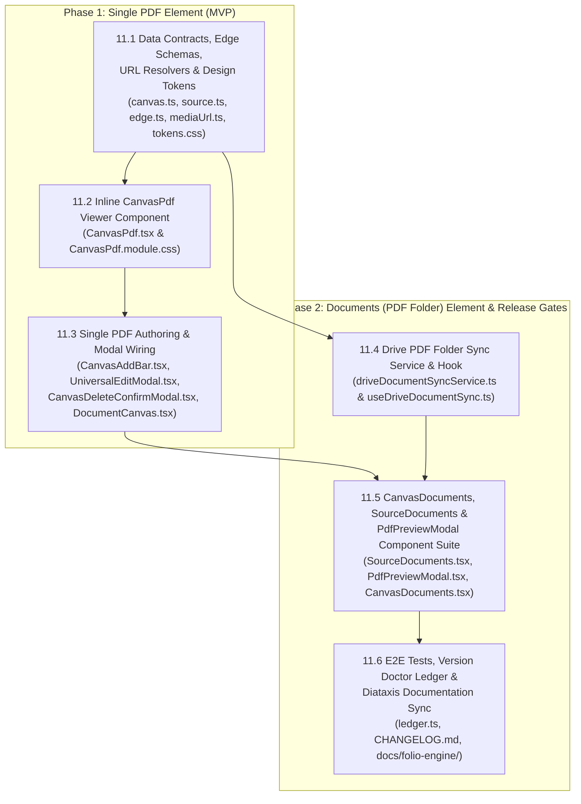

# Epic 11: Lightweight Canvas PDF Support — Inline `pdf` Viewer & Drive `documents` Folder Sync

> **Status:** Planned & Ready for Execution  
> **Alignment Directive:** Strictly aligned with [Epic 7 Cloudflare KV SSOT Architecture](file:///Users/francisdave/Documents/folio/docs/task/archives/TASKS-EPIC-7.md) (self-contained `NodeCanvasDocument` AST), [Epic 9 Modal Unification](file:///Users/francisdave/Documents/folio/docs/task/TASKS-EPIC-9.md), and [Design System First](file:///Users/francisdave/Documents/folio/.agents/rules/design-system-first.md).  
> **Prevalence Notice:** Governed by [.agents/skills/karpathy-rules/SKILL.md](file:///Users/francisdave/Documents/folio/.agents/skills/karpathy-rules/SKILL.md), [.agents/skills/feature-dev/SKILL.md](file:///Users/francisdave/Documents/folio/.agents/skills/feature-dev/SKILL.md), [.agents/skills/superpowers/SKILL.md](file:///Users/francisdave/Documents/folio/.agents/skills/superpowers/SKILL.md), [.agents/rules/editorial-restraint.md](file:///Users/francisdave/Documents/folio/.agents/rules/editorial-restraint.md), [.agents/rules/package-boundary.md](file:///Users/francisdave/Documents/folio/.agents/rules/package-boundary.md), [.agents/rules/folio-engine-migration.md](file:///Users/francisdave/Documents/folio/.agents/rules/folio-engine-migration.md), and [.agents/rules/docs-sync.md](file:///Users/francisdave/Documents/folio/.agents/rules/docs-sync.md).

---

## 🎯 Executive Overview & Locked Architectural Decisions

Epic 11 introduces first-class, zero-bloat PDF document support to the Folio Engine Dynamic Canvas (`@devcabs/folio-engine`), enabling coordinators to embed individual PDF Means of Verification (MOVs) or synchronize entire Google Drive folders of PDF documents directly into any canvas section or subsection.

### 1. Two-Phase Mental Model (Mirrors `PhotoElement` vs `GalleryElement`)
- **Phase 1 (MVP) — Single `pdf` Canvas Element (`PdfElement`)**:
  - Mirrors `PhotoElement` (`type: 'photo'`).
  - Coordinator pastes any supported Google Drive file link (`drive.google.com/file/d/{id}/view`, `/preview`, `/open?id={id}`, `/uc?id={id}`, or raw file ID) in `UniversalEditModal` (`mode="add" | "edit"`, `elementType="pdf"`).
  - Renders inline on the canvas via `<CanvasPdf>` inside a token-styled fixed aspect-ratio frame (`https://drive.google.com/file/d/{fileId}/preview`), complete with an optional editorial title/caption, an accessible `"Open in New Tab ↗"` fallback link (`https://drive.google.com/file/d/{fileId}/view`), a calm fallback card when unlinked or inaccessible, and unified Developer Mode edit controls (`✎ Edit` side button + `CanvasItemControls` floating toolbar).
- **Phase 2 — `documents` (PDF Folder) Canvas Element (`DocumentsElement`)**:
  - Mirrors `GalleryElement` (`type: 'gallery'`) as a **dedicated** document-list element (`type: 'documents'`), keeping photographic collages (`SourceGallery`) and archival PDF repositories (`SourceDocuments`) cleanly separated.
  - Coordinator links a Google Drive folder URL (`drive.google.com/drive/folders/{folderId}`) via the canonical `<LinkFolderModal>` (unified across both the floating toolbar `Edit` icon and the side `✎ Edit` button per Epic 9 Subtask 9.4).
  - Queries Google Drive REST API v3 for `application/pdf` files (including 1st-level subfolders), reconciles items with O(1) Map diffing (`reconcileDriveDocuments`), preserves custom coordinator titles (`isCustomTitle: true`), and persists `syncedDocuments` directly onto `DocumentsElement` in the `NodeCanvasDocument` AST (`PUT /api/draft`).
  - Renders clean, token-styled document cards/rows (with zero horizontal dividing lines per `editorial-restraint.md`). Clicking any document row opens `<PdfPreviewModal>` (built on canonical `<Modal>`) featuring the embedded Google Drive Preview `<iframe>`, previous/next document navigation, and an `"Open in New Tab ↗"` action.

### 2. Lightweight, Zero-Bloat Rendering Engine
- **Google Drive Preview `<iframe>` (`https://drive.google.com/file/d/{fileId}/preview`)**:
  - **Zero new npm dependencies**: No `pdfjs-dist`, no canvas worker bundles, zero client bundle weight increase.
  - **Zero Cloudflare Edge bandwidth cost**: PDFs stream directly from Google Drive's viewer infrastructure rather than proxying multi-megabyte binaries through `/api/media/drive/:fileId`.
  - **Sharing Model**: Assumes `"Anyone with the link can view"` Google Drive permissions, identical to Folio Engine's existing Drive photo and folder integration.

### 3. Self-Contained AST & Package Boundary Compliance
- **Cloudflare KV SSOT**: Both `PdfElement` and `DocumentsElement` (including `syncedDocuments`) live inside the self-contained `NodeCanvasDocument` AST in Cloudflare KV (`draft:workspace` in Dev Mode, `PublicNodePayload` in Public Mode).
- **Edge Schema Compatibility**: `CanvasLeafElementSchema` in `src/types/edge.ts` is updated to validate `pdf` and `documents` leaf elements so `compilePublicNodePayload` (`edgePreBakeService.ts`) and `/api/publish` succeed without Zod rejection.
- **Strict Package Boundary**: All changes are strictly scoped to `@devcabs/folio-engine` (`package-boundary.md`). Zero modifications or deployments to any Consumer repository.

---

## 🧭 Phase Breakdown & Subtasks Index

| Phase | Subtask ID | Title | Scope | File Reference | Status |
| :--- | :--- | :--- | :--- | :--- | :--- |
| **Phase 1: Single `pdf` MVP** | **11.1** | [PDF & Documents Data Contracts, Edge Schemas, URL Resolvers & Design Tokens](file:///Users/francisdave/Documents/folio/docs/task/11.1-pdf-data-contracts-url-resolvers-and-tokens.md) | Define `PdfElement`, `DocumentsElement`, `SyncedDocumentItem`, Zod edge schemas, Drive preview/view URL resolvers in `mediaUrl.ts`, default factories in `canvasDefaults.ts`, and PDF/document tokens in `src/styles/tokens.css` | `docs/task/11.1-pdf-data-contracts-url-resolvers-and-tokens.md` | Pending |
| **Phase 1: Single `pdf` MVP** | **11.2** | [Inline `<CanvasPdf>` Viewer Component & Fallback States](file:///Users/francisdave/Documents/folio/docs/task/11.2-canvas-pdf-inline-viewer-component.md) | Build `<CanvasPdf>` with responsive Google Drive `/preview` `<iframe>`, editorial header/caption, `"Open in New Tab ↗"` action, calm unlinked/error fallback state, and side `✎ Edit` affordance | `docs/task/11.2-canvas-pdf-inline-viewer-component.md` | Done |
| **Phase 1: Single `pdf` MVP** | **11.3** | [Single PDF Authoring Wiring (`CanvasAddBar`, `UniversalEditModal`, `DocumentCanvas`)](file:///Users/francisdave/Documents/folio/docs/task/11.3-single-pdf-authoring-and-modal-wiring.md) | Wire `pdf` creation, editing, deletion confirmation, and AST persistence across `CanvasAddBar`, `UniversalEditModal`, `CanvasDeleteConfirmModal`, and `DocumentCanvas` | `docs/task/11.3-single-pdf-authoring-and-modal-wiring.md` | Done |
| **Phase 2: `documents` Folder** | **11.4** | [Google Drive PDF Folder Sync Service & `useDriveDocumentSync` Hook](file:///Users/francisdave/Documents/folio/docs/task/11.4-drive-pdf-folder-sync-service-and-hook.md) | Implement `driveDocumentSyncService.ts` (`fetchDriveFolderPdfs`, `reconcileDriveDocuments`, `syncFolderDocuments`) and `useDriveDocumentSync.ts` with 5-state lifecycle and AST persistence | `docs/task/11.4-drive-pdf-folder-sync-service-and-hook.md` | Done |
| **Phase 2: `documents` Folder** | **11.5** | [`<CanvasDocuments>`, `<SourceDocuments>` List & `<PdfPreviewModal>` Suite](file:///Users/francisdave/Documents/folio/docs/task/11.5-canvas-documents-list-and-preview-modal.md) | Build `<SourceDocuments>`, `<PdfPreviewModal>`, `<EditDocumentModal>`, and `<CanvasDocuments>`, wire `Document` submenu (`Single PDF` / `PDF Folder`) in `CanvasAddBar`, and unify `LinkFolderModal` editing in `DocumentCanvas` | `docs/task/11.5-canvas-documents-list-and-preview-modal.md` | Pending |
| **Phase 2: Release & Docs** | **11.6** | [End-to-End Verification, Version Doctor Migration Ledger & Diátaxis Docs Sync](file:///Users/francisdave/Documents/folio/docs/task/11.6-pdf-support-e2e-verification-ledger-and-docs-sync.md) | Record release entry in `src/migrations/ledger.ts`, sync `CHANGELOG.md`, update Diátaxis docs per `docs-sync.md`, and run full quality/token/migration verification gates | `docs/task/11.6-pdf-support-e2e-verification-ledger-and-docs-sync.md` | Done |

---

## 🔄 Sequence & Dependency Graph

---

## 🛡️ Quality, Token, Migration & Restraint Gates

Before marking Epic 11 complete, every gate below must pass:
- [ ] **Design System Token Gate (`design-system-first.md`)**: All required PDF frame and document card tokens exist in `src/styles/tokens.css` before component scaffolding; `npm run test:tokens` passes with 100% token purity and zero raw hex/pixel violations.
- [ ] **4-State Interactive Matrix & Universal Zero Outline Policy (`ui-standards.md`)**: Every interactive button, document card/row, link pill, and modal control implements Default, Hover, Active/Pressed, Focus-Visible (`outline: none`), and Disabled/Loading states.
- [ ] **Editorial Restraint (`editorial-restraint.md`)**:
  - Zero horizontal dividing lines (`border-bottom`, `border-top`, `
`) between document rows; separation relies strictly on surface cards and spatial flow tokens (`var(--space-3)`, `var(--space-flow-tight)`).
  - Administrative edit buttons strictly display `✎ Edit` (zero custom button labels like `"Edit PDF"` or `"Edit Documents"` on side buttons).
  - Single `↻ Sync` button in `sideEditWrapper` beside `✎ Edit` on `<SourceDocuments>` (zero duplicate footer sync buttons).
- [ ] **Edge Zod Schema & Pre-Bake Gate (`edge.ts` & `edgePreBakeService.ts`)**: `PublicNodePayloadSchema` validates canvases containing `pdf` and `documents` elements without error, and `transformCanvasAst` preserves `PdfElement` and `DocumentsElement` cleanly.
- [ ] **Version Doctor & Migration Ledger Gate (`folio-engine-migration.md` & `version-doctor`)**: New `CanvasElementType` variants (`'pdf'` | `'documents'`) and public exports are logged in `src/migrations/ledger.ts`, compiled into `CHANGELOG.md` via `npm run changelog`, and verified via `npm run verify:migrations` and `npm run doctor`.
- [ ] **Diátaxis Documentation Sync (`docs-sync.md`)**: All affected reference and how-to documentation files in `docs/folio-engine/` are updated in lockstep.
- [ ] **Package Boundary (`package-boundary.md`)**: Zero files modified outside `/Users/francisdave/Documents/folio`; zero Consumer app deployments executed.
- [ ] **Compiler & Test Suite (`karpathy-rules` & `superpowers`)**: `npx tsc --noEmit`, `npm test`, `npm run build`, and `npm run build:lib` pass with zero errors.
