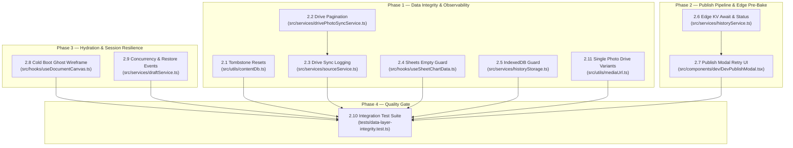

# Epic 2: Folio Engine Data Layer Integrity & Observability Pipeline

> **Status:** Planned & Ready for Execution  
> **Prevalence Notice:** Governed by [.agents/skills/karpathy-rules/SKILL.md](file:///Users/francisdave/Documents/folio/.agents/skills/karpathy-rules/SKILL.md), [.agents/skills/superpowers/SKILL.md](file:///Users/francisdave/Documents/folio/.agents/skills/superpowers/SKILL.md), [.agents/skills/feature-dev/SKILL.md](file:///Users/francisdave/Documents/folio/.agents/skills/feature-dev/SKILL.md), and [.agents/skills/code-simplifier/SKILL.md](file:///Users/francisdave/Documents/folio/.agents/skills/code-simplifier/SKILL.md).

---

## 🎯 Executive Overview

Following a comprehensive audit of Folio Engine's data-handling layer (`src/services/`, `src/hooks/`, `src/utils/`, and `src/components/dev/`), Epic 2 resolves critical observability gaps, silent data loss failure modes, and race conditions across the portal's dual-channel storage (Draft vs. Live), Google Drive photo sync, Google Sheets chart ingestion, IndexedDB disaster recovery, and Cloudflare KV edge pre-baking.

### Core Architectural Mandates
1. **Strict Zero-LocalStorage Policy (< 5 KB):** Canvas ASTs and large text dictionaries belong strictly in Cloudflare KV Edge and Supabase. LocalStorage stores scalar session tokens only.
2. **Deterministic Await on Edge KV Deployment:** Publishing is never considered successful until the Cloudflare KV REST API confirms deployment, with granular 3-tier feedback (`Local ✔`, `Supabase ✔`, `Edge ✔`) and an in-modal retry affordance.
3. **Safety Pagination & Non-Destructive Reconciliation:** Google Drive syncing fetches beyond 100 images via `nextPageToken` loops, eliminating accidental photo pruning.
4. **Tombstone Draft Resets:** Resetting content in Draft records an explicit tombstone, preventing cleared fields from resurrecting previous live values during publishing.
5. **Zero Flash of Baseline:** Cold public visits render clean ghost wireframes until Edge KV payload resolves (<50ms).

---

## 🗺️ Subtasks Index

| Subtask ID | Title | Scope | File Reference | Status |
| :--- | :--- | :--- | :--- | :--- |
| **2.1** | [Content Override "Reset to Default" Tombstone Isolation](file:///Users/francisdave/Documents/folio/docs/task/2.1-content-override-tombstone-isolation.md) | Prevent cleared draft overrides from resurrecting old live values at publish time | `docs/task/2.1-content-override-tombstone-isolation.md` | Completed |
| **2.2** | [Google Drive Photo Sync Pagination & Resilience](file:///Users/francisdave/Documents/folio/docs/task/2.2-drive-photo-sync-pagination-and-resilience.md) | Implement `nextPageToken` loop and error diagnostics for folder syncing | `docs/task/2.2-drive-photo-sync-pagination-and-resilience.md` | Completed |
| **2.3** | [Drive Background Sync Status & Observability](file:///Users/francisdave/Documents/folio/docs/task/2.3-drive-background-sync-status-and-observability.md) | Surface cloud write errors; quiet logging for background sync, toasts for manual | `docs/task/2.3-drive-background-sync-status-and-observability.md` | Completed |
| **2.4** | [Google Sheets Tabular Sync Empty-Dataset Guard](file:///Users/francisdave/Documents/folio/docs/task/2.4-sheets-tabular-sync-empty-dataset-guard.md) | Reject 0-row sync results; preserve existing chart datasets with clear error warnings | `docs/task/2.4-sheets-tabular-sync-empty-dataset-guard.md` | Completed |
| **2.5** | [IndexedDB Quota & Storage Observability Guard](file:///Users/francisdave/Documents/folio/docs/task/2.5-indexeddb-quota-and-storage-observability.md) | Detect IndexedDB failures/private mode and surface storage limit alert toasts | `docs/task/2.5-indexeddb-quota-and-storage-observability.md` | Completed |
| **2.6** | [Publish Pipeline Edge KV Await & 3-Tier Status](file:///Users/francisdave/Documents/folio/docs/task/2.6-publish-pipeline-edge-kv-await-and-status.md) | Await Cloudflare KV deployment; return granular 3-tier result from `publishNewSnapshot` | `docs/task/2.6-publish-pipeline-edge-kv-await-and-status.md` | Completed |
| **2.7** | [DevPublishModal 3-Tier Status & Retry Affordance](file:///Users/francisdave/Documents/folio/docs/task/2.7-publish-modal-3-tier-status-and-retry.md) | Render 3-step checklist in modal; provide "Retry Edge Deploy" on partial failure | `docs/task/2.7-publish-modal-3-tier-status-and-retry.md` | Completed |
| **2.8** | [Cold Boot Skeleton Wireframe (Zero Flash-of-Baseline)](file:///Users/francisdave/Documents/folio/docs/task/2.8-cold-boot-skeleton-wireframe-zero-flash.md) | Render ghost wireframe on cold visitor load until Edge KV document resolves | `docs/task/2.8-cold-boot-skeleton-wireframe-zero-flash.md` | Completed |
| **2.9** | [Draft Init Concurrency & Snapshot Restore Events](file:///Users/francisdave/Documents/folio/docs/task/2.9-draft-init-concurrency-and-restore-events.md) | In-flight promise sentinel for `initDraftSession`; fire canvas events on restore | `docs/task/2.9-draft-init-concurrency-and-restore-events.md` | Completed |
| **2.10** | [Data Layer Integration Testing & Quality Gates](file:///Users/francisdave/Documents/folio/docs/task/2.10-data-layer-integration-testing.md) | Automated tests covering tombstones, retry gates, Drive pagination, and zero-storage | `docs/task/2.10-data-layer-integration-testing.md` | Completed |
| **2.11** | [Google Drive Single Photo Link Variants Ingestion](file:///Users/francisdave/Documents/folio/docs/task/2.11-single-photo-drive-link-variants.md) | Ingest all 10 single-photo Drive link formats with instant modal preview; strictly exclude folders | `docs/task/2.11-single-photo-drive-link-variants.md` | Completed |

---

## 🔄 Sequence & Dependency Graph

