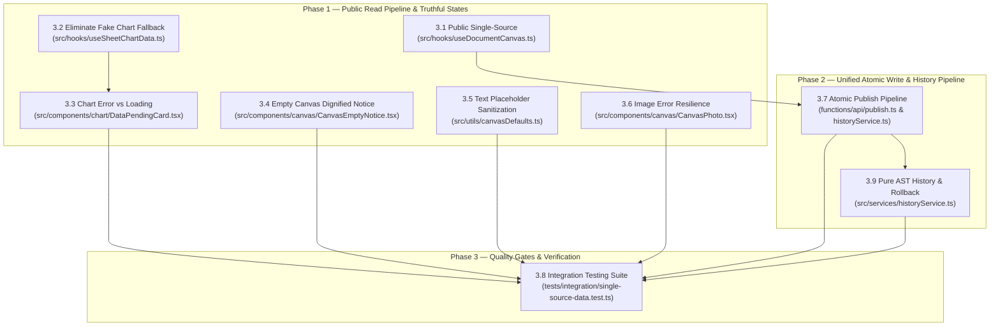

# Epic 3: Folio Engine Single-Source Data Architecture & Deterministic Fallback Pipeline

> **Status:** Planned & Ready for Execution  
> **Prevalence Notice:** Governed by [.agents/skills/karpathy-rules/SKILL.md](file:///Users/francisdave/Documents/folio/.agents/skills/karpathy-rules/SKILL.md), [.agents/skills/superpowers/SKILL.md](file:///Users/francisdave/Documents/folio/.agents/skills/superpowers/SKILL.md), [.agents/skills/feature-dev/SKILL.md](file:///Users/francisdave/Documents/folio/.agents/skills/feature-dev/SKILL.md), and [.agents/skills/code-simplifier/SKILL.md](file:///Users/francisdave/Documents/folio/.agents/skills/code-simplifier/SKILL.md).

---

## 🎯 Executive Overview

Following an exhaustive forensic audit of Folio Engine's data read and write pipelines (`src/hooks/`, `src/services/`, `src/components/canvas/`, `src/components/chart/`, `src/utils/`, and `functions/api/`), Epic 3 transforms the platform from an over-engineered 5-tier fallback model to a **clean, single-source of truth with deterministic UX states**.

The previous architecture prioritized "never rendering a blank screen" at the expense of integrity:
1. **The Fallback Ladder:** Synchronous reads from `localStorage` on cold public visits create jarring layout shifts (CLS) when Cloudflare Edge KV resolves 40ms later.
2. **The "Wrong Data" Trap:** When an indicator chart lacks data, `useSheetChartData` silently substitutes unrelated sibling charts from the same node.
3. **The Forever Loader:** Broken or unconfigured data sources display pulsing skeleton wireframes permanently, creating user cognitive fatigue.
4. **Dead Page Voids:** Empty published domains return `null`, leaving an abrupt white gap that leads visitors to believe the application crashed.
5. **Developer Copy Leaks:** Internal authoring prompts ("Click Edit to add narrative text...") leak directly to public readers.
6. **Network Stalls:** Failed image proxies fall back to raw Google Drive thumbnail endpoints, stalling HTTP/2 connection pools and leaving broken image icons.
7. **Write Pipeline Redundancy:** Canvas modifications are stored redundantly both in the Canvas AST JSON and as flat keys in `ContentDB`, while the client browser attempts to independently orchestrate multi-hop writes across Supabase and Cloudflare KV.
8. **Rollback Re-Hydration Bloat:** Restoring historical snapshots attempts to re-populate dead flat keys in `_draft_content_overrides` and re-runs migration folding, re-introducing dual-storage synchronization issues.

Epic 3 resolves these architectural defects by establishing an honest, predictable contract across both read and write layers.

---

## 🏛️ Core Architectural Mandates

1. **Public Single-Source:** Public readers fetch strictly from Cloudflare Edge KV (`/api/public/node/:nodeId`). Zero synchronous `localStorage` reads. Zero stale cache flashing.
2. **Deterministic Tri-State UX:** Every canvas element has only three valid states: **Loading**, **Verified Data**, or **Dignified Notice**. No silent substitutions.
3. **Canvas AST Sole Authority:** Canvas structure and element text are authored, diffed, and restored exclusively via the Canvas AST. `ContentDB` is reserved strictly for global portal chrome (hero title, tagline).
4. **Server-Side Atomic Publishing:** The browser dispatches a single publish request (`POST /api/publish`); the server atomically persists the snapshot to Supabase and deploys pre-baked payloads to Cloudflare KV using edge bindings. Cloudflare API tokens never touch client bundles.
5. **Lightweight History Manifest (< 5 KB):** `localStorage` stores only metadata headers for revisions. Full snapshot trees are maintained exclusively in IndexedDB (client) and Supabase (cloud).
6. **Token Purity & Zero Outline Policy:** All fallback, loading, and diagnostic states consume CSS variables from `src/styles/tokens.css` with 100% adherence to the Universal Zero Outline Policy.

---

## 🗺️ Subtasks Index

| Subtask ID | Title | Scope | File Reference | Status |
| :--- | :--- | :--- | :--- | :--- |
| **3.1** | [Public Single-Source Reading Pipeline & LocalStorage Purge](file:///Users/francisdave/Documents/folio/docs/task/3.1-public-single-source-and-storage-purge.md) | Strip public `localStorage` reading to eliminate layout pops and stale cached data flashes | `docs/task/3.1-public-single-source-and-storage-purge.md` | Planned |
| **3.2** | [Eliminate Misleading Node-Level Chart Fallbacks](file:///Users/francisdave/Documents/folio/docs/task/3.2-eliminate-misleading-chart-node-fallback.md) | Remove arbitrary chart substitution (`bakedCharts.find(c => c.nodeId)`); fail cleanly to pending cards | `docs/task/3.2-eliminate-misleading-chart-node-fallback.md` | Planned |
| **3.3** | [Chart Error vs. Loading Visual Differentiation](file:///Users/francisdave/Documents/folio/docs/task/3.3-chart-error-vs-loading-differentiation.md) | Stop rendering permanent ghost wireframes on broken links; show clear diagnostic badges & notices | `docs/task/3.3-chart-error-vs-loading-differentiation.md` | Planned |
| **3.4** | [Dignified Public Empty Canvas State](file:///Users/francisdave/Documents/folio/docs/task/3.4-public-empty-canvas-dignified-notice.md) | Replace `null` return on empty nodes with a calm, token-styled "Documentation in progress" notice | `docs/task/3.4-public-empty-canvas-dignified-notice.md` | Planned |
| **3.5** | [Public Editorial Text Placeholder Sanitization](file:///Users/francisdave/Documents/folio/docs/task/3.5-public-placeholder-text-sanitization.md) | Prevent internal editor prompts ("Click Edit to add...") from leaking into public view | `docs/task/3.5-public-placeholder-text-sanitization.md` | Planned |
| **3.6** | [Resilient Image Fallback Card & Latency Elimination](file:///Users/francisdave/Documents/folio/docs/task/3.6-resilient-image-fallback-card.md) | Replace slow/blocked direct Google Drive thumbnail swaps with tokenized image error states | `docs/task/3.6-resilient-image-fallback-card.md` | Planned |
| **3.7** | [Unified Atomic Write & Publish Pipeline](file:///Users/francisdave/Documents/folio/docs/task/3.7-unified-atomic-write-pipeline.md) | Streamline draft authoring and consolidate Supabase + Edge KV into a single atomic publish pipe | `docs/task/3.7-unified-atomic-write-pipeline.md` | Complete ✅ |
| **3.8** | [Single-Source Integration Testing & Quality Gates](file:///Users/francisdave/Documents/folio/docs/task/3.8-single-source-integration-testing.md) | Automated tests for edge-only public reads, empty states, zero-data leakage, and design token purity | `docs/task/3.8-single-source-integration-testing.md` | Complete ✅ |
| **3.9** | [Revision History Ledger & Pure AST Rollback Pipeline](file:///Users/francisdave/Documents/folio/docs/task/3.9-revision-history-and-ast-rollback.md) | Pure AST rollback injection into draft session, AST changelog diffing, and `< 5 KB` manifest locking | `docs/task/3.9-revision-history-and-ast-rollback.md` | Planned |

---

## 🔄 Sequence & Dependency Graph

---

## 📐 Architecture Transition: Legacy vs. Single-Source

| Capability | Legacy Over-Engineered Architecture | Epic 3 Single-Source Architecture |
| :--- | :--- | :--- |
| **Public Reading** | Edge KV → LocalStorage → Bundled JSON → Defaults | Edge KV (`/api/public/node/:id`) directly into memory; 0 LocalStorage reads |
| **Cold Visitor Hydration** | Synchronous LocalStorage paint → Edge pop (CLS > 0) | Ghost wireframe skeleton → Verified Edge payload (CLS = 0) |
| **Missing Chart Data** | Steals sibling chart data matching `nodeId` | Returns `null` dataset; displays honest `DataPendingCard` |
| **Empty Domain Canvas** | Returns `null` (dead page void, layout collapse) | Renders tokenized `<CanvasEmptyNotice />` with institutional seal |
| **Unedited Draft Text** | Renders "Click Edit to add narrative..." to public | Automated sanitization gate suppresses authoring copy in public mode |
| **Image Proxy Failure** | Swaps to `drive.google.com/thumbnail` (stalls 10s, 403) | Immediate 16:9 tokenized `<CanvasPhotoFallback />` card |
| **Canvas Element Writes** | Dual-write to Canvas AST JSON AND ContentDB flat keys | Canvas AST is sole authority; ContentDB reserved for portal chrome |
| **Publish Flow** | Browser coordinates Supabase POST, PATCH, and Cloudflare KV API | Single `POST /api/publish` with atomic server-side execution |
| **History Manifest** | Serializes full canvas trees into `localStorage` (> 5MB) | Lightweight metadata headers only (`< 5 KB`); full trees in IndexedDB/Supabase |
| **Revision Rollback** | Re-inflates flat `contentOverrides` keys & runs migration | Pure AST tree injection into draft session; 0 ContentDB mutations |
| **Cloudflare Credentials** | Client bundle requires `CLOUDFLARE_API_TOKEN` | Stored exclusively on Edge server; zero client exposure |

---

## 🛡️ Quality Gates & Enforcement Routines

All implementations under Epic 3 must satisfy:
1. `npm test`: 100% passing across unit and integration tests.
2. `npm run test:tokens`: 0 hardcoded colors, 0 raw pixel geometries, 100% token purity.
3. `npm run typecheck`: 0 TypeScript compiler diagnostics.
4. Universal Zero Outline Policy: `outline: none` on all interactive states, replacing focus outlines with tokenized box-shadow rings.
