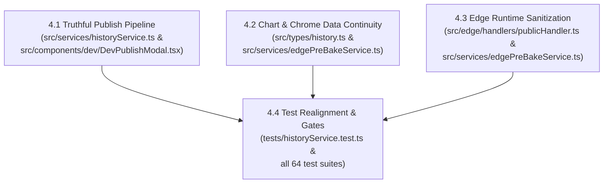

# Epic 4: Pragmatic Single-Source Stabilization & Data Continuity

> **Status:** Planned & Ready for Execution  
> **Prevalence Notice:** Governed by [.agents/skills/karpathy-rules/SKILL.md](file:///Users/francisdave/Documents/folio/.agents/skills/karpathy-rules/SKILL.md), [.agents/skills/superpowers/SKILL.md](file:///Users/francisdave/Documents/folio/.agents/skills/superpowers/SKILL.md), [.agents/skills/feature-dev/SKILL.md](file:///Users/francisdave/Documents/folio/.agents/skills/feature-dev/SKILL.md), and [.agents/skills/code-simplifier/SKILL.md](file:///Users/francisdave/Documents/folio/.agents/skills/code-simplifier/SKILL.md).

---

## 🎯 Executive Overview

Following a forensic architectural audit, Epic 4 strips away theoretical distributed-systems complexity (Two-Phase Commit, OCC locks, mock edge emulators) and focuses strictly on **four high-impact, real-world stabilization fixes**:

1. **Truthful Publish Pipeline (Fail-Stop):**
   When remote publish encounters a network error or server failure, the client must fail honestly. No deceptive toasts claiming *"Published locally. Cloud sync pending"*, no "Close Anyway" bypass, and no clearing of the dirty draft.
2. **Chart, Source & Portal Chrome Data Continuity:**
   When coordinators publish changes, bundle active chart configurations, linked evidence source metadata, and portal chrome text directly into the published snapshot and pre-baked edge payloads. Public visitors hydrate chrome in memory only (`memoryOnly: true`), completely eliminating static mock fallbacks and public storage pollution.
3. **Edge Runtime Sanitization & Cache Freshness:**
   Purge the poisonous cold-miss fallback in `publicHandler.ts` that writes empty canvases (`sections: []`) into Cloudflare KV. Purge client credential leaks (`CLOUDFLARE_API_TOKEN`). Configure `portal:manifest` with `max-age=0, must-revalidate` so published updates propagate globally with zero cache lag.
4. **Test Suite Realignment:**
   Invert test assertions that previously locked in fake local publishing on network failure. Ensure all 64 test suites pass with 100% integrity.

---

## 🗺️ Subtasks Index

| Subtask ID | Title | Scope | File Reference | Status |
| :--- | :--- | :--- | :--- | :--- |
| **4.1** | [Truthful Publish Pipeline & Fail-Stop Enforcement](file:///Users/francisdave/Documents/folio/docs/task/4.1-truthful-publish-pipeline-and-fail-stop.md) | Purge local publish fallbacks, delete "Close Anyway", remove ghost sync toasts, and keep draft dirty on failure | `docs/task/4.1-truthful-publish-pipeline-and-fail-stop.md` | Planned |
| **4.2** | [Chart, Source & Portal Chrome Data Continuity](file:///Users/francisdave/Documents/folio/docs/task/4.2-publish-chart-and-chrome-bundling.md) | Bundle active chart configs, evidence source metadata, and portal chrome into `PublishedSnapshot`; pre-bake into node KV payloads and enforce zero-storage in-memory chrome hydration | `docs/task/4.2-publish-chart-and-chrome-bundling.md` | Completed |
| **4.3** | [Edge Runtime Sanitization & Cache Freshness](file:///Users/francisdave/Documents/folio/docs/task/4.3-edge-runtime-sanitization-and-cache-fix.md) | Delete cold-miss `kv.put` empty canvas writes, remove `CLOUDFLARE_API_TOKEN` from client, fix manifest cache header | `docs/task/4.3-edge-runtime-sanitization-and-cache-fix.md` | Planned |
| **4.4** | [Test Suite Realignment & Verification](file:///Users/francisdave/Documents/folio/docs/task/4.4-test-suite-realignment-and-quality-gates.md) | Invert tests to assert fail-stop on publish error, fix JSDOM container mock, verify all 64 test suites | `docs/task/4.4-test-suite-realignment-and-quality-gates.md` | Planned |

---

## 🔄 Sequence & Dependency Graph

---

## 🛡️ Quality Verification Gates

1. `npm test`: 100% passing across all 64 test suites with zero failures.
2. `npm run test:tokens`: 0 hardcoded colors, 0 raw pixel geometries, 100% token purity.
3. `npm run typecheck`: 0 TypeScript compiler diagnostics across all source files.
4. Universal Zero Outline Policy: `outline: none` on interactive states, replaced by tokenized box-shadow rings.
5. Zero Client Credential Ingestion: `grep -rn "CLOUDFLARE_API_TOKEN" src/components/` returns 0 results.
6. Zero Cache Poisoning: KV cold miss never writes synthetic empty payloads into Cloudflare KV.
