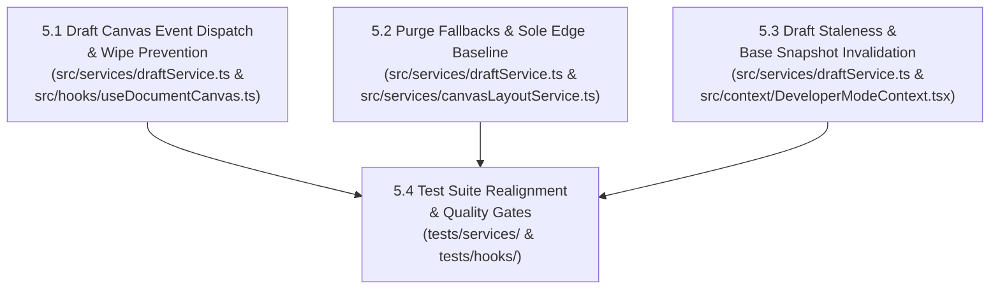

# Epic 5: Single-Source Baseline Fidelity & Unified Draft Hydration

> **Status:** Completed  
> **Alignment Directive:** Strictly following [Epic 4](file:///Users/francisdave/Documents/folio/docs/task/TASKS-EPIC-4.md) and [Epic 3](file:///Users/francisdave/Documents/folio/docs/task/TASKS-EPIC-3.md) Single-Source Architecture.  
> **Prevalence Notice:** Governed by [.agents/skills/karpathy-rules/SKILL.md](file:///Users/francisdave/Documents/folio/.agents/skills/karpathy-rules/SKILL.md), [.agents/skills/superpowers/SKILL.md](file:///Users/francisdave/Documents/folio/.agents/skills/superpowers/SKILL.md), [.agents/skills/feature-dev/SKILL.md](file:///Users/francisdave/Documents/folio/.agents/skills/feature-dev/SKILL.md), and [.agents/skills/code-simplifier/SKILL.md](file:///Users/francisdave/Documents/folio/.agents/skills/code-simplifier/SKILL.md).

---

## 🎯 Executive Overview: Single-Source Principle for Drafts

Following Epic 4, **there is absolutely and strictly only ONE place for saving and fetching published data, and ONE unified place for draft baseline hydration: Cloudflare Edge KV (`/api/public/node/:nodeId` and `/api/public/manifest`).**

Previously, draft saving and fetching was fragmented across multiple conflicting layers:
1. In-memory cache (`inMemoryDraftCanvases`)
2. LocalStorage legacy keys (`folio_draft_canvas_*`, `folio_live_canvas_*`, which violated the Epic 3/4 Zero-LocalStorage policy)
3. Supabase `engine_drafts` table
4. Edge KV endpoints (`/api/public/node/:nodeId`)
5. Local live canvas fallbacks

Because draft state was split across all these places:
- It fetched from whichever legacy branch responded first (often returning empty defaults or stale snapshots).
- When `initDraftSession()` successfully cloned from Edge KV, it **forgot to dispatch `EVENT_DRAFT_CANVAS_CHANGE`**, leaving React's `useDocumentCanvas` deaf to the update.
- Switching into Developer Mode synchronously wiped the live Edge KV document already rendered on screen.
- Clean drafts (`!isDraftDirty()`) short-circuited initialization before checking if the Edge KV baseline had advanced.

**Epic 5 eliminates this multi-tier maze, unifying saving and fetching into a single, clean pipeline:**
- **Single Read Source:** Draft baseline hydrates strictly from Cloudflare Edge KV (`/api/public/node/:nodeId`). All legacy localStorage draft/live reading fallbacks are purged.
- **Single In-Session Authoring Store:** In-memory draft sandbox (`inMemoryDraftCanvases`), providing 60 FPS zero-localStorage editing.
- **Single Write / Publish Pipeline:** `POST /api/publish` commits directly to Cloudflare Edge KV (fail-stop).
- **Reactive Event Delivery:** Every baseline clone and post-publish sync immediately dispatches `dispatchAggregateCanvasChange(true)`.

---

## 🗺️ Subtasks Index

| Subtask ID | Title | Scope | File Reference | Status |
| :--- | :--- | :--- | :--- | :--- |
| **5.1** | [Draft Canvas Event Dispatch & Screen Wipe Prevention](file:///Users/francisdave/Documents/folio/docs/task/5.1-draft-canvas-event-dispatch-and-wipe-prevention.md) | Dispatch `EVENT_DRAFT_CANVAS_CHANGE` via `dispatchAggregateCanvasChange(true)` on draft hydration and publish sync; preserve active Edge KV document in `useDocumentCanvas` during Dev Mode toggle | `docs/task/5.1-draft-canvas-event-dispatch-and-wipe-prevention.md` | Completed |
| **5.2** | [Purge Legacy Fallback Maze & Enforce Edge KV as Sole Draft Baseline](file:///Users/francisdave/Documents/folio/docs/task/5.2-authoritative-baseline-hydration-and-cloud-fallback.md) | Strip legacy `localStorage` draft/live reading branches; enforce `/api/public/node/:nodeId` as the sole baseline source; guard against cold-miss empty payloads (`sections: []`) | `docs/task/5.2-authoritative-baseline-hydration-and-cloud-fallback.md` | Completed |
| **5.3** | [Draft Staleness & Base Snapshot Invalidation](file:///Users/francisdave/Documents/folio/docs/task/5.3-draft-staleness-and-base-snapshot-invalidation.md) | Invalidate clean drafts (`!isDraftDirty()`) when the Edge KV published manifest advances; harden `null`/`undefined` `baseId` guards; ensure clean draft re-population from Edge KV on discard | `docs/task/5.3-draft-staleness-and-base-snapshot-invalidation.md` | Completed |
| **5.4** | [Test Suite Realignment & Hydration Verification](file:///Users/francisdave/Documents/folio/docs/task/5.4-test-suite-and-hydration-verification.md) | Add unit and integration tests verifying single-source published-to-draft continuity, event broadcasting, and quality gate enforcement across all 67 suites | `docs/task/5.4-test-suite-and-hydration-verification.md` | Completed |

---

## 🔄 Sequence & Dependency Graph

---

## 🛡️ Quality Verification Gates

1. `npm test`: 100% passing across all test suites with zero failures.
2. `npm run test:tokens`: 100% token purity, 0 hardcoded colors or raw pixel geometries.
3. `npm run typecheck`: 0 TypeScript compiler diagnostics across all source files.
4. **Single-Source Invariant**: Edge KV (`/api/public/node/:nodeId`) is the sole authority for published reads; public readers and draft initializers consume the identical endpoint.
5. **Zero Screen Flash / Wipe**: Entering Developer Mode preserves the active live canvas and updates smoothly once draft synchronization completes.
6. **Zero LocalStorage Draft Documents**: Zero keys matching `_draft_canvas_*` or `_live_canvas_*` are written to or read from `localStorage`.
7. **Publish Sync Gate**: Publishing a revision immediately propagates to Edge KV and refreshes the draft sandbox in memory without page reload.
