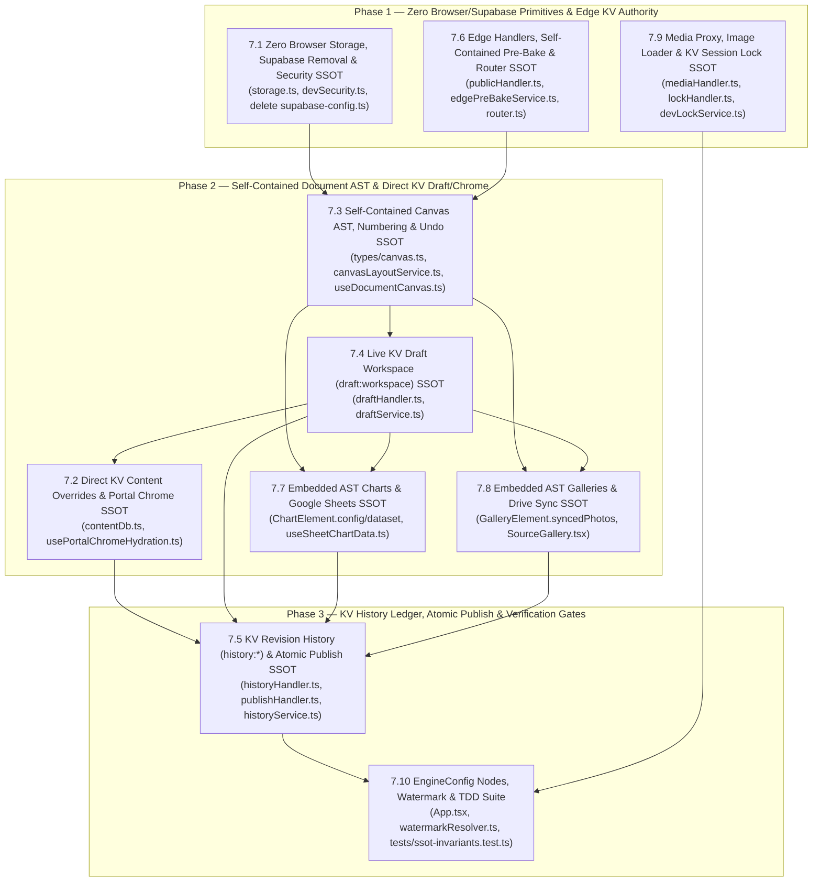

# Epic 7: Absolute Single Source of Truth (SSOT) on Live Cloudflare KV & Self-Contained AST Architecture

> **Status:** ✅ Done  
> **Alignment Directive:** Supersedes residual multi-tier fallbacks, Supabase dependencies, and client-side shadow stores identified after [Epic 3](file:///Users/francisdave/Documents/folio/docs/task/TASKS-EPIC-3.md), [Epic 4](file:///Users/francisdave/Documents/folio/docs/task/TASKS-EPIC-4.md), [Epic 5](file:///Users/francisdave/Documents/folio/docs/task/TASKS-EPIC-5.md), and [Epic 6](file:///Users/francisdave/Documents/folio/docs/task/TASKS-EPIC-6.md).  
> **Prevalence Notice:** Governed by [.agents/skills/karpathy-rules/SKILL.md](file:///Users/francisdave/Documents/folio/.agents/skills/karpathy-rules/SKILL.md), [.agents/skills/superpowers/SKILL.md](file:///Users/francisdave/Documents/folio/.agents/skills/superpowers/SKILL.md), [.agents/skills/feature-dev/SKILL.md](file:///Users/francisdave/Documents/folio/.agents/skills/feature-dev/SKILL.md), and [.agents/rules/design-system-first.md](file:///Users/francisdave/Documents/folio/.agents/rules/design-system-first.md).

---

## 🎯 Executive Overview & Core Invariants

**The Three Non-Negotiable Epic 7 Invariants:**
1. **Live Cloudflare KV Only**: Eliminate Supabase (`engine_drafts`, `engine_history`, `chart_sources`, `engine_sources`, `dev_mode_session`, `node_canvas`, `pillar_canvas`, `engine-media` storage bucket, `src/utils/supabase-config.ts`, `src/utils/supabase-write-guard.ts`, `src/utils/runtime-env.ts`, and `src/services/mediaService.ts`) and eliminate all browser-side and module-level shadow stores—no `localStorage` (`src/utils/storage.ts`, `src/utils/storageAdapter.ts`), no `sessionStorage`, no `IndexedDB` (`src/services/historyStorage.ts`), no `BroadcastChannel` sync shadows, and no module-level in-memory shadow stores (`inMemoryLive*`, `inMemoryDraft*`, `liveMemoryCache`, `draftMemoryCache`, `inMemoryManifest`, `inMemoryRegistry`, `memoryCache`, `hasCompletedHydration`, `inMemorySessionId`). All reads and writes (live, drafts, history, locks) go directly to Cloudflare KV via `/api/*` edge routes.
2. **Self-Contained Document AST & Versioned Atomic Switching**: Embed all node content—including charts (`ChartElement.config` and `ChartElement.dataset`) and evidence galleries (`GalleryElement.driveUrl`, `GalleryElement.title`, `GalleryElement.description`, `GalleryElement.lastVerified`, and `GalleryElement.syncedPhotos`)—directly inside the `NodeCanvasDocument` AST. To prevent multi-key KV split-brain on partial publish failure, `POST /api/publish` writes immutable versioned node keys (`node:${snapshotId}:${nodeId}`) and `history:snapshot:${snapshotId}` **before** flipping `portal:manifest.activeSnapshotId`.
3. **Strict Fail-Stop & Edge-Authenticated Lock Authority**: Zero dual writes and zero fallback chains. PIN verification and brute-force rate limiting (`lock:pin_ratelimit`) execute on the Cloudflare Edge (`POST /api/lock` issuing an opaque `lockToken` verified via `Authorization: Bearer <lockToken>` on all mutating `/api/draft`, `/api/publish`, `/api/history/restore`, and `/api/lock` routes, never leaking `holderSessionId` on `GET /api/lock` or bundling PIN hashes into client JS). If any Cloudflare KV, Google Sheets, or Google Drive read/write fails, fail stop immediately with an explicit HTTP 4xx/5xx response or UI error state.

A full-codebase forensic audit across `src/utils/`, `src/services/`, `src/hooks/`, `src/context/`, `src/components/`, `src/edge/`, `src/diagnostics/`, and `functions/api/` uncovered **36 distinct architectural violations and lifecycle blind spots** across 10 domains where data is:
1. **[C1] Multi-Source Read/Write**: Read from or written to more than one source (Supabase, `localStorage`, `sessionStorage`, `IndexedDB`, module-level memory caches, or static JSON).
2. **[C2] Silent Fallback Instead of Fail-Stop**: Degraded to a secondary, local, static JSON, or default store upon failure or missing value instead of failing stop.
3. **[C3] State Duplication / Mirroring / Syncing**: Duplicated, mirrored, or synchronized across multiple stores or sidecar services outside the Canvas AST.
4. **[C4] Lifecycle / Concurrency / Auth Blind Spot**: Vulnerable to partial multi-key KV writes, cold-boot empty-KV deadlock, stale overwrite races, or unauthenticated mutation spoofing.

Epic 7 systematically eliminates every single violation using **Karpathy Engineering Rules** (think before coding, surgical changes, verify everything), **Superpowers TDD** (atomic task decomposition, red-green-refactor unit and integration tests first), and the **Feature-Dev 5-Step Pipeline** (contract alignment, token verification, atomic scaffolding, quality gates, and review).

---

## 📋 Complete Forensic SSOT Audit Ledger

### Domain 1: Browser Storage, Security Primitives & Supabase Removal
| ID | File & Lines | Category | Conflicting Sources / Fallback Chain | Why It Violates SSOT |
| :--- | :--- | :---: | :--- | :--- |
| **V1.1** | [storage.ts](file:///Users/francisdave/Documents/folio/src/utils/storage.ts#L5-L18), [storageAdapter.ts](file:///Users/francisdave/Documents/folio/src/utils/storageAdapter.ts#L22-L58), [devSecurity.ts](file:///Users/francisdave/Documents/folio/src/utils/devSecurity.ts#L265-L278) | C1, C2 | `window.localStorage` → `window.sessionStorage` → `null` + `localStorageAdapter` | Uses browser storage (`localStorage` / `sessionStorage`) across two separate storage wrappers (`storage.ts` and `storageAdapter.ts`) instead of operating with zero browser-side persistence. |
| **V1.2** | [devSecurity.ts](file:///Users/francisdave/Documents/folio/src/utils/devSecurity.ts#L10-L20), [devSecurity.ts](file:///Users/francisdave/Documents/folio/src/utils/devSecurity.ts#L166-L184), [publishHandler.ts](file:///Users/francisdave/Documents/folio/src/edge/handlers/publishHandler.ts#L84-L98) | C1, C2, C4 | Salt: `salt` arg → `EngineConfig.securitySalt` → `VITE_DEV_SALT` → `${ns}_dev_salt_v1` Hash: `expectedHash` arg → `EngineConfig.expectedPinHash` → `VITE_DEV_PIN_HASH` → `EXPECTED_PIN_HASH` | Resolves authentication credentials in the browser via a 4-tier fallback chain ending in hardcoded default constants, stores lockout counters in browser storage instead of Cloudflare KV (`lock:pin_ratelimit`), and leaves `/api/publish` unauthenticated beyond checking `Boolean(snapshot.authorSessionId)`. |
| **V1.3** | [storage.ts](file:///Users/francisdave/Documents/folio/src/utils/storage.ts#L27-L69) vs. [contentDb.ts](file:///Users/francisdave/Documents/folio/src/utils/contentDb.ts#L91-L105), [canvasLayoutService.ts](file:///Users/francisdave/Documents/folio/src/services/canvasLayoutService.ts#L910-L981), [historyService.ts](file:///Users/francisdave/Documents/folio/src/services/historyService.ts#L860) | C1, C3 | `purgeLegacyDocumentStorage()` deletes `_draft_canvas_`, `_canvas_`, `_live_canvas_`, and `_content_overrides` on boot while runtime services actively write/read them | Browser `localStorage` is purged as legacy bloat at module load, yet re-populated and read during the session as a shadow store. |
| **V1.4** | [mediaService.ts](file:///Users/francisdave/Documents/folio/src/services/mediaService.ts#L8-L161), [UniversalEditModal.tsx](file:///Users/francisdave/Documents/folio/src/components/dev/UniversalEditModal.tsx#L20), [UniversalEditModal.tsx](file:///Users/francisdave/Documents/folio/src/components/dev/UniversalEditModal.tsx#L430-L458), [supabase-write-guard.ts](file:///Users/francisdave/Documents/folio/src/utils/supabase-write-guard.ts#L1-L46), [runtime-env.ts](file:///Users/francisdave/Documents/folio/src/utils/runtime-env.ts#L1-L47) | C1, C4 | `uploadMediaAsset` → Supabase Storage `/storage/v1/object/engine-media` + `installSupabaseWriteGuard` | Retains an active Supabase Storage binary upload dependency in `mediaService.ts` and `UniversalEditModal.tsx` alongside orphaned Supabase environment guards. |

### Domain 2: Content Database (`ContentDB`) & Portal Chrome Hydration
| ID | File & Lines | Category | Conflicting Sources / Fallback Chain | Why It Violates SSOT |
| :--- | :--- | :---: | :--- | :--- |
| **V2.1** | [contentDb.ts](file:///Users/francisdave/Documents/folio/src/utils/contentDb.ts#L27-L110), [contentDb.ts](file:///Users/francisdave/Documents/folio/src/utils/contentDb.ts#L365-L377), [useContent.ts](file:///Users/francisdave/Documents/folio/src/hooks/useContent.ts#L39-L50) | C1, C2, C3 | Live: `liveMemoryCache` → `localStorage` (`_live_content_overrides`) → `localStorage` (`_content_overrides`) → `inMemoryLiveStores` Map → `{}` Draft: `draftMemoryCache` → `localStorage` (`_draft_content_overrides`) → `inMemoryDraftStores` Map → `{}` | Mirrors content overrides across module-level singletons (`liveMemoryCache`, `draftMemoryCache`), namespace Maps (`inMemoryLiveStores`, `inMemoryDraftStores`), `localStorage`, Cloudflare KV, and Supabase; swallows errors and falls back to `{}`. |
| **V2.2** | [contentDb.ts](file:///Users/francisdave/Documents/folio/src/utils/contentDb.ts#L33), [contentDb.ts](file:///Users/francisdave/Documents/folio/src/utils/contentDb.ts#L131-L165), [contentDb.ts](file:///Users/francisdave/Documents/folio/src/utils/contentDb.ts#L239-L280) | C1, C2, C3 | `draftMemoryCache` → `draftTombstones` (module-level `Set`) → `liveMemoryCache` → `defaultValue` | Dev mode reads layer module-level draft cache over module-level live cache using an unpersisted `draftTombstones` Set instead of reading directly from KV `draft:workspace.contentOverrides`. |
| **V2.3** | [usePortalChromeHydration.ts](file:///Users/francisdave/Documents/folio/src/hooks/usePortalChromeHydration.ts#L18-L68), [HeroWelcome.tsx](file:///Users/francisdave/Documents/folio/src/components/layout/HeroWelcome.tsx#L20-L42) | C1, C2, C3, C4 | `/api/public/manifest` → `hasCompletedHydration` singleton → `ContentDB` module memory cache → `EngineConfig.branding` props → `DEFAULT_KICKER` / `DEFAULT_TITLE` / `DEFAULT_SUBTITLE` | Swallows `/api/public/manifest` fetch/HTTP failures (`catch(() => {})`), silently falls back to prop/hardcoded strings, and uses a module-level `hasCompletedHydration` lock that blocks re-hydration after exiting Dev Mode. |

### Domain 3: Dynamic Self-Contained Canvas AST, Section Numbering & Undo
| ID | File & Lines | Category | Conflicting Sources / Fallback Chain | Why It Violates SSOT |
| :--- | :--- | :---: | :--- | :--- |
| **V3.1** | [canvasLayoutService.ts](file:///Users/francisdave/Documents/folio/src/services/canvasLayoutService.ts#L94-L325), [SectionTitle.tsx](file:///Users/francisdave/Documents/folio/src/components/ui/SectionTitle.tsx#L65-L108), [CanvasSection.tsx](file:///Users/francisdave/Documents/folio/src/components/canvas/CanvasSection.tsx#L42-L76), [CanvasSubsection.tsx](file:///Users/francisdave/Documents/folio/src/components/canvas/CanvasSubsection.tsx#L36-L53), [use-dynamic-section-numbers.ts](file:///Users/francisdave/Documents/folio/src/hooks/use-dynamic-section-numbers.ts#L91-L108), [UniversalEditModal.tsx](file:///Users/francisdave/Documents/folio/src/components/dev/UniversalEditModal.tsx#L331-L342) | C1, C3 | `ContentDB` (`${titlePointId}` and `${titlePointId}.isNumbered`) ↔ `NodeCanvasDocument` AST (`section.title`, `section.isNumbered`, `subsection.title`) | Section/subsection titles and `isNumbered` flags are read from `ContentDB` first and fall back to Canvas AST properties, while `foldCanvasOverridesIntoDocument` mutates AST from `ContentDB`. |
| **V3.2** | [canvasLayoutService.ts](file:///Users/francisdave/Documents/folio/src/services/canvasLayoutService.ts#L867-L953), [canvasLayoutService.ts](file:///Users/francisdave/Documents/folio/src/services/canvasLayoutService.ts#L979-L990) | C1, C2, C3 | `getLiveNodeCanvas` / `saveLiveNodeCanvas`: `localStorage` (`_live_canvas_${nodeId}`) → `createDefaultCanvasDocument(nodeId)` | Maintains a shadow copy of live canvases in `localStorage` and module-level memory alongside Cloudflare KV, silently returning an empty default document on missing storage. |
| **V3.3** | [canvasLayoutService.ts](file:///Users/francisdave/Documents/folio/src/services/canvasLayoutService.ts#L1116-L1169) | C1, C2, C3 | `getLiveNodeCanvas(nodeId)` (`localStorage`) → POST `/rest/v1/node_canvas` (table check `'pillar_canvas'`) → simulated `{ success: true }` when offline | Writes canvas AST to a separate Supabase table (`node_canvas`) from `localStorage` and fakes `{ success: true }` when Supabase is unconfigured. |
| **V3.4** | [useDocumentCanvas.ts](file:///Users/francisdave/Documents/folio/src/hooks/useDocumentCanvas.ts#L100-L105), [useDocumentCanvas.ts](file:///Users/francisdave/Documents/folio/src/hooks/useDocumentCanvas.ts#L127-L145), [useDocumentCanvas.ts](file:///Users/francisdave/Documents/folio/src/hooks/useDocumentCanvas.ts#L209-L269) | C1, C2, C3 | Dev-mode switch: `getNodeCanvas(nodeId, true)` → `documentRef.current` (live doc) → `createDefaultCanvasDocument` Public hydration: copies `edgeData.chartDatasets` → `chartSourceService` and `edgeData.sourceMetadata` → `sourceService` | Reads from module-level `inMemoryDraftCanvases` with fallback to `documentRef.current`, and splits charts/galleries into sidecar services instead of embedding them directly inside the `NodeCanvasDocument` AST read from and written to Cloudflare KV. |
| **V3.5** | [DocumentCanvas.tsx](file:///Users/francisdave/Documents/folio/src/components/canvas/DocumentCanvas.tsx#L172), [DocumentCanvas.tsx](file:///Users/francisdave/Documents/folio/src/components/canvas/DocumentCanvas.tsx#L186-L243) vs. [useDocumentCanvas.ts](file:///Users/francisdave/Documents/folio/src/hooks/useDocumentCanvas.ts#L336-L363) | C3 | `DocumentCanvas` local `undoBackup` state vs. `UndoRedoContext` (`pushAction`) | Duplicates deletion undo records in component state and `UndoRedoContext`; toast undo restores items without popping the undo stack. |

### Domain 4: Draft Workspace in Cloudflare KV (`draft:workspace`)
| ID | File & Lines | Category | Conflicting Sources / Fallback Chain | Why It Violates SSOT |
| :--- | :--- | :---: | :--- | :--- |
| **V4.1** | [draftService.ts](file:///Users/francisdave/Documents/folio/src/services/draftService.ts#L62-L65), [draftService.ts](file:///Users/francisdave/Documents/folio/src/services/draftService.ts#L96-L134), [draftService.ts](file:///Users/francisdave/Documents/folio/src/services/draftService.ts#L159-L219), [historyService.ts](file:///Users/francisdave/Documents/folio/src/services/historyService.ts#L836-L889), [canvasLayoutService.ts](file:///Users/francisdave/Documents/folio/src/services/canvasLayoutService.ts#L1090-L1103) | C1, C2, C3 | Flags: `inMemoryDraftActive`/`BaseId`/`Dirty` ↔ `localStorage` (`_draft_active`, `_draft_dirty`) Canvases: `inMemoryDraftCanvases` ↔ `localStorage` (`_draft_canvas_${nodeId}`) ↔ Supabase `engine_drafts` | Stores draft state across module-level globals (`inMemoryDraft*`), `localStorage`, and Supabase `engine_drafts` instead of reading and writing directly to Cloudflare KV (`draft:workspace` via `/api/draft`). |
| **V4.2** | [draftService.ts](file:///Users/francisdave/Documents/folio/src/services/draftService.ts#L467-L587) | C1, C2, C3, C4 | `initDraftSession`: (1) `inMemoryDraftCanvases` → (2) Supabase `engine_drafts` → (3) Edge KV `/api/public/node/:id` → (4) `createDefaultCanvasDocument` | Cascades across 4 stores on draft init and silently catches network/HTTP errors at every tier; conversely, failing stop when KV is completely unseeded causes a cold-boot deadlock unless `POST /api/draft/init` explicitly bootstraps uninitialized portals (`portal:manifest === null && history:index === null`). |
| **V4.3** | [draftService.ts](file:///Users/francisdave/Documents/folio/src/services/draftService.ts#L348-L384), [draftService.ts](file:///Users/francisdave/Documents/folio/src/services/draftService.ts#L399-L447) | C2, C3, C4 | `inMemoryDraftCanvases` + `ContentDB` draft ↔ debounced POST to Supabase `engine_drafts` (last-write-wins without revision/ETag check) | Uses Supabase `engine_drafts`, silently degrades to module-level memory on failure, and lacks optimistic concurrency control (`expectedUpdatedAt` / `revision`) to prevent concurrent background syncs from overwriting active edits. |

### Domain 5: Revision History (`history:*`) & Atomic Publish Pipeline in Cloudflare KV
| ID | File & Lines | Category | Conflicting Sources / Fallback Chain | Why It Violates SSOT |
| :--- | :--- | :---: | :--- | :--- |
| **V5.1** | [historyService.ts](file:///Users/francisdave/Documents/folio/src/services/historyService.ts#L163-L196), [historyService.ts](file:///Users/francisdave/Documents/folio/src/services/historyService.ts#L1431-L1444) | C1, C2 | `localStorage` `_live_active_published_id` → `_active_published_id` → `_history_manifest.activePublishedId` → `_history_manifest.activeMilestoneId` → `'snap-system-baseline'` | Resolves the active snapshot ID from a 5-stage local fallback chain that competes with `portal:manifest.activeSnapshotId` in Cloudflare KV. |
| **V5.2** | [historyService.ts](file:///Users/francisdave/Documents/folio/src/services/historyService.ts#L261-L392), [historyStorage.ts](file:///Users/francisdave/Documents/folio/src/services/historyStorage.ts#L71-L132) | C1, C2, C3 | `inMemoryManifest` ↔ `IndexedDB` (`history_store`) ↔ `localStorage` (`_history_manifest`, stripped metadata <5 KB) | Triple-writes history to module memory (`inMemoryManifest`), `IndexedDB`, and truncated `localStorage` instead of storing history exclusively in Cloudflare KV (`history:index` and `history:snapshot:${id}`). |
| **V5.3** | [historyService.ts](file:///Users/francisdave/Documents/folio/src/services/historyService.ts#L891-L1022), [HistoryHubModal.tsx](file:///Users/francisdave/Documents/folio/src/components/history/HistoryHubModal.tsx#L254-L282) | C1, C2, C3 | Supabase `engine_history` → `getLocalFallbackSnapshots()` (`localStorage`/`IndexedDB`/`inMemoryManifest`) → `getDefaultSystemBaselineSnapshot()` | Queries Supabase `engine_history` and silently falls back to local browser stores and a synthetic baseline snapshot instead of querying Cloudflare KV (`GET /api/history`) and failing stop on error. |
| **V5.4** | [historyService.ts](file:///Users/francisdave/Documents/folio/src/services/historyService.ts#L1027-L1096), [historyService.ts](file:///Users/francisdave/Documents/folio/src/services/historyService.ts#L1457-L1511) | C1, C2, C3 | Supabase `engine_history` (`id=eq.${activeId}` → fallback `is_active=eq.true`) → mirrors into `localStorage` (`_live_canvas_*`, `_live_content_overrides`) | Hydrates "live" state from Supabase `engine_history` into `localStorage` on Dev Mode entry, conflicting with Cloudflare KV authority. |
| **V5.5** | [publishHandler.ts](file:///Users/francisdave/Documents/folio/src/edge/handlers/publishHandler.ts#L100-L240), [historyService.ts](file:///Users/francisdave/Documents/folio/src/services/historyService.ts#L1259-L1315), [historyService.ts](file:///Users/francisdave/Documents/folio/src/services/historyService.ts#L1320-L1392) | C1, C2, C3, C4 | Server: Supabase `engine_history` + unversioned KV `node:*` + KV `chart:*` + KV `portal:manifest` Client: `localStorage` + `IndexedDB` + `inMemoryDraftCanvases` + `BroadcastChannel` (`_portal_sync`) | Fans out published state across Supabase, `localStorage`, `IndexedDB`, `BroadcastChannel`, and unversioned KV `node:*` keys (risking split-brain partial state if a multi-key `kv.put` fails mid-loop before `portal:manifest` is updated). |
| **V5.6** | [historyService.ts](file:///Users/francisdave/Documents/folio/src/services/historyService.ts#L540-L573), [historyService.ts](file:///Users/francisdave/Documents/folio/src/services/historyService.ts#L634-L687), [historyService.ts](file:///Users/francisdave/Documents/folio/src/services/historyService.ts#L836-L889), [HistoryHubModal.tsx](file:///Users/francisdave/Documents/folio/src/components/history/HistoryHubModal.tsx#L323-L335) | C1, C3, C4 | `restoreSnapshotToDraft` writes `localStorage` `_draft_canvas_*` and drops `snapshot.contentOverrides`, `chartConfigs`, and `sourceMetadata`; `HistoryHubModal` calls local `getDefaultSystemBaselineSnapshot()` | Restoring a snapshot drops all portal chrome text overrides, charts, and galleries from that snapshot, and local milestone/autosave/restore functions operate against browser `localStorage` instead of Cloudflare KV (`POST /api/history/restore`). |

### Domain 6: Edge Public Handlers, Pre-Bake Compiler & Router
| ID | File & Lines | Category | Conflicting Sources / Fallback Chain | Why It Violates SSOT |
| :--- | :--- | :---: | :--- | :--- |
| **V6.1** | [publicHandler.ts](file:///Users/francisdave/Documents/folio/src/edge/handlers/publicHandler.ts#L114-L156), [publicHandler.ts](file:///Users/francisdave/Documents/folio/src/edge/handlers/publicHandler.ts#L180-L214), [publicHandler.ts](file:///Users/francisdave/Documents/folio/src/edge/handlers/publicHandler.ts#L251-L286) | C1, C2 | `handlePublicNodeRoute`: KV `node:${id}` → HTTP 200 empty `fallbackPayload` (`SUPABASE_FALLBACK`) `handlePublicManifestRoute`: KV `portal:manifest` → HTTP 200 `fallbackManifest` `handlePublicChartRoute`: KV `chart:${id}` → HTTP 200 `baked-charts.json` (`STATIC_FALLBACK`) | On KV cold miss or unbound KV, edge handlers return HTTP 200 with fabricated empty payloads or static bundled JSON instead of failing stop (HTTP 404/503). |
| **V6.2** | [edgePreBakeService.ts](file:///Users/francisdave/Documents/folio/src/services/edgePreBakeService.ts#L141-L252) | C1, C2 | `gatherIndicatorDatasets`: `baked-charts.json` + `snapshot.chartConfigs` + `options.chartDatasets` `gatherSourceMetadata`: `source-sources.json` + `snapshot.sourceMetadata` + `options.sourceMetadata` | Pre-baking blends compile-time static JSON files (`baked-charts.json`, `source-sources.json`) and sidecar maps into published node payloads instead of compiling self-contained `NodeCanvasDocument` ASTs. |
| **V6.3** | [_shared.ts](file:///Users/francisdave/Documents/folio/functions/api/public/_shared.ts#L12-L66), [publicHandler.ts](file:///Users/francisdave/Documents/folio/src/edge/handlers/publicHandler.ts#L19-L81), [router.ts](file:///Users/francisdave/Documents/folio/src/edge/router.ts#L40-L47), [functions/api/publish.ts](file:///Users/francisdave/Documents/folio/functions/api/publish.ts#L22) | C1, C2, C3 | KV binding: `options.kv` → `env[options.kvBinding]` → `env.KV_ENGINE_PUBLIC` → `env.KV_MASID_PUBLIC` → `null` Duplicate helpers in `functions/api/public/_shared.ts` vs `src/edge/handlers/publicHandler.ts` | Falls back across two KV namespace bindings (`KV_ENGINE_PUBLIC` and legacy `KV_MASID_PUBLIC`) and duplicates edge response helpers with conflicting `Cache-Control` TTLs. |

### Domain 7: Self-Contained AST Charts & Google Sheets Pipeline
| ID | File & Lines | Category | Conflicting Sources / Fallback Chain | Why It Violates SSOT |
| :--- | :--- | :---: | :--- | :--- |
| **V7.1** | [chartSourceService.ts](file:///Users/francisdave/Documents/folio/src/services/chartSourceService.ts#L63), [chartSourceService.ts](file:///Users/francisdave/Documents/folio/src/services/chartSourceService.ts#L113-L164), [chartSourceService.ts](file:///Users/francisdave/Documents/folio/src/services/chartSourceService.ts#L178-L259), [useChartConfigForm.ts](file:///Users/francisdave/Documents/folio/src/components/chart/drawer/hooks/useChartConfigForm.ts#L450-L508) | C1, C2, C3 | `memoryCache` ↔ `localStorage` (`_chart_source_${id}`, `_chart_sources_manifest`) ↔ Supabase `chart_sources` (`cached_dataset` + `visual_config.__cached_dataset`, `node_id` + `visual_config.__node_id`) | Stores chart configs in a sidecar service (`chartSourceService`), module `memoryCache`, `localStorage`, and Supabase `chart_sources` instead of embedding `config` and `dataset` directly inside `ChartElement` in the `NodeCanvasDocument` AST. |
| **V7.2** | [chartSourceService.ts](file:///Users/francisdave/Documents/folio/src/services/chartSourceService.ts#L264-L375) | C1, C2 | `fetchChartConfig` & `fetchChartConfigsByNode`: `getCachedChartConfig` → Supabase `chart_sources` → fallback to `getCachedChartConfig` / `localStorage` manifest | Queries Supabase `chart_sources` and falls back to stale browser/module caches instead of reading `ChartElement` directly from the Canvas AST. |
| **V7.3** | [chartSourceService.ts](file:///Users/francisdave/Documents/folio/src/services/chartSourceService.ts#L414-L619), [ChartConfigDrawer.tsx](file:///Users/francisdave/Documents/folio/src/components/chart/ChartConfigDrawer.tsx#L333-L347), [ChartConfigDrawer.tsx](file:///Users/francisdave/Documents/folio/src/components/chart/ChartConfigDrawer.tsx#L406-L421) | C1, C2, C3 | `saveChartConfigDetailed`: writes `localStorage` first → posts to Supabase → strips rejected columns on HTTP 400 → returns `success: savedLocally` (`true`) even when Supabase fails | Dual-writes to `localStorage` and Supabase and treats local-only saves as `success: true`, instead of updating `ChartElement` in the Canvas AST and persisting to KV `draft:workspace` (failing stop on KV error). |
| **V7.4** | [useSheetChartData.ts](file:///Users/francisdave/Documents/folio/src/hooks/useSheetChartData.ts#L35), [useSheetChartData.ts](file:///Users/francisdave/Documents/folio/src/hooks/useSheetChartData.ts#L98-L234), [useSheetChartData.ts](file:///Users/francisdave/Documents/folio/src/hooks/useSheetChartData.ts#L271-L307), [useSheetChartData.ts](file:///Users/francisdave/Documents/folio/src/hooks/useSheetChartData.ts#L324-L389) | C1, C2, C3 | (1) `localStorage` `chart_matrix_${id}` → (2) `cachedConfig.cachedDataset` (`memoryCache`/`localStorage` `chart_source_${id}`) → (3) `initialDataset` prop → (4) `baked-charts.json` → (5) Supabase `chart_sources` | Resolves chart datasets across 6 competing sources instead of reading strictly from the `ChartElement` embedded in the Canvas AST (`node:${nodeId}` in Public Mode, `draft:workspace` in Dev Mode). |
| **V7.5** | [ChartCard.tsx](file:///Users/francisdave/Documents/folio/src/components/chart/ChartCard.tsx#L76-L133) | C1, C3 | `onSync()` (`useSheetChartData.syncLiveSheet`) vs. inline `fetchLiveSheetMatrix` → `saveChartConfigDetailed` in `ChartCard` | Duplicates the live Google Sheet sync and persistence logic in two places. |
| **V7.6** | [sheetsDataService.ts](file:///Users/francisdave/Documents/folio/src/services/sheetsDataService.ts#L506-L535), [useLiveMatrixSync.ts](file:///Users/francisdave/Documents/folio/src/components/chart/drawer/hooks/useLiveMatrixSync.ts#L38-L50), [useLiveMatrixSync.ts](file:///Users/francisdave/Documents/folio/src/components/chart/drawer/hooks/useLiveMatrixSync.ts#L64-L95) | C1, C2 | `fetchLiveSheetMatrix` returns `[]` on HTTP/login/network error → `useLiveMatrixSync` falls back to `previewMatrix` (`initialConfig?.cachedDataset`) | Swallows live sheet fetch errors by returning `[]` and silently falling back to cached matrix data. |
| **V7.7** | [sheetsVerificationService.ts](file:///Users/francisdave/Documents/folio/src/services/sheetsVerificationService.ts#L153-L225), [sheetsVerificationService.ts](file:///Users/francisdave/Documents/folio/src/services/sheetsVerificationService.ts#L237-L355), [useSheetVerification.ts](file:///Users/francisdave/Documents/folio/src/components/chart/drawer/hooks/useSheetVerification.ts#L128-L130) | C1, C2 | `fetchSheetTabs`: Sheets API v4 → `/htmlview` regex scraping → `'Sheet1'` `verifySheetAccess`: Sheets API v4 → GViz CSV probe | Uses a multi-tier fallback chain across REST API v4, HTML scraping, GViz probing, and a hardcoded `'Sheet1'` fallback. |

### Domain 8: Self-Contained AST Evidence Galleries & Google Drive Photo Sync
| ID | File & Lines | Category | Conflicting Sources / Fallback Chain | Why It Violates SSOT |
| :--- | :--- | :---: | :--- | :--- |
| **V8.1** | [sourceService.ts](file:///Users/francisdave/Documents/folio/src/services/sourceService.ts#L95-L109), [sourceService.ts](file:///Users/francisdave/Documents/folio/src/services/sourceService.ts#L159-L198), [sourceService.ts](file:///Users/francisdave/Documents/folio/src/services/sourceService.ts#L246-L366), [sourceService.ts](file:///Users/francisdave/Documents/folio/src/services/sourceService.ts#L400-L492) | C1, C2, C3 | `source-sources.json` ← `localStorage` `_evidence_cache_v2` (with silent `syncedPhotos` quota stripping) ← `inMemoryRegistry` ← Supabase `engine_sources` | Maintains a sidecar source registry merging static JSON, `localStorage`, module `inMemoryRegistry`, and Supabase `engine_sources` instead of embedding gallery data directly inside `GalleryElement` in the `NodeCanvasDocument` AST. |
| **V8.2** | [source.ts](file:///Users/francisdave/Documents/folio/src/utils/source.ts#L24-L49), [useSourcePoint.ts](file:///Users/francisdave/Documents/folio/src/hooks/useSourcePoint.ts#L46-L119), [useDrivePhotoSync.ts](file:///Users/francisdave/Documents/folio/src/hooks/useDrivePhotoSync.ts#L47-L98), [SourceGallery.tsx](file:///Users/francisdave/Documents/folio/src/components/source/SourceGallery.tsx#L89-L137), [SourceGallery.tsx](file:///Users/francisdave/Documents/folio/src/components/source/SourceGallery.tsx#L531-L544), [CanvasGallery.tsx](file:///Users/francisdave/Documents/folio/src/components/canvas/CanvasGallery.tsx#L12-L14), [CanvasGallery.tsx](file:///Users/francisdave/Documents/folio/src/components/canvas/CanvasGallery.tsx#L43-L60), [SourceFolderAttachment.tsx](file:///Users/francisdave/Documents/folio/src/components/source/SourceFolderAttachment.tsx#L59-L88), [SourceFolderAttachment.tsx](file:///Users/francisdave/Documents/folio/src/components/source/SourceFolderAttachment.tsx#L160-L180), [LinkFolderModal.tsx](file:///Users/francisdave/Documents/folio/src/components/source/LinkFolderModal.tsx#L176-L192), [historyService.ts](file:///Users/francisdave/Documents/folio/src/services/historyService.ts#L464-L535) | C1, C2, C3 | Gallery folder URL, title, & photos split across: (1) Canvas AST `GalleryElement`, (2) `sourceService` (`engine_sources`/`_evidence_cache_v2`/`source-sources.json`), (3) `ContentDB` (`source.<id>.source`), and (4) `src/data/node-nodes.json` | Splits gallery folder URLs, titles, descriptions, and `syncedPhotos` across Canvas AST, `sourceService`, `ContentDB`, and static JSON files instead of storing everything inside `GalleryElement` on the Canvas AST. |
| **V8.3** | [driveVerificationService.ts](file:///Users/francisdave/Documents/folio/src/services/driveVerificationService.ts#L162-L200), [driveVerificationService.ts](file:///Users/francisdave/Documents/folio/src/services/driveVerificationService.ts#L230-L266), [LinkFolderModal.tsx](file:///Users/francisdave/Documents/folio/src/components/source/LinkFolderModal.tsx#L149-L171), [drivePhotoSyncService.ts](file:///Users/francisdave/Documents/folio/src/services/drivePhotoSyncService.ts#L345-L374) | C2 | `verifyDriveFolderUrl`: `files.get` → `files.list` on 404 → `status: 'unverified'` on API/network error or missing key (accepted by `LinkFolderModal`) `fetchDriveFolderImages`: swallows subfolder scan errors | Degrades verification failures to `'unverified'` (allowing unverified folders to be saved) and swallows subfolder scan errors (pruning existing subfolder photos). |

### Domain 9: Media Proxy, Image Loader & Cloudflare KV Coordinator Session Lock (`lock:coordinator`)
| ID | File & Lines | Category | Conflicting Sources / Fallback Chain | Why It Violates SSOT |
| :--- | :--- | :---: | :--- | :--- |
| **V9.1** | [mediaHandler.ts](file:///Users/francisdave/Documents/folio/src/edge/handlers/mediaHandler.ts#L14-L40), [mediaHandler.ts](file:///Users/francisdave/Documents/folio/src/edge/handlers/mediaHandler.ts#L88-L178), [useImageLoader.ts](file:///Users/francisdave/Documents/folio/src/hooks/useImageLoader.ts#L47-L55), [SourceCard.tsx](file:///Users/francisdave/Documents/folio/src/components/source/SourceCard.tsx#L107-L119), [SourceLightbox.tsx](file:///Users/francisdave/Documents/folio/src/components/source/SourceLightbox.tsx#L232-L238), [LightboxPhotoStrip.tsx](file:///Users/francisdave/Documents/folio/src/components/source/LightboxPhotoStrip.tsx#L49-L55), [LightboxPhotoStrip.tsx](file:///Users/francisdave/Documents/folio/src/components/source/LightboxPhotoStrip.tsx#L109-L113), [mediaUrl.ts](file:///Users/francisdave/Documents/folio/src/utils/mediaUrl.ts#L109-L119), [drivePhotoSyncService.ts](file:///Users/francisdave/Documents/folio/src/services/drivePhotoSyncService.ts#L74-L117) | C1, C2, C3 | Edge: `caches.default` (1-yr `immutable`) → Google Drive thumbnail → synthetic SVG (`renderPlaceholderSvg`) Client: `/api/media/drive/:id` → `https://drive.google.com/thumbnail?id=...` in `useImageLoader`, `LightboxPhotoStrip`, `resolveSingleDrivePhotoUrl`, and `reconcileDrivePhotos` | Edge proxy masks 403/404 with synthetic SVG and caches responses for 1 year (`immutable`) in `caches.default`, while `useImageLoader`, `LightboxPhotoStrip`, `mediaUrl.ts`, and `drivePhotoSyncService.ts` emit or fall back to direct `drive.google.com/thumbnail` URLs. |
| **V9.2** | [devLockService.ts](file:///Users/francisdave/Documents/folio/src/services/devLockService.ts#L36-L105), [devLockService.ts](file:///Users/francisdave/Documents/folio/src/services/devLockService.ts#L172-L510), [DeveloperModeContext.tsx](file:///Users/francisdave/Documents/folio/src/context/DeveloperModeContext.tsx#L532-L556), [supabase-config.ts](file:///Users/francisdave/Documents/folio/src/utils/supabase-config.ts#L44-L125) | C1, C2, C3, C4 | Session ID: `sessionStorage` → `inMemorySessionId` + `BroadcastChannel` Lock: Supabase `dev_mode_session` ↔ `localStorage` (`_dev_lock`) Table Memoizer: `missingTables` Set ↔ `sessionStorage` (`_missing_supabase_tables`) | Uses Supabase `dev_mode_session`, `sessionStorage`, `inMemorySessionId`, and `localStorage` (`_dev_lock`) with offline local lock grant instead of edge-authenticated Cloudflare KV (`lock:coordinator` issuing an opaque `lockToken` via `/api/lock`). |

### Domain 10: Engine Configuration, Active Nodes & Content Watermark
| ID | File & Lines | Category | Conflicting Sources / Fallback Chain | Why It Violates SSOT |
| :--- | :--- | :---: | :--- | :--- |
| **V10.1** | [App.tsx](file:///Users/francisdave/Documents/folio/src/App.tsx#L20-L45), [App.tsx](file:///Users/francisdave/Documents/folio/src/App.tsx#L253-L291), [RoadmapNode.tsx](file:///Users/francisdave/Documents/folio/src/components/roadmap/RoadmapNode.tsx#L138-L173), [PhotoFlightEngine.tsx](file:///Users/francisdave/Documents/folio/src/components/roadmap/PhotoFlightEngine.tsx#L56), [RoadmapTrack.tsx](file:///Users/francisdave/Documents/folio/src/components/roadmap/RoadmapTrack.tsx#L266-L274), [CanvasGallery.tsx](file:///Users/francisdave/Documents/folio/src/components/canvas/CanvasGallery.tsx#L12-L14), [AppFooter.tsx](file:///Users/francisdave/Documents/folio/src/components/layout/AppFooter.tsx#L15-L21), [historyService.ts](file:///Users/francisdave/Documents/folio/src/services/historyService.ts#L45-L51), [canvasLayoutService.ts](file:///Users/francisdave/Documents/folio/src/services/canvasLayoutService.ts#L50), [use-hash-route.ts](file:///Users/francisdave/Documents/folio/src/hooks/use-hash-route.ts#L18-L40), [publicHandler.ts](file:///Users/francisdave/Documents/folio/src/edge/handlers/publicHandler.ts#L95) | C1, C2, C3, C4 | `EngineConfig.nodes` → `sample-nodes.json` vs. `node-nodes.json` vs. hardcoded `NODE_IDS`/`VALID_NODES`/`NODE_ITEMS` Key collisions: `node.${id}.summary` vs. `node.${id}.subtitle`; `node.${id}.tagline` vs. `node.${id}.kicker`; un-overridden `currentNode.title` in `Breadcrumb`/`EditorialSidebar` | Node definitions come from 5 sources (with the Edge Worker blind to React's `EngineConfig.nodes`), and node eyebrow/title/summary keys diverge between the home roadmap, page header, breadcrumb, and sidebar. |
| **V10.2** | [watermarkResolver.ts](file:///Users/francisdave/Documents/folio/src/utils/watermarkResolver.ts#L23-L66), [migrationService.ts](file:///Users/francisdave/Documents/folio/src/services/migrationService.ts#L48-L67), [MigrationContext.tsx](file:///Users/francisdave/Documents/folio/src/context/MigrationContext.tsx#L47-L75), [migrationDoctor.ts](file:///Users/francisdave/Documents/folio/src/diagnostics/migrationDoctor.ts#L674-L693) | C1, C2, C4 | `resolveContentWatermark`: `max(EngineConfig.contentVersion, localStorage['folio_content_version'])` → `'0.0.0'` `getEnginePackageVersion`: `package.json` → `FOLIO_MIGRATION_LEDGER` → `'0.0.0'` | Reconciles two competing watermark sources (`EngineConfig.contentVersion` vs `localStorageAdapter` in `storageAdapter.ts`) using a max-semver rule instead of one authoritative source. |

---

## 🏛️ Epic 7 Canonical Single-Source Architecture (100% Cloudflare KV)

| Data Entity | Authoritative Cloudflare KV Key & Route (Public Mode) | Authoritative Cloudflare KV Key & Route (Dev Mode / Draft) | Fail-Stop & Concurrency Contract |
| :--- | :--- | :--- | :--- |
| **Self-Contained Node Canvas AST** | KV `node:${activeSnapshotId}:${nodeId}` (resolved via `portal:manifest.activeSnapshotId` in `GET /api/public/node/:nodeId` → `canvas`) | KV `draft:workspace` (`GET / PUT /api/draft` → `canvases[nodeId]`) | HTTP 404/503 on KV miss; optimistic concurrency (`expectedUpdatedAt` → HTTP 409 on conflict); zero `localStorage`, `IndexedDB`, `BroadcastChannel`, or module-level shadow stores; zero `ContentDB` folding. |
| **Portal Chrome Text (`contentOverrides`)** | KV `portal:manifest` (`GET /api/public/manifest` → `contentOverrides`) | KV `draft:workspace` (`GET / PUT /api/draft` → `contentOverrides`) | Hydrated into React `PortalChromeContext` (re-fetched on Dev Mode exit); explicit `<TopErrorBanner />` if `/api/public/manifest` or `/api/draft` fails; zero `localStorage`, zero module singletons (`liveMemoryCache`, `draftMemoryCache`, `hasCompletedHydration`), zero live-cache fallthrough. |
| **Embedded Chart Config & Dataset** | KV `node:${activeSnapshotId}:${nodeId}` (`ChartElement.config` with `sheetUrl` stripped & `ChartElement.dataset` inside `canvas.sections`) | KV `draft:workspace` (`ChartElement.config` & `ChartElement.dataset` inside `canvases[nodeId].sections`, updated via `PUT /api/draft`) | Zero sidecar `chart:${chartId}` KV keys, zero Supabase `chart_sources`, zero `localStorage`, zero `memoryCache`, zero `baked-charts.json` fallback; fail-stop on sheet/KV error. |
| **Embedded Gallery Folder & Photos** | KV `node:${activeSnapshotId}:${nodeId}` (`GalleryElement.driveUrl`, `title`, `description`, `lastVerified`, `syncedPhotos` with `/api/media/drive/:id` URLs inside `canvas.sections`) | KV `draft:workspace` (`GalleryElement` inside `canvases[nodeId].sections`, updated via `PUT /api/draft`) | Zero Supabase `engine_sources`, zero `localStorage`, zero `inMemoryRegistry`, zero `source-sources.json` or `node-nodes.json` fallback; `'unverified'` Drive folders blocked from saving; subfolder errors fail stop. |
| **Revision History & Atomic Publish** | KV `portal:manifest` & `node:${activeSnapshotId}:${nodeId}` | KV `history:index` & `history:snapshot:${id}` (`GET /api/history`, `POST /api/history/restore`, `POST /api/publish`) | `POST /api/publish` verifies `Authorization: Bearer <lockToken>`, writes immutable `node:${id}:${nodeId}` and `history:snapshot:${id}` **first**, then flips `portal:manifest` and `history:index`, and resets `draft:workspace` (preventing split-brain on partial failure). `POST /api/history/restore` atomically restores `canvases` + `contentOverrides` (or `'snap-system-baseline'`) into `draft:workspace`. |
| **Coordinator Session Lock & PIN Auth** | N/A (Public visitors never touch lock) | KV `lock:coordinator` & `lock:pin_ratelimit` (`GET / POST / PATCH / DELETE /api/lock`) | Edge-verified PIN (`env.DEV_PIN_HASH`, `env.DEV_SECURITY_SALT`) issues an opaque `lockToken` (never exposed on `GET /api/lock`); re-authenticating with PIN supersedes stale reload locks; fails stop (HTTP 401/409/429/503) if unreachable or held by another coordinator. |
| **Active Node Registry** | `EngineConfig.nodes` (client) & `portal:manifest.nodeIds` (edge) | `EngineConfig.nodes` (passed to `POST /api/draft/init`) | Fails stop in `verifyEngineWiring` if `EngineConfig.nodes` is empty; edge routes validate node IDs dynamically against KV rather than a hardcoded 5-node list. |
| **Content Watermark** | `EngineConfig.contentVersion` | `EngineConfig.contentVersion` | Read strictly from `EngineConfig.contentVersion`; `storageAdapter.ts` deleted; zero `localStorage` `folio_content_version` shadow override. |

---

## 🗺️ Subtasks Index

| Subtask ID | Title | Violations Resolved | File Reference | Status |
| :--- | :--- | :--- | :--- | :--- |
| **7.1** | [Zero Browser Storage, Supabase Removal & KV Security Primitives SSOT](file:///Users/francisdave/Documents/folio/docs/task/7.1-storage-adapter-and-security-ssot.md) | V1.1, V1.2, V1.3, V9.2 (Supabase removal) | `docs/task/7.1-storage-adapter-and-security-ssot.md` | Done |
| **7.2** | [Direct KV Content Overrides & Portal Chrome Hydration SSOT](file:///Users/francisdave/Documents/folio/docs/task/7.2-content-db-and-portal-chrome-ssot.md) | V2.1, V2.2, V2.3 | `docs/task/7.2-content-db-and-portal-chrome-ssot.md` | Done |
| **7.3** | [Self-Contained Document AST, Section Numbering & Undo SSOT](file:///Users/francisdave/Documents/folio/docs/task/7.3-canvas-ast-and-section-numbering-ssot.md) | V3.1, V3.2, V3.3, V3.4, V3.5 | `docs/task/7.3-canvas-ast-and-section-numbering-ssot.md` | Done |
| **7.4** | [Live Cloudflare KV Draft Workspace (`draft:workspace`) SSOT](file:///Users/francisdave/Documents/folio/docs/task/7.4-draft-sandbox-and-cloud-sync-ssot.md) | V4.1, V4.2, V4.3 | `docs/task/7.4-draft-sandbox-and-cloud-sync-ssot.md` | ✅ Done |
| **7.5** | [Cloudflare KV Revision History (`history:*`) & Atomic Publish Pipeline SSOT](file:///Users/francisdave/Documents/folio/docs/task/7.5-revision-history-and-publish-pipeline-ssot.md) | V5.1, V5.2, V5.3, V5.4, V5.5, V5.6 | `docs/task/7.5-revision-history-and-publish-pipeline-ssot.md` | Done |
| **7.6** | [Edge Public Handlers, Self-Contained Pre-Bake & Router SSOT](file:///Users/francisdave/Documents/folio/docs/task/7.6-edge-public-handlers-and-prebake-ssot.md) | V6.1, V6.2, V6.3 | `docs/task/7.6-edge-public-handlers-and-prebake-ssot.md` | ✅ Done |
| **7.7** | [Embedded AST Chart Configuration & Google Sheets Pipeline SSOT](file:///Users/francisdave/Documents/folio/docs/task/7.7-chart-config-and-sheets-pipeline-ssot.md) | V7.1, V7.2, V7.3, V7.4, V7.5, V7.6, V7.7 | `docs/task/7.7-chart-config-and-sheets-pipeline-ssot.md` | Done |
| **7.8** | [Embedded AST Evidence Galleries & Google Drive Photo Sync SSOT](file:///Users/francisdave/Documents/folio/docs/task/7.8-evidence-sources-and-drive-sync-ssot.md) | V8.1, V8.2, V8.3 | `docs/task/7.8-evidence-sources-and-drive-sync-ssot.md` | Done |
| **7.9** | [Media Proxy, Image Loader & Cloudflare KV Coordinator Session Lock SSOT](file:///Users/francisdave/Documents/folio/docs/task/7.9-media-proxy-and-session-lock-ssot.md) | V9.1, V9.2 | `docs/task/7.9-media-proxy-and-session-lock-ssot.md` | ✅ Done |
| **7.10** | [Engine Config, Active Nodes, Watermark & SSOT Verification Suite](file:///Users/francisdave/Documents/folio/docs/task/7.10-engine-config-nodes-watermark-and-test-gates.md) | V10.1, V10.2 + Full TDD Verification Gate | `docs/task/7.10-engine-config-nodes-watermark-and-test-gates.md` | ✅ Done |

---

## 🔄 Sequence & Dependency Graph

---

## 🛡️ Quality Verification Gates

Before marking Epic 7 complete, all of the following gates must pass:
1. **Live Cloudflare KV Only (Zero Supabase & Zero Browser/Module Stores)**: Zero references to Supabase anywhere in `src/` or `functions/`; zero `localStorage`, `sessionStorage`, or `IndexedDB` reads or writes; and zero module-level in-memory shadow stores (`inMemoryLive*`, `inMemoryDraft*`, `liveMemoryCache`, `draftMemoryCache`, `inMemoryManifest`, `inMemoryRegistry`, or `memoryCache`). All reads and writes go directly to Cloudflare KV (`portal:manifest`, `node:${nodeId}`, `draft:workspace`, `history:index`, `history:snapshot:${id}`, `lock:coordinator`, `lock:pin_ratelimit`).
2. **Self-Contained Document AST**: `NodeCanvasDocument` embeds all chart configurations and datasets (`ChartElement.config`, `ChartElement.dataset`) and all evidence gallery metadata and photos (`GalleryElement.driveUrl`, `GalleryElement.title`, `GalleryElement.description`, `GalleryElement.lastVerified`, `GalleryElement.syncedPhotos`). Zero sidecar chart or source registries exist outside the Canvas AST.
3. **Strict Fail-Stop Enforcement**: Zero dual writes and zero fallback chains (`baked-charts.json`, `source-sources.json`, `node-nodes.json`, `sample-nodes.json`, or synthetic HTTP 200 payloads). Any KV, Google Sheets, or Google Drive read/write failure immediately fails stop with an explicit HTTP 4xx/5xx error and deterministic UI error banner/alert.
4. **Automated Test Suite (`npm test`)**: 100% passing across all unit and integration suites, including the dedicated `tests/ssot-invariants.test.ts` suite.
5. **Token Purity (`npm run test:tokens`)**: 0 hardcoded hex/RGB colors, 0 raw pixel spacing values, 100% adherence to `src/styles/tokens.css` and the Universal Zero Outline Policy (`outline: none;`).
6. **Type Safety (`npm run typecheck` & `npm run build`)**: 0 TypeScript compiler errors and clean library + application production bundles.
