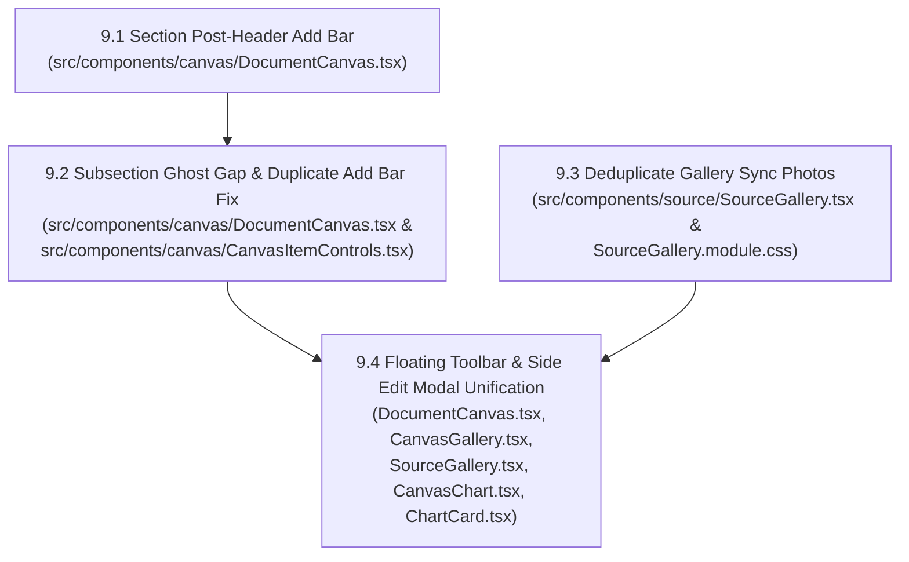

# Epic 9: Developer Mode Canvas Authoring Controls, Insertion Bars & Modal Unification

> **Status:** Planned & Ready for Execution  
> **Alignment Directive:** Strictly aligned with [Epic 7 SSOT Architecture](file:///Users/francisdave/Documents/folio/docs/task/archives/TASKS-EPIC-7.md) (Cloudflare KV `draft:workspace` authority and self-contained `NodeCanvasDocument` AST).  
> **Prevalence Notice:** Governed by [.agents/skills/karpathy-rules/SKILL.md](file:///Users/francisdave/Documents/folio/.agents/skills/karpathy-rules/SKILL.md), [.agents/skills/feature-dev/SKILL.md](file:///Users/francisdave/Documents/folio/.agents/skills/feature-dev/SKILL.md), [.agents/skills/superpowers/SKILL.md](file:///Users/francisdave/Documents/folio/.agents/skills/superpowers/SKILL.md), and [.agents/rules/design-system-first.md](file:///Users/francisdave/Documents/folio/.agents/rules/design-system-first.md).

---

## 🎯 Executive Overview & Root-Cause Diagnosis

A forensic inspection of Developer Mode (`isDevMode && isDesktop`) on `DocumentCanvas`, `CanvasItemControls`, `SourceGallery`, and `ChartCard` identified four concrete authoring UX regressions:

1. **Missing `+ Add Element` Bar After Canvas Sections (`DocumentCanvas.tsx#L618-L626`)**:
   - **Diagnosis:** Inside `<CanvasSection>`, the post-header insertion bar (`barId="sec-top-${section.id}"`) is gated by `{isAuthoringActive && (section.elements || []).length === 0 && (...)}`. Whenever a section contains one or more child elements (`section.elements.length > 0`, which is true for every populated section), `sec-top-${section.id}` is completely suppressed. Consequently, there is **never** an `+ Add Element` bar immediately after a section's header (`<h2>Section 01 / Title</h2>`), making it impossible to insert a new element at index `0` right below the section heading.
   - **Solution:** Render `sec-top-${section.id}` unconditionally whenever `isAuthoringActive` is `true` so every section heading is always followed by exactly one `+ Add Element` insertion bar targeting `(section.id, 0)`.

2. **Ghost "Element" & Duplicate `+ Add Element` Bars After Canvas Subsections (`DocumentCanvas.tsx#L644-L740`, `CanvasItemControls.tsx#L128`)**:
   - **Diagnosis:** Three interacting structural defects occur in subsection rendering:
     1. When a subsection is empty (`validSubLeaves.length === 0`), `DocumentCanvas.tsx` renders `<CanvasAddBar barId="sub-top-${child.id}" />` inside `<CanvasSubsection>` (`subsectionBody`) **and** immediately renders a second `<CanvasAddBar barId="sub-${child.id}" />` right after `</CanvasSubsection></CanvasItemControls>` (`L730-L738`).
     2. When a subsection has leaves (`validSubLeaves.length > 0`), `sub-top-${child.id}` is hidden (`validSubLeaves.length === 0`), while the last leaf renders `leaf-${subLeaf.id}` inside `subsectionBody` **and** `sub-${child.id}` is rendered right outside `</CanvasSubsection>`, again stacking **two** `+ Add Element` bars back-to-back.
     3. Because `<CanvasItemControls itemType="subsection">` wraps the entire `<CanvasSubsection>` container (including `subsectionBody` and its `var(--space-6)` bottom margin), the 48px vertical gap between the inner `CanvasAddBar` and the outer `sub-${child.id}` `CanvasAddBar` remains part of `div.itemControlsWrapper[data-canvas-item-type="subsection"]`. Hovering that empty gap triggers `.itemControlsFloatingBar` (`top: 50%`) over blank space—appearing as a **"ghost element"** sitting between two `+ Add Element` bars.
   - **Solution:**
     - Render `sub-top-${child.id}` unconditionally when `isAuthoringActive` is `true` (so every subsection heading is always followed by one `+ Add Element` bar at index `0` of the subsection).
     - Remove the duplicate trailing `sub-${child.id}` `<CanvasAddBar>` (`L730-L738`).
     - In `handleExecuteAdd`, when a coordinator selects `Subsection` from an insertion bar inside a subsection (`targetSubsectionId` present), insert the new subsection into the parent section at `subIdx + 1`.
     - Anchor `itemType === 'subsection'` floating controls near the heading top (`sectionFloatingBar`) in `CanvasItemControls.tsx` so the toolbar never floats over empty body space.

3. **Duplicate Sync Photos Button on Galleries (`SourceGallery.tsx#L467-L481` vs `L519-L533`)**:
   - **Diagnosis:** In Developer Mode (`isDevActive`), `SourceGallery.tsx` renders two separate sync buttons wired to the exact same `handleManualSync` callback and `aria-label="Sync photos from Google Drive"`:
     1. The canonical administrative side button `<Button className={styles.sideSyncBtn}>↻ Sync</Button>` inside `styles.sideEditWrapper` beside the gallery card (`L467-L481`, matching `ChartCard.tsx`).
     2. A legacy footer button `<button className={styles.syncButton}>↻ Sync Photos</button>` inside `styles.footerRight` at the bottom-right of the gallery (`L519-L533`).
   - **Solution:** Remove the duplicate `styles.footerRight` `↻ Sync Photos` button block (`L519-L533`) in `SourceGallery.tsx` (and associated dead CSS rules in `SourceGallery.module.css`), retaining the single canonical `↻ Sync` button in `sideEditWrapper` right below `✎ Edit`.

4. **Floating Toolbar Edit (`CanvasItemControls`) Does Not Use the Same Modal as the Side `✎ Edit` Button (`DocumentCanvas.tsx`, `SourceGallery.tsx`, `ChartCard.tsx`)**:
   - **Diagnosis:** Both canvas elements that feature a side `✎ Edit` button (`sideEditWrapper`) diverge when edited via the top floating toolbar (`CanvasItemControls`):
     - **Gallery (`CanvasGallery` / `SourceGallery`)**: Clicking the side `✎ Edit` button beside the gallery (`SourceGallery.tsx#L458`) opens `<LinkFolderModal>` (`"Link Folder"`, which includes `Folder Label`, `Google Drive Folder URL`, the `Verify` button, `Test Link ↗`, and the mandatory Google Drive API folder verification gate). Clicking the Edit icon (`✎`) on the floating toolbar (`CanvasItemControls`) calls `DocumentCanvas.handleEditLeaf(leaf)` (`L310-L325`), which opens `<UniversalEditModal elementType="gallery">` (`"Edit Gallery"`—a completely different modal lacking Drive folder verification).
     - **Chart (`CanvasChart` / `ChartCard`)**: Clicking the side `✎ Edit` button beside the chart (`ChartCard.tsx#L266`) opens `ChartCard`'s internal `<ChartConfigDrawer>` pre-populated with `initialConfig={config || undefined}` and wired to `onDeployed={onConfigUpdated}`. Clicking the Edit icon (`✎`) on the floating toolbar (`CanvasItemControls`) calls `DocumentCanvas.handleEditLeaf(leaf)` (`L287-L294`), which opens `DocumentCanvas`'s `<ChartConfigDrawer>` (`L834-L882`) **without `initialConfig`** (opening blank in Step 1) and **without an `edit` branch in `onDeployed`** (silently discarding edits on deploy).
   - **Solution:**
     - **Gallery Unification:** Route floating toolbar Edit (`handleEditLeaf` for `leaf.type === 'gallery'`) and side `✎ Edit` in `SourceGallery` to the **exact same `<LinkFolderModal>`** (with full Drive verification and AST persistence via `handleUpdateGallery`).
     - **Chart Unification:** Extend `ActiveChartDrawerState` in `DocumentCanvas.tsx` with `elementId?: string` and `initialConfig?: SheetChartConfig`, pass `initialConfig` into `<ChartConfigDrawer>`, persist `mode === 'edit'` deployments via `updateItem<ChartElement>`, and wire `CanvasChart` / `ChartCard`'s side `✎ Edit` button to invoke the unified `onEdit` handler so both triggers open the exact same drawer instance.

---

## 🗺️ Subtasks Index

| Subtask ID | Title | Scope | File Reference | Status |
| :--- | :--- | :--- | :--- | :--- |
| **9.1** | [Unconditional Post-Header Insertion Bar for Canvas Sections](file:///Users/francisdave/Documents/folio/docs/task/9.1-canvas-section-post-header-add-bar.md) | Always render `sec-top-${section.id}` `CanvasAddBar` immediately after every `<CanvasSection>` heading in Dev Mode so elements can be inserted at index `0` of any section | `docs/task/9.1-canvas-section-post-header-add-bar.md` | Done |
| **9.2** | [Eliminate Subsection Ghost Hover Zone & Duplicate Insertion Bars](file:///Users/francisdave/Documents/folio/docs/task/9.2-canvas-subsection-ghost-gap-and-duplicate-add-bar-fix.md) | Render `sub-top-${child.id}` unconditionally after subsection headings, remove duplicate `sub-${child.id}` bar, fix subsection-from-subsection insertion index, and anchor subsection toolbar at top | `docs/task/9.2-canvas-subsection-ghost-gap-and-duplicate-add-bar-fix.md` | Done |
| **9.3** | [Deduplicate Gallery Sync Photos Affordance in `SourceGallery`](file:///Users/francisdave/Documents/folio/docs/task/9.3-gallery-duplicate-sync-photos-button-removal.md) | Remove legacy `footerRight` `↻ Sync Photos` button in `SourceGallery.tsx`, preserving the single canonical `sideSyncBtn` in `sideEditWrapper` | `docs/task/9.3-gallery-duplicate-sync-photos-button-removal.md` | Done |
| **9.4** | [Unify Floating Toolbar Edit Action with Side `✎ Edit` Button Modals](file:///Users/francisdave/Documents/folio/docs/task/9.4-floating-toolbar-and-side-edit-modal-unification.md) | Unify Gallery floating toolbar Edit + side `✎ Edit` onto `LinkFolderModal`, and unify Chart floating toolbar Edit + side `✎ Edit` onto a single `ChartConfigDrawer` with `initialConfig` & AST persistence | `docs/task/9.4-floating-toolbar-and-side-edit-modal-unification.md` | Done |

---

## 🔄 Sequence & Dependency Graph

---

## 🛡️ Quality Verification Gates

Before marking Epic 9 complete:
- [ ] `npm run test:tokens` passes with 100% token purity and zero raw hex/pixel violations.
- [ ] `npm test` passes across all unit and integration suites (including new regression tests for subtasks `9.1`–`9.4`).
- [ ] `npm run build` and `tsc --noEmit` complete with zero TypeScript diagnostics.
- [x] **Section Insertion Invariant:** Every section in Dev Mode displays a single `+ Add Element` bar immediately below its heading (`sec-top-${section.id}`), both when empty and when populated.
- [ ] **Subsection Insertion Invariant:** Every subsection in Dev Mode displays a single `+ Add Element` bar immediately below its heading (`sub-top-${child.id}`) with zero ghost hover zones and zero back-to-back duplicate `+ Add Element` bars.
- [x] **Single Gallery Sync Button Invariant:** `SourceGallery` renders exactly one `↻ Sync` button (in `sideEditWrapper` beside `✎ Edit`) in Dev Mode.
- [x] **Modal Identity Invariant:** Clicking Edit (`✎`) on the floating toolbar (`CanvasItemControls`) and clicking `✎ Edit` beside a canvas element open the exact same modal/drawer instance with identical initial state and save behavior.
