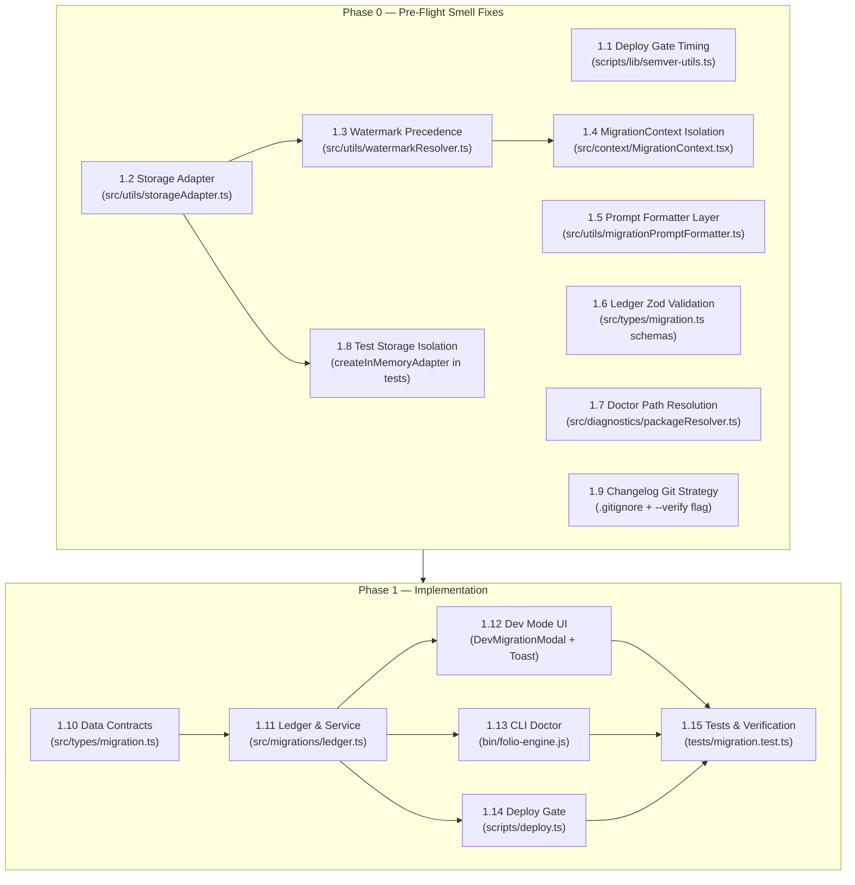

# Unified Tasks: Folio Engine Migration Ledger & Consumer Drift Protection

> **Status:** Planned & Ready for Execution  
> **Prevalence Notice:** Governed by [.agents/skills/feature-dev/SKILL.md](file:///Users/francisdave/Documents/folio/.agents/skills/feature-dev/SKILL.md), [.agents/skills/karpathy-rules/SKILL.md](file:///Users/francisdave/Documents/folio/.agents/skills/karpathy-rules/SKILL.md), and [.agents/rules/design-system-first.md](file:///Users/francisdave/Documents/folio/.agents/rules/design-system-first.md).

---

## 🎯 Executive Overview

Folio Engine (`@devcabs/folio-engine`) is consumed by standalone portfolio and client applications. When engine versions bump with schema changes, new token requirements, or AST adjustments, consumer apps frequently break due to untracked migration steps and unnoticed content drift.

This initiative introduces a comprehensive 3-pillar safety system:
1. **Single Typed Migration Ledger (`src/migrations/ledger.ts`)**: Single source of truth containing every version transition, breaking code changes, and required content changes. Auto-generates `CHANGELOG.md` and blocks releases in `scripts/deploy.ts` if entries are missing.
2. **AI Agent Guidance (`npx folio-engine doctor` & Agent Rule)**: CLI doctor and agent instructions that allow AI coding assistants managing consumer apps to immediately identify and execute code/content migrations.
3. **In-App Dev Mode Notification (`DevMigrationModal` + Action Toast)**: When entering Dev Mode in a consumer app, the engine detects pending content changes between the app's `contentVersion` watermark and the current engine version, prompting the user with an actionable review modal and a copyable AI migration prompt.

---

## 🗺️ Subtasks Index

### Phase 0 — Pre-Flight: Smell Fixes (Foundations)

> Must be completed before any implementation task. These establish the architectural contracts, isolation boundaries, and safety rails that all subsequent tasks depend on.

| Subtask ID | Title | Scope | File Reference | Status |
| :--- | :--- | :--- | :--- | :--- |
| **1.1** | [Pre-Flight: Deploy Gate Version Pre-Calculation](file:///Users/francisdave/Documents/folio/docs/task/1.1-preflight-deploy-gate-timing.md) | Semver utils + gate fires before `npm version` to prevent orphan tags | `docs/task/1.1-preflight-deploy-gate-timing.md` | Pending |
| **1.2** | [Pre-Flight: Storage Adapter & SSR Safety](file:///Users/francisdave/Documents/folio/docs/task/1.2-preflight-storage-ssr-safety.md) | `StorageAdapter` interface + `createInMemoryAdapter()` — no direct `localStorage` calls | `docs/task/1.2-preflight-storage-ssr-safety.md` | Completed |
| **1.3** | [Pre-Flight: Watermark Precedence Contract](file:///Users/francisdave/Documents/folio/docs/task/1.3-preflight-watermark-precedence.md) | `resolveContentWatermark()` — single strict rule for config vs runtime watermark | `docs/task/1.3-preflight-watermark-precedence.md` | Pending |
| **1.4** | [Pre-Flight: MigrationContext Isolation](file:///Users/francisdave/Documents/folio/docs/task/1.4-preflight-migration-context-isolation.md) | New `MigrationContext.tsx` as sibling — zero coupling to `DeveloperModeContext` | `docs/task/1.4-preflight-migration-context-isolation.md` | Completed |
| **1.5** | [Pre-Flight: AI Prompt Formatter Extraction](file:///Users/francisdave/Documents/folio/docs/task/1.5-preflight-prompt-formatter-layer.md) | `migrationPromptFormatter.ts` pure util — formatter out of service layer | `docs/task/1.5-preflight-prompt-formatter-layer.md` | Completed |
| **1.6** | [Pre-Flight: Ledger Runtime Zod Validation](file:///Users/francisdave/Documents/folio/docs/task/1.6-preflight-ledger-runtime-validation.md) | Zod schemas as named exports + validate ledger at module load time | `docs/task/1.6-preflight-ledger-runtime-validation.md` | Completed |
| **1.7** | [Pre-Flight: Doctor Monorepo-Safe Resolution](file:///Users/francisdave/Documents/folio/docs/task/1.7-preflight-doctor-path-resolution.md) | `packageResolver.ts` using `require.resolve` — no brittle CWD assumptions | `docs/task/1.7-preflight-doctor-path-resolution.md` | Completed |
| **1.8** | [Pre-Flight: Test Storage Isolation](file:///Users/francisdave/Documents/folio/docs/task/1.8-preflight-test-storage-isolation.md) | `beforeEach` adapter injection + no global `localStorage` in tests | `docs/task/1.8-preflight-test-storage-isolation.md` | Completed |
| **1.9** | [Pre-Flight: Changelog Git Strategy](file:///Users/francisdave/Documents/folio/docs/task/1.9-preflight-changelog-git-strategy.md) | `.gitignore` CHANGELOG + `--dry-run`/`--verify` flags + CI hook | `docs/task/1.9-preflight-changelog-git-strategy.md` | Completed |

### Phase 1 — Implementation

| Subtask ID | Title | Scope | File Reference | Status |
| :--- | :--- | :--- | :--- | :--- |
| **1.10** | [Migration Data Contracts & Config](file:///Users/francisdave/Documents/folio/docs/task/1.10-migration-data-contracts.md) | Define TypeScript contracts + Zod schemas for migration entries, extend `EngineConfig` | `docs/task/1.10-migration-data-contracts.md` | Completed |
| **1.11** | [Migration Ledger & Runtime Service](file:///Users/francisdave/Documents/folio/docs/task/1.11-migration-ledger-and-service.md) | Implement `src/migrations/ledger.ts` and `src/services/migrationService.ts` with baseline history | `docs/task/1.11-migration-ledger-and-service.md` | Completed |
| **1.12** | [Dev Mode Notification & Review Modal](file:///Users/francisdave/Documents/folio/docs/task/1.12-dev-mode-notification-and-modal.md) | Build `DevMigrationModal`, Dev Mode toast trigger, and `DevModeBadge` indicator pill | `docs/task/1.12-dev-mode-notification-and-modal.md` | Pending |
| **1.13** | [CLI Doctor & AI Migration Agent Rules](file:///Users/francisdave/Documents/folio/docs/task/1.13-cli-doctor-and-agent-reminders.md) | Create `npx folio-engine doctor` CLI runner and `.agents/rules/folio-engine-migration.md` | `docs/task/1.13-cli-doctor-and-agent-reminders.md` | Completed |
| **1.14** | [Hard Deploy Gate & Auto-Changelog](file:///Users/francisdave/Documents/folio/docs/task/1.14-deploy-release-gate-and-changelog.md) | Enforce ledger entry in `scripts/deploy.ts` and compile `CHANGELOG.md` via `--verify` gate | `docs/task/1.14-deploy-release-gate-and-changelog.md` | Completed |
| **1.15** | [Verification, Unit Tests & Quality Gates](file:///Users/francisdave/Documents/folio/docs/task/1.15-testing-and-verification.md) | Comprehensive test suite for ledger integrity, diff computation, and token audits | `docs/task/1.15-testing-and-verification.md` | Completed |

---

## 🔄 Sequence & Dependency Graph

---

## 🛡️ Quality Verification Gates

Before completing the overall task:
- [x] `npm run test:tokens` passes with 0 token mismatches or raw values.
- [x] `npm test` runs with 100% passing tests (including `tests/migration.test.ts`).
- [x] `npm run build:lib` and `tsc --noEmit` succeed with zero TypeScript diagnostics.
- [x] `scripts/deploy.ts` pre-flight validation successfully blocks bump if ledger entry is omitted.
- [x] Dev Mode entry in consumer test scenario prompts toast and opens `DevMigrationModal`.

