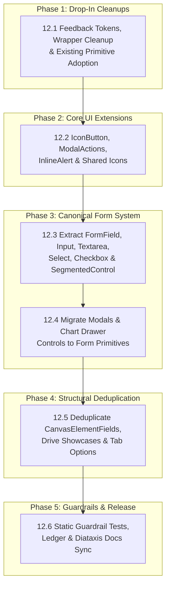

# Epic 12: Canonical UI Primitives & Anti-Duplication Consolidation

> **Status:** Completed  
> **Alignment Directive:** Strictly aligned with [Canonical UI Enforcement](file:///Users/francisdave/Documents/folio/.agents/rules/canonical-ui-enforcement.md), [Design System First](file:///Users/francisdave/Documents/folio/.agents/rules/design-system-first.md), [UI Standards](file:///Users/francisdave/Documents/folio/.agents/rules/ui-standards.md), and [Editorial Restraint](file:///Users/francisdave/Documents/folio/.agents/rules/editorial-restraint.md).  
> **Prevalence Notice:** Governed by [.agents/skills/karpathy-rules/SKILL.md](file:///Users/francisdave/Documents/folio/.agents/skills/karpathy-rules/SKILL.md), [.agents/skills/feature-dev/SKILL.md](file:///Users/francisdave/Documents/folio/.agents/skills/feature-dev/SKILL.md), [.agents/skills/superpowers/SKILL.md](file:///Users/francisdave/Documents/folio/.agents/skills/superpowers/SKILL.md), [.agents/rules/coding-standards.md](file:///Users/francisdave/Documents/folio/.agents/rules/coding-standards.md), [.agents/rules/package-boundary.md](file:///Users/francisdave/Documents/folio/.agents/rules/package-boundary.md), [.agents/rules/folio-engine-migration.md](file:///Users/francisdave/Documents/folio/.agents/rules/folio-engine-migration.md), and [.agents/rules/docs-sync.md](file:///Users/francisdave/Documents/folio/.agents/rules/docs-sync.md).

---

## 🎯 Executive Overview & Architectural Scope

A full UI audit of `src/components/` (including Epic 11 PDF additions) identified widespread non-canonical drift: **71** raw `<button>` elements bypassing `Button`, **89** raw `<input>`/`<textarea>`/`<select>` elements lacking canonical form primitives, **9** hardcoded `rgba()`/`#ffffff` declarations in feedback CSS, cross-component CSS module borrowing (`EditDocumentModal.tsx` importing `./EditPhotoModal.module.css`), duplicated inline `<svg>` icons, ad-hoc external action links (`Open ↗`), ad-hoc badge spans, and near-duplicate modal/showcase shells (`CanvasAddModal` vs. `UniversalEditModal`, `SourceGallery` vs. `SourceDocuments`).

Epic 12 resolves these gaps in ordered, low-risk phases—from drop-in token and primitive cleanups, to extending core UI primitives, to extracting missing form primitives, to structural deduplication, and finally locking in automated regression tests so non-canonical UI cannot recur.

### Explicit Non-Goals (Abstraction Fit Boundaries)
To prevent premature or over-parameterized abstractions, the following are **explicitly left separate**:
- **Ghost Wireframes & Skeletons** (`CanvasGhostWireframe`, `ChartGhostWireframe`, `HeroWelcomeGhostWireframe`, `SourceGallerySkeleton`) — bespoke SVG/grid geometries matching distinct domain layouts.
- **Empty & Pending States** (`EmptyState`, `CanvasEmptyNotice`, `DataPendingCard`) — distinct semantic roles (generic empty region vs. draft notice with `ParametricShape` vs. chart diagnostic fallback); only `EmptyState`'s raw `<button>` is migrated to `Button`.
- **Fullscreen Media Lightbox** (`SourceLightbox`) — full-bleed zoom/swipe stage with idle-chrome hiding; not forced onto card-centered `Modal` (only adopts `IconButton` for close/nav controls).

---

## 🧭 Phase Breakdown & Subtasks Index

| Phase | Subtask ID | Title | Scope | File Reference | Status |
| :--- | :--- | :--- | :--- | :--- | :--- |
| **Phase 1: Drop-In Cleanups** | **12.1** | [Drop-In Canonical Cleanups & Feedback Token Purity](file:///Users/francisdave/Documents/folio/docs/task/12.1-drop-in-canonical-cleanups-and-feedback-tokens.md) | Replace 9 hardcoded `rgba()`/`#ffffff` declarations in `feedback/*.module.css`, remove `layout/StatusPill.tsx` wrapper, adopt `Button`/`StatusPill` in `EmptyState`, `CanvasPdf`, `PdfPreviewModal`, `SourceDocuments`, and `Step1Source*` | `docs/task/12.1-drop-in-canonical-cleanups-and-feedback-tokens.md` | Completed |
| **Phase 2: Core UI Extensions** | **12.2** | [Canonical `IconButton`, `ModalActions`, `InlineAlert` & Shared Icons](file:///Users/francisdave/Documents/folio/docs/task/12.2-canonical-icon-button-modal-footer-and-icons.md) | Add `IconButton` (or `Button` `iconOnly`/`danger`), `Modal` `footer`/`ModalActions`, `InlineAlert`, and shared SVG icon primitives (`DocumentIcon`, edit/trash); migrate raw icon/close buttons and modal footers | `docs/task/12.2-canonical-icon-button-modal-footer-and-icons.md` | Completed |
| **Phase 3A: Form Primitives** | **12.3** | [Canonical Form Primitives (`FormField`, `Input`, `Textarea`, `Select`, `Checkbox`, `SegmentedControl`)](file:///Users/francisdave/Documents/folio/docs/task/12.3-canonical-form-primitives-extraction.md) | Lock missing form tokens in `tokens.css` and TDD-build canonical `FormField`, `Input`, `Textarea`, `Select`, `Checkbox` (generalizing `ValueLabelToggle`/`AxisBaselineToggle`), and `SegmentedControl` in `src/components/ui/` | `docs/task/12.3-canonical-form-primitives-extraction.md` | Completed |
| **Phase 3B: Form Adoption** | **12.4** | [Migrate Feature Modals & Chart Drawer Controls to Canonical Form Primitives](file:///Users/francisdave/Documents/folio/docs/task/12.4-migrate-modals-and-chart-drawer-to-form-primitives.md) | Migrate `EditPhotoModal`, `EditDocumentModal` (eliminating cross-CSS borrowing), `LinkFolderModal`, `DevPublishModal`, and chart drawer controls/panels to canonical form primitives | `docs/task/12.4-migrate-modals-and-chart-drawer-to-form-primitives.md` | Completed |
| **Phase 4: Structural Dedup** | **12.5** | [Structural Deduplication: Canvas Element Forms, Drive Showcases & Tab Options](file:///Users/francisdave/Documents/folio/docs/task/12.5-structural-deduplication-canvas-forms-and-drive-showcases.md) | Extract shared `CanvasElementFields` (`CanvasAddModal` + `UniversalEditModal`, unifying `isNumbered` drift), shared Drive sync error helper & `SourceFolderActionBar` (`SourceGallery` + `SourceDocuments`, adopting `showToast`), and `buildTabOptions` (`Step1Source*`) | `docs/task/12.5-structural-deduplication-canvas-forms-and-drive-showcases.md` | Completed |
| **Phase 5: Guardrails & Release** | **12.6** | [Canonical UI Guardrail Tests, Version Doctor Ledger & Diátaxis Docs Sync](file:///Users/francisdave/Documents/folio/docs/task/12.6-canonical-ui-regression-tests-ledger-and-docs-sync.md) | Add static enforcement tests for `canonical-ui-enforcement.md`, record new public UI exports in `src/migrations/ledger.ts`, update `CHANGELOG.md` and Diátaxis docs, and run full quality/token/build/doctor gates | `docs/task/12.6-canonical-ui-regression-tests-ledger-and-docs-sync.md` | Completed |

---

## 🔄 Sequence & Dependency Graph

---

## 🛡️ Quality, Token, Migration & Restraint Gates

Before marking Epic 12 complete, every gate below must pass:
- [ ] **Canonical UI Enforcement Gate (`canonical-ui-enforcement.md`)**: Zero unauthorized raw `<button>`, `<input>`, `<textarea>`, `<select>`, cross-component `.module.css` imports, or duplicated inline `<svg>` icons outside `src/components/ui/`.
- [ ] **Design System Token Gate (`design-system-first.md`)**: Zero hardcoded `#hex`, `rgb()`, `rgba()`, `hsl()`, or `hsla()` values in `src/components/**/*.module.css`; `npm run test:tokens` passes 100%.
- [ ] **4-State Interactive Matrix & Universal Zero Outline Policy (`ui-standards.md`)**: Every canonical primitive enforces Default, Hover, Active/Pressed, Focus-Visible (`outline: none`), and Disabled/Loading states with WCAG 2.1 AA accessibility.
- [ ] **TDD & Surgical Scope (`superpowers` & `karpathy-rules`)**: Every new primitive has unit/a11y tests written first in `tests/`; changes are strictly scoped without behavioral regressions.
- [ ] **Version Doctor & Migration Ledger Gate (`folio-engine-migration.md`)**: New public UI exports in `src/index.ts` are logged in `src/migrations/ledger.ts`, compiled into `CHANGELOG.md`, and verified via `npm run verify:migrations` and `npm run doctor`.
- [ ] **Diátaxis Documentation Sync (`docs-sync.md`)**: `docs/folio-engine/reference/01-public-api-exports.md` and `docs/folio-engine/reference/03-components.md` updated in lockstep.
- [ ] **Package Boundary (`package-boundary.md`)**: Zero files modified outside `/Users/francisdave/Documents/folio`.
- [ ] **Compiler & Build Gates**: `npx tsc --noEmit`, `npm test`, `npm run build`, and `npm run build:lib` pass with zero errors.
