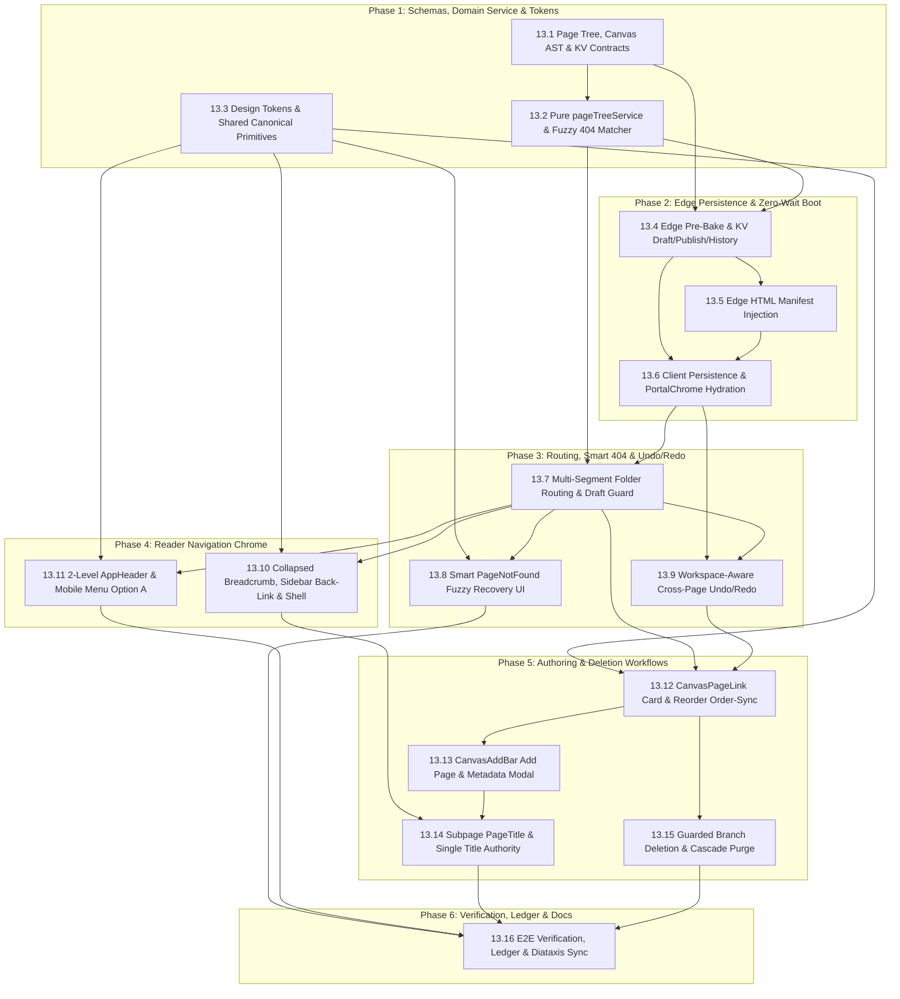

# Epic 13: Dynamic Multi-Page & Nested Subpage Architecture

> **Status:** Completed  
> **Product Source of Truth (PRD):** [Epic 13 PRD: Dynamic Multi-Page & Nested Subpage Architecture](file:///Users/francisdave/Documents/folio/docs/whiteboard/EPIC-13-dynamic-nested-pages/13-PRD.md)  
> **Alignment Directive:** Strictly aligned with [Canonical UI Enforcement](file:///Users/francisdave/Documents/folio/.agents/rules/canonical-ui-enforcement.md), [Design System First](file:///Users/francisdave/Documents/folio/.agents/rules/design-system-first.md), [UI Standards](file:///Users/francisdave/Documents/folio/.agents/rules/ui-standards.md), [UX Psychology](file:///Users/francisdave/Documents/folio/.agents/rules/ux-psychology.md), and [Editorial Restraint](file:///Users/francisdave/Documents/folio/.agents/rules/editorial-restraint.md).  
> **Prevalence Notice:** Governed by [.agents/skills/karpathy-rules/SKILL.md](file:///Users/francisdave/Documents/folio/.agents/skills/karpathy-rules/SKILL.md), [.agents/skills/feature-dev/SKILL.md](file:///Users/francisdave/Documents/folio/.agents/skills/feature-dev/SKILL.md), [.agents/skills/superpowers/SKILL.md](file:///Users/francisdave/Documents/folio/.agents/skills/superpowers/SKILL.md), [.agents/skills/version-doctor/SKILL.md](file:///Users/francisdave/Documents/folio/.agents/skills/version-doctor/SKILL.md), [.agents/rules/coding-standards.md](file:///Users/francisdave/Documents/folio/.agents/rules/coding-standards.md), [.agents/rules/package-boundary.md](file:///Users/francisdave/Documents/folio/.agents/rules/package-boundary.md), [.agents/rules/folio-engine-migration.md](file:///Users/francisdave/Documents/folio/.agents/rules/folio-engine-migration.md), and [.agents/rules/docs-sync.md](file:///Users/francisdave/Documents/folio/.agents/rules/docs-sync.md).

---

## 🎯 Executive Overview & Architectural Scope

Today, Folio Engine (`@devcabs/folio-engine`) supports rich in-page authoring via `DocumentCanvas` (`sections`, `subsections`, `text`, `photo`, `gallery`, `chart`, `pdf`, `documents`), while page structure itself is flat and static—restricted to single-level root milestones in `EngineConfig.nodes` and single-segment routing (`/node/:id/`) inside `useHashRoute`.

Epic 13 elevates Folio Engine into a **structured editorial knowledge base** while preserving the calm stepped scrollytelling roadmap on the home page:
1. **Normalized Dynamic Page Tree (`PageNode`)**: Main chapters remain fixed in `EngineConfig.nodes`; editors in Developer/Coordinator Mode can create, rename, reorder, and delete subpages at **arbitrary nesting depth** beneath any chapter using a forward-compatible `parentId: string | null` registry persisted across Cloudflare KV (`draft:workspace`, `portal:manifest`, `history:snapshot:*`, `node:*`).
2. **Zero-Wait Folder URLs & Smart 404 Recovery**: Clean folder-style paths (`/node/<chapter>/<subpage>/.../`) resolve synchronously on millisecond 0 via Edge HTML injection (`window.__FOLIO_MANIFEST__`) + optimistic chapter-prefix fallback during local dev hydration, paired with a fuzzy-matched Smart `PageNotFound` recovery view (`token overlap + Levenshtein distance + substring scoring` + direct **"Return to `<Nearest Valid Parent>`"** CTA).
3. **Calm Reader Orientation**:
   - `EditorialSidebar` remains 100% dedicated to the **current page's Sections & Subsections** (never a nested page tree), while its sticky top back-link dynamically returns to `< <Parent Page Title>` on subpages and `< Roadmap` on root chapters.
   - `Breadcrumb` collapses middle ancestors into a **non-interactive `…` ellipsis** when `items.length > 4`.
   - `AppHeader` presents main chapters on both Home and Node routes (`mobileOnlyNav={false}`) in a single-row floating glass capsule with **solid-surface Level 2 dropdowns** (`var(--folio-bg-surface)` + `var(--shadow-md)`, zero glass-on-glass blur), and ports this strictly 2-level hierarchy into the mobile hamburger menu (**Option A** — zero in-page section clutter).
4. **1:1 Card-to-Subpage Lifecycle & Single Title Authority**: Adding a subpage via `CanvasAddBar` ("Add Page") atomically creates its `PageNode`, initializes its empty canvas, and inserts a full-width editorial `CanvasPageLink` card. Editing via either the card's `✎ Edit` button or the subpage's `<PageTitle>` edits the exact same `PageNode`. Deleting a Page Link card triggers a guarded confirmation modal (standard confirmation for leaf pages; typed phrase `DELETE ALL SUBPAGES` with exact descendant count for branch pages) and atomically removes the card, `PageNode` subtree, and purged canvases via `deletedPageIds`—making ghost/orphan pages impossible.
5. **Workspace-Aware Cross-Page Undo/Redo Engine**: Upgrades `UndoRedoManager` / `UndoRedoContext` and `useDocumentCanvas` from fragile unmounted React hook `documentRef` closures to self-contained workspace-addressed atomic commands (`canvases` + `pages` + `deletedPageIds`) with automatic route reconciliation if an undo/redo removes or renames the currently viewed page.

### Explicit Non-Goals (Epic 13 v1)
To maintain editorial restraint and scope discipline, the following are **explicitly excluded from v1**:
- **Dynamic creation/deletion of top-level Home Roadmap chapters**: Main chapters stay anchored to `EngineConfig.nodes` so the home page scrollytelling roadmap and `PhotoFlightEngine` remain visually predictable and protected.
- **Separate "Page Manager" Drawer in v1**: Cut from v1. Because the Page Link card and subpage share a 1:1 lifecycle, orphan pages cannot exist and the canvas itself is the sole, intuitive management surface.
- **Cross-chapter / arbitrary reparenting UI ("Move to…") in v1**: Deferred to a future epic; however, `PageNode.parentId: string | null` and `pageTreeService.reparentPageNode` (with circular-reparenting cycle detection) MUST ship in v1 so future reparenting requires zero schema migrations.
- **Automatic URL redirect tables**: Renaming/reorganizing a page is permitted to change its folder-style URL; broken links are handled gracefully by Smart `PageNotFound`.
- **Full tree navigation inside `EditorialSidebar`**: The left reading sidebar never renders a Notion-style nested file tree.
- **In-page section lists inside the mobile hamburger menu**: Mobile hamburger menu strictly renders the 2-level chapter & Level 2 subpage hierarchy (Option A).
- **Showing Level 3+ pages in `AppHeader`**: Top bar navigation is strictly capped at 2 levels (main chapters + direct Level 2 subpages).
- **Interactive breadcrumb ellipsis**: The collapsed `…` indicator in deep breadcrumbs is purely visual (``, non-clickable, zero popover).

---

## 🧭 Phase Breakdown & Subtasks Index

| Phase | Subtask ID | Title | Scope | Dependencies | File Reference | Status |
| :--- | :--- | :--- | :--- | :--- | :--- | :--- |
| **Phase 1: Schemas, Domain & Tokens** | **13.1** | [Page Tree, Canvas AST & Edge KV Data Contracts](file:///Users/francisdave/Documents/folio/docs/task/13.1-page-tree-canvas-ast-and-edge-kv-contracts.md) | Define `PageNode` + `PageNodeSchema`, add `pages?` & `deletedPageIds?` across KV/Manifest/Snapshot/Draft contracts, add `PageLinkElement` + `PageLinkElementSchema` & guards, workspace `UndoActionType`s, and 2-level `NavItem` fields | None | `docs/task/13.1-page-tree-canvas-ast-and-edge-kv-contracts.md` | Completed |
| **Phase 1: Schemas, Domain & Tokens** | **13.2** | [Pure Page Tree Domain Service & Smart 404 Fuzzy Matcher](file:///Users/francisdave/Documents/folio/docs/task/13.2-pure-page-tree-service-and-fuzzy-404-matcher.md) | Build pure immutable `src/services/pageTreeService.ts`: CRUD, slug sanitization & sibling-only uniqueness, `reparentPageNode` with cycle detection, canvas-driven order sync, path/ancestor/2-level-nav resolvers, and fuzzy 404 matcher + nearest ancestor | `13.1` | `docs/task/13.2-pure-page-tree-service-and-fuzzy-404-matcher.md` | Completed |
| **Phase 1: Schemas, Domain & Tokens** | **13.3** | [Design System Tokens & Shared Canonical UI Primitives](file:///Users/francisdave/Documents/folio/docs/task/13.3-design-tokens-and-shared-canonical-primitives.md) | Lock Epic 13 semantic tokens in `src/styles/tokens.css`, extract shared thin-stroke `PageIcon` SVG primitive in `src/components/ui/`, and verify post-Epic 12 canonical primitives (`Input`, `FormField`, `IconButton`, `InlineAlert`, `ModalActions`, `Icons`, `Button` `danger`) | None | `docs/task/13.3-design-tokens-and-shared-canonical-primitives.md` | Completed |
| **Phase 2: Edge Persistence & Boot** | **13.4** | [Edge Pre-Bake Compiler & Cloudflare KV Draft / Publish / History Handlers](file:///Users/francisdave/Documents/folio/docs/task/13.4-edge-prebake-and-kv-draft-publish-history-handlers.md) | Update `edgePreBakeService`, `draftHandler` (`pages` + `deletedPageIds` purge), `publishHandler` (stage `page-*` nodes + `pages`), `historyHandler` (restore `pages` / baseline reset), and verify `publicHandler` | `13.1`, `13.2` | `docs/task/13.4-edge-prebake-and-kv-draft-publish-history-handlers.md` | Completed |
| **Phase 2: Edge Persistence & Boot** | **13.5** | [Edge HTML `window.__FOLIO_MANIFEST__` Injection Middleware](file:///Users/francisdave/Documents/folio/docs/task/13.5-edge-html-manifest-injection-middleware.md) | Inject active `portal:manifest` JSON into `<head>` on `text/html` asset fallthroughs in `handleFolioEdgeRequest` with strict XSS escaping, SPA multi-segment fallback, and `src/edge.ts` exports | `13.1`, `13.4` | `docs/task/13.5-edge-html-manifest-injection-middleware.md` | Completed |
| **Phase 2: Edge Persistence & Boot** | **13.6** | [Client Workspace Persistence Services & Synchronous `PortalChromeContext` Hydration](file:///Users/francisdave/Documents/folio/docs/task/13.6-client-persistence-and-synchronous-portal-chrome-hydration.md) | Extend `draftService`, `historyService`, `contentDb`, and `PortalChromeContext` for 0ms `window.__FOLIO_MANIFEST__` synchronous boot, `pages` state reactivity, and atomic `pages` + `canvases` + `deletedPageIds` persistence | `13.1`, `13.2`, `13.4`, `13.5` | `docs/task/13.6-client-persistence-and-synchronous-portal-chrome-hydration.md` | Completed |
| **Phase 3: Routing, 404 & Undo/Redo** | **13.7** | [Multi-Segment Folder Routing & Dev-Mode Draft Refresh Guard](file:///Users/francisdave/Documents/folio/docs/task/13.7-multi-segment-folder-routing-and-draft-refresh-guard.md) | Upgrade `parseRoute` & `useHashRoute` for `/node/<chapter>/<subpage>/.../` resolution, optimistic chapter-prefix `'hydrating'` guard (zero false 404 flash), and Dev Mode unpublished subpage exit/refresh redirect | `13.2`, `13.6` | `docs/task/13.7-multi-segment-folder-routing-and-draft-refresh-guard.md` | Completed |
| **Phase 3: Routing, 404 & Undo/Redo** | **13.8** | [Smart `PageNotFound` Fuzzy Recovery UI](file:///Users/francisdave/Documents/folio/docs/task/13.8-smart-page-not-found-fuzzy-recovery-ui.md) | Upgrade `PageNotFound` to canonical `Button`, primary **"Return to `<Nearest Valid Parent>`"** CTA, top 3–5 fuzzy-matched page suggestions, 4-state matrix, and wire `App.tsx` `'not-found'` route | `13.2`, `13.3`, `13.7` | `docs/task/13.8-smart-page-not-found-fuzzy-recovery-ui.md` | Completed |
| **Phase 3: Routing, 404 & Undo/Redo** | **13.9** | [Workspace-Aware Cross-Page Undo/Redo Engine](file:///Users/francisdave/Documents/folio/docs/task/13.9-workspace-aware-cross-page-undo-redo-engine.md) | Upgrade `undoRedoService`, `UndoRedoContext`, and `useDocumentCanvas` to self-contained workspace-addressed KV commands (`canvases` + `pages` + `deletedPageIds`) with automatic route reconciliation across page navigation | `13.1`, `13.6`, `13.7` | `docs/task/13.9-workspace-aware-cross-page-undo-redo-engine.md` | Completed |
| **Phase 4: Reader Navigation Chrome** | **13.10** | [Collapsed Non-Interactive `Breadcrumb`, Contextual `EditorialSidebar` Back-Link & Subpage Shell](file:///Users/francisdave/Documents/folio/docs/task/13.10-collapsed-breadcrumb-contextual-sidebar-and-subpage-shell.md) | Collapse middle ancestors into non-clickable `…` in `Breadcrumb` (`items.length > 4`), add dynamic `backLabel` (`< <Parent Page Title>` vs `< Roadmap`) to `EditorialSidebar`, and wire dynamic `PageNode` shell in `App.tsx` | `13.3`, `13.7` | `docs/task/13.10-collapsed-breadcrumb-contextual-sidebar-and-subpage-shell.md` | Completed |
| **Phase 4: Reader Navigation Chrome** | **13.11** | [2-Level Desktop `AppHeader` (Solid-Surface Dropdowns) & Mobile Hamburger Menu Port (Option A)](file:///Users/francisdave/Documents/folio/docs/task/13.11-two-level-app-header-and-mobile-menu-option-a.md) | Upgrade `AppHeader` (`mobileOnlyNav={false}` on Home & Node routes) with clickable chapters + solid-surface Level 2 dropdowns, keyboard/touch/overflow support, and strictly 2-level mobile menu (Option A) | `13.2`, `13.3`, `13.7` | `docs/task/13.11-two-level-app-header-and-mobile-menu-option-a.md` | Completed |
| **Phase 5: Authoring & Deletion** | **13.12** | [`CanvasPageLink` Editorial Card & Canvas Reorder Order-Sync](file:///Users/francisdave/Documents/folio/docs/task/13.12-canvas-page-link-card-and-reorder-order-sync.md) | Build full-width calm `CanvasPageLink` row (zero dividers, 4-state matrix, missing-target public-hidden / dev-recovery), register in `DocumentCanvas`, and sync `PageNode.order` on card reorder so `AppHeader` updates immediately | `13.1`, `13.2`, `13.3`, `13.7`, `13.9` | `docs/task/13.12-canvas-page-link-card-and-reorder-order-sync.md` | Completed |
| **Phase 5: Authoring & Deletion** | **13.13** | [`CanvasAddBar` "Add Page" Flow & Canonical Page Metadata Modal](file:///Users/francisdave/Documents/folio/docs/task/13.13-canvas-add-bar-add-page-and-metadata-modal.md) | Add "Add Page" to `CanvasAddBar` (shared `PageIcon`), wire canonical `'page-link'` fields into Epic 12's shared `CanvasElementFields` + `UniversalEditModal` (`ModalActions`, Title, auto-slugified URL Name + live mono path preview, ≤15-word summary), atomic create (`PageNode` + empty canvas + card) & card `✎ Edit` with workspace undo | `13.2`, `13.3`, `13.6`, `13.9`, `13.12` | `docs/task/13.13-canvas-add-bar-add-page-and-metadata-modal.md` | Completed |
| **Phase 5: Authoring & Deletion** | **13.14** | [Subpage `<PageTitle>` Header Defaults & Single `PageNode` Title Authority](file:///Users/francisdave/Documents/folio/docs/task/13.14-subpage-page-title-and-single-title-authority.md) | Bind subpage `<PageTitle>` to `PageNode` (`title`, `summary`), inherit root chapter `accentColor` & parent-title default kicker, and wire uniform `✎ Edit` directly to `draft.pages` so all surfaces stay 100% synchronized | `13.6`, `13.9`, `13.10`, `13.13` | `docs/task/13.14-subpage-page-title-and-single-title-authority.md` | Completed |
| **Phase 5: Authoring & Deletion** | **13.15** | [Guarded Unified Page / Branch Deletion Modal & Atomic Cascade Purge](file:///Users/francisdave/Documents/folio/docs/task/13.15-guarded-branch-deletion-modal-and-atomic-cascade-purge.md) | Extend `CanvasDeleteConfirmModal` (reusing Epic 12 `Modal` `footer`/`ModalActions`, `Button` `danger`, `InlineAlert` `error`, `FormField`, `Input`) for standard confirm (0 children) & exact descendant count + typed `DELETE ALL SUBPAGES` gate (1+ children), atomic `deletedPageIds` purge, and reversible workspace undo with parent redirect | `13.2`, `13.3`, `13.6`, `13.9`, `13.12` | `docs/task/13.15-guarded-branch-deletion-modal-and-atomic-cascade-purge.md` | Completed |
| **Phase 6: Verification, Ledger & Docs** | **13.16** | [End-to-End Verification, Public Exports, Version Doctor Ledger & Diátaxis Docs Sync](file:///Users/francisdave/Documents/folio/docs/task/13.16-e2e-verification-exports-ledger-and-diataxis-docs-sync.md) | Add E2E lifecycle integration suite, export public APIs in `src/index.ts` & `src/edge.ts`, pass full quality/token/canonical-UI/build/doctor gates, update `src/migrations/ledger.ts` (post-`0.2.7`) & `CHANGELOG.md`, and sync all affected Diátaxis docs | `13.1`–`13.15` | `docs/task/13.16-e2e-verification-exports-ledger-and-diataxis-docs-sync.md` | Completed |

---

## 🔄 Sequence & Dependency Graph

---

## 🛡️ Quality, Token, Canonical UI, Migration & Docs-Sync Gates

Before marking Epic 13 complete, every gate below must pass with zero exceptions:
- [ ] **Design System Token Gate (`design-system-first.md`)**: Every new token is declared in `src/styles/tokens.css` before component CSS consumes it; zero hardcoded `#hex`, `rgb()`, `rgba()`, `hsl()`, or `hsla()` values in `src/components/**/*.module.css`; `npm run test:tokens` passes 100%.
- [ ] **Canonical UI Enforcement Gate (`canonical-ui-enforcement.md` & `tests/canonical-ui-enforcement.test.ts`)**: Zero new raw `<button>`, `<input>`, `<textarea>`, or `<select>` elements outside `src/components/ui/`; prune `PageNotFound.tsx`, `EditorialSidebar.tsx`, and `AppHeader.tsx` from `RAW_CONTROL_EXEMPTIONS` as they migrate in `13.8`, `13.10`, and `13.11`; zero cross-component `.module.css` borrowing; zero copy-pasted `<svg>` icons (shared `PageIcon` and Epic 12 `Icons.tsx` consumed everywhere); reuse Epic 12's `CanvasElementFields`, `IconButton`, `InlineAlert`, `Modal` `footer` / `ModalActions`, `FormField`, `Input`, and `Button` `danger` variant.
- [ ] **4-State Interactive Matrix, Editorial Restraint & Universal Zero Outline Policy (`ui-standards.md`, `editorial-restraint.md`)**: Every interactive control (`CanvasPageLink`, `AppHeader` chapter links/triggers/dropdowns, `Breadcrumb`, `EditorialSidebar` back-link, `PageNotFound` CTA/suggestions) implements Default, Hover, Active/Pressed, Focus-Visible (`outline: none;`), and Disabled states; zero horizontal dividing lines (`border-top`/`border-bottom`/`
`) separating cards/sections; zero glass-on-glass dropdown stacking; zero synthetic badge theater; uniform `✎ Edit` button labels.
- [ ] **TDD & Surgical Scope (`superpowers` & `karpathy-rules`)**: Every subtask writes failing Vitest tests in `tests/` before implementation, makes strictly scoped changes, and verifies both targeted and full suites (`npm test`).
- [ ] **Edge Delegation & Zero-Duplication Policy (`version-doctor`, `folio-engine-migration.md`)**: All Edge KV persistence and HTML manifest injection live exclusively in `src/edge/` and export from `src/edge.ts` — preserving the 5-line Consumer `worker.ts` contract (`verifyEdgeDelegation` passes).
- [ ] **Version Doctor & Migration Ledger Gate (`version-doctor`, `folio-engine-migration.md`)**: Additive schema/API/UI changes are logged in `src/migrations/ledger.ts` (`breakingChanges`, `codeActions`, `contentChanges`), compiled into `CHANGELOG.md` via `npm run changelog`, and verified with `npm run changelog:verify`, `npm run verify:migrations`, and `npm run doctor`.
- [ ] **Diátaxis Documentation Sync (`docs-sync.md`)**: All impacted `reference/*`, `how-to/developers/*`, `how-to/end-users/*`, and `explanation/*` guides under `docs/folio-engine/` are updated in lockstep.
- [ ] **Package Boundary (`package-boundary.md`)**: Zero files modified outside `/Users/francisdave/Documents/folio`.
- [ ] **Compiler & Build Gates**: `npx tsc --noEmit`, `npm run test:tokens`, `npm test`, `npm run build`, and `npm run build:lib` pass with zero errors.
