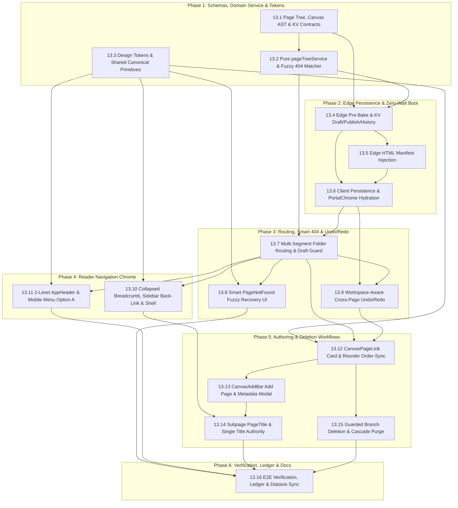

# Epic 13 PRD: Dynamic Multi-Page & Nested Subpage Architecture

> **Status:** Approved — Promoted to `docs/task/`  
> **Epic Number:** 13 *(sequenced after [Epic 12](file:///Users/francisdave/Documents/folio/docs/task/TASKS-EPIC-12.md))*  
> **Owner:** Folio Engine (`@devcabs/folio-engine`)  
> **Canonical Task Spec:** [TASKS-EPIC-13.md](file:///Users/francisdave/Documents/folio/docs/task/TASKS-EPIC-13.md)  
> **Design & UX Alignment:** [UI Standards](file:///Users/francisdave/Documents/folio/.agents/rules/ui-standards.md), [UX Psychology](file:///Users/francisdave/Documents/folio/.agents/rules/ux-psychology.md), [Editorial Restraint](file:///Users/francisdave/Documents/folio/.agents/rules/editorial-restraint.md), [Canonical UI Enforcement](file:///Users/francisdave/Documents/folio/.agents/rules/canonical-ui-enforcement.md), [Design System First](file:///Users/francisdave/Documents/folio/.agents/rules/design-system-first.md)

---

## 1. Problem Statement

Today, Folio Engine supports rich, dynamic editing *inside* a page via `DocumentCanvas` (sections, subsections, text, photos, galleries, charts, PDFs, documents), while the **page structure itself is flat and static**:

- Pages exist only as a single-level list of root milestones declared in `EngineConfig.nodes`.
- Routing (`useHashRoute`) supports only single-segment paths (`/node/:id/`).
- When a chapter grows large, authors have no choice but to stack everything into one long vertical page, which degrades readability, focus, and shareability.

Authors need the ability to **dynamically create, organize, and nest subpages** underneath main chapters—turning Folio Engine into a structured editorial knowledge base while preserving the calm scrollytelling roadmap on the home page.

---

## 2. Goals & Non-Goals

### Goals

1. Enable editors in Developer/Coordinator Mode to **create, rename, reorder, and delete subpages** at arbitrary nesting depths beneath any main chapter—using an "Add Page" workflow inside `CanvasAddBar` that feels identical to adding a Section.
2. Provide **clean, human-readable folder-style URLs** (`/node/<chapter>/<subpage>/.../`) with **zero-wait Edge HTML manifest injection** (plus optimistic chapter-prefix matching in local dev so deep links never flash a false 404 while loading), paired with a **Smart `PageNotFound` recovery page** using fuzzy similarity matching (`token overlap + Levenshtein/substring scoring`) and a direct link to the nearest valid parent page.
3. Keep the reading experience calm and uncluttered even under deep nesting:
   - Left sidebar (`EditorialSidebar`) remains 100% dedicated to the **current page's Sections & Subsections** (with its sticky top back-link dynamically returning to `< <Parent Page Title>` on subpages and `< Roadmap` on root chapters).
   - Breadcrumbs (`Breadcrumb`) collapse middle ancestors with a **non-interactive `…` ellipsis** when paths grow deep (`> 4` items).
   - Top bar navigation (`AppHeader`) displays main chapters on both Home and Node routes in a **single-row bar with solid-surface Level 2 dropdowns** (main chapters remain directly clickable, with overflow truncation/protection), and **ports this pure 2-level chapter & Level 2 subpage hierarchy into the mobile hamburger menu (Option A: strictly chapters + Level 2 subpages, zero in-page section clutter)**.
4. Enforce a **1:1 Card-to-Subpage Lifecycle**: a subpage and its parent's **Page Link editorial card** share a single unified lifecycle and a single title/metadata authority (`PageNode`). Editing the title on the Page Link card or on the subpage's `<PageTitle>` header updates the exact same `PageNode` record. Deleting a Page Link card triggers the guarded Page Deletion modal (standard confirmation for 0 subpages; typed confirmation phrase with exact descendant count for 1+ subpages) and atomically removes the card, the `PageNode`(s), and their canvases—making ghost/orphan pages impossible.
5. Design a **Workspace-Aware Cross-Page Undo/Redo Engine** (dedicated subtask) that replaces mounted-hook closure mutations with workspace-level atomic commands (`DraftWorkspacePayload` transactions + automatic route reconciliation if an undo/redo removes or restores the currently viewed page), and repair `undoRedoService` / `UndoRedoContext` (`popUndoAsync`, `popRedoAsync`, `clearScope`).
6. Persist the dynamic page tree through Folio Engine's existing **Cloudflare KV Draft (`draft:workspace`), Publish (`portal:manifest` & `history:snapshot:*`), and History/Rollback** pipelines, with a **forward-compatible schema** (`parentId: string | null`) ready for future cross-chapter reparenting ("Move to…" picker) without schema migrations.

### Non-Goals (Epic 13 v1)

- **Dynamic creation/deletion of top-level Home Roadmap chapters:** Main chapters stay anchored to `EngineConfig.nodes` so the home page's stepped scrollytelling roadmap and `PhotoFlightEngine` remain visually predictable and protected.
- **Separate "Page Manager" Drawer in v1:** Cut from v1. Because the Page Link card and the subpage share a 1:1 lifecycle (creating a subpage inserts its card; reordering the card reorders the subpage; deleting the card deletes the subpage via confirmation modal), orphan pages cannot exist and the canvas itself is the sole, intuitive place to manage subpages.
- **Cross-chapter / arbitrary reparenting UI ("Move to…") in v1:** Deferred to a future follow-up epic until we finalize its UX; however, the **data schema and tree model MUST support reparenting out of the box** (`parentId: string | null`) so adding a "Move to…" picker later requires zero schema migration.
- **Automatic URL redirect tables:** Moving or renaming a page is allowed to change its folder-style URL; broken links are handled gracefully by the Smart 404 page with fuzzy similar-page suggestions and nearest valid parent link.
- **Full tree navigation inside the reading sidebar:** The left reading sidebar will *not* render a Notion-style nested file tree.
- **In-page section lists inside the mobile hamburger menu:** To prevent clutter (Option A), the mobile hamburger menu strictly mirrors the 2-level site navigation (main chapters + Level 2 subpages).
- **Showing all nesting levels in the top bar:** Top bar navigation is strictly capped at 2 levels (main chapters + direct Level 2 subpages).
- **Interactive breadcrumb ellipsis:** The collapsed `…` indicator in deep breadcrumbs is purely visual (non-clickable, no popover).

---

## 3. Locked-In Product Decisions

| # | Area | Decision | Rationale |
| :--- | :--- | :--- | :--- |
| **1** | **Main Chapters vs. Subpages** | **Main chapters stay fixed** in `EngineConfig.nodes`; subpages beneath them are dynamic and editable in-browser. | Protects the home page scrollytelling experience while giving editors full freedom inside each chapter. |
| **2** | **Web Addresses & Zero-Wait Routing** | **Full folder-style paths** (`/node/chapter-1/research/interviews/2026-notes/`) backed by **Edge HTML manifest injection** (`window.__FOLIO_MANIFEST__`) + optimistic chapter-prefix fallback during local dev hydration. | Eliminates the ~150ms async fetch gap on cold page loads so deep subpage URLs resolve synchronously on millisecond 0 without flashing a false 404. |
| **2b** | **Broken / Moved Links** | **Smart `PageNotFound` recovery** using fuzzy similarity matching (`token overlap + Levenshtein/substring scoring`) + direct **"Return to `<Nearest Valid Parent>`"** action. | Accepts URL changes on reorganization without leaving readers at a dead end. |
| **3** | **Nesting Depth** | **Unlimited nesting** in data and authoring. | Never blocks power users; visual clutter is solved by UI boundaries rather than artificial depth caps. |
| **3b** | **Sidebar Restraint & Contextual Back Link** | `EditorialSidebar` shows **only the current page's Sections & Subsections**. Its sticky top back-button shows `< <Parent Page Title>` on subpages (navigating up 1 level) and `< Roadmap` on root chapters. | Guarantees the sidebar never becomes cramped and prevents catapulting deep readers all the way back to Home when clicking the sticky back button. |
| **3c** | **Deep Breadcrumbs** | `Breadcrumb` **collapses middle directories** with a **non-clickable `…`** when `items.length > 4` (e.g., `Overview / Chapter 1 / … / Parent / Current Page`). | Keeps breadcrumb single-line and calm at arbitrary depth without extra interactive popovers. |
| **4** | **Top Bar Navigation (Desktop)** | **Single-row top bar + Solid-Surface Dropdown on Home & Node routes:** Main chapters appear in one clean row (`mobileOnlyNav={false}`), remain directly clickable, and expose a solid-surface (`var(--folio-bg-surface)`, zero glass-on-glass stacking) dropdown (`▾`) listing their direct Level 2 subpages (ordered by the chapter canvas's Page Link card order). Long chapter lists truncate cleanly or collapse into a chapters menu. | Preserves `AppHeader`'s single-row floating glass capsule while making chapters and Level 2 subpages accessible from anywhere. |
| **4b** | **Mobile Hamburger Menu Port (Option A)** | **Strictly 2-level chapter & Level 2 subpage navigation.** Replaces the old sections-only mobile list on node routes with the clean 2-level site hierarchy (zero in-page section list mixed into the hamburger menu). | Eliminates mobile menu clutter and matches desktop `AppHeader` navigation 1:1. |
| **4c** | **1:1 Card & Subpage Lifecycle + Single Title Authority** | **`CanvasAddBar` gets an "Add Page" action** (prompts for Title, sanitized auto-slugified URL Name with live `var(--font-mono)` path preview, and optional ≤15-word summary). Creates the `PageNode` + empty canvas and inserts a **Page Link card** in one atomic draft write. Both the card's `✎ Edit` button and the subpage's `<PageTitle>` header read/write the **exact same `PageNode` record**. | Prevents ghost pages and ensures the Page Link card, `<PageTitle>`, `Breadcrumb`, and `AppHeader` never drift out of sync. |
| **5** | **Unified Card / Branch Deletion** | Clicking Trash on a Page Link card opens the **Page Deletion confirmation modal**: standard confirmation for leaf pages (0 subpages), or **typed confirmation phrase** (`DELETE ALL SUBPAGES`) showing the **exact count** of nested subpages for branch pages (1+ subpages). Atomically deletes the card, the `PageNode` subtree, and all deleted pages' canvases. | Clean folder-like deletion with strong friction against accidental subtree wipes and zero orphan pages. |
| **6** | **Workspace-Scoped Cross-Page Undo/Redo** | Dedicated architecture upgrading `undoRedoService` & `UndoRedoContext` to execute **workspace-level atomic commands** (`canvases` + `pages` mutations) with automatic route reconciliation if an undo/redo removes or restores the currently active subpage. | Makes `Cmd+Z` / `Cmd+Shift+Z` work reliably across page creation, editing, and navigation without stale unmounted React hook closures. |
| **7** | **Moving / Reparenting Scope** | **Deferred from v1 UI, but open in schema:** Data model uses `parentId: string | null` and `pageTreeService` implements reparenting with cycle detection now so a future "Move to…" picker plugs in with zero schema migration. | Keeps v1 focused and intuitive while avoiding future breaking migrations. |

---

## 4. User Flows & Experience

### Reader Flows

1. **Top-Level Exploration:** Reader visits the home page, explores the scrollytelling roadmap, and enters a main chapter (`/node/chapter-1/`).
2. **2-Level Top Bar Navigation (Desktop):** From any page (Home or Node), the reader clicks a main chapter in `AppHeader` to jump directly to it, or opens its dropdown (`▾`) to jump straight to any direct (Level 2) subpage.
3. **2-Level Hamburger Menu (Mobile — Option A):** On mobile viewports, opening the hamburger menu displays the clean 2-level chapter & Level 2 subpage hierarchy without in-page section clutter.
4. **Deep Reading via Page Link Cards:** While reading a chapter or subpage, the reader clicks an inline **Page Link editorial card** placed contextually within a section to drill down to Level 2, 3, 4+ subpages.
5. **Orientation via Breadcrumbs & Sticky Sidebar:**
   - On deep pages, the breadcrumb displays `Overview / Chapter 1 / … / Parent / Current Page`. The `…` is a calm, non-interactive visual indicator; visible ancestor segments remain clickable.
   - The left `EditorialSidebar` tracks only the current page's Sections & Subsections. When scrolled down on a subpage, its sticky back button displays `< <Parent Page Title>` to step up one level (or `< Roadmap` when on a root chapter).
6. **Zero-Wait Deep Link Load & Smart 404 Recovery:**
   - Opening a valid bookmarked deep link (`/node/chapter-1/research/2026-notes/`) resolves immediately on first render via Edge-injected `window.__FOLIO_MANIFEST__` (or waits calmly for manifest hydration in local dev if the root chapter prefix is valid).
   - If a URL genuinely does not exist, `PageNotFound` presents clickable fuzzy-matched page suggestions (`token overlap + Levenshtein/substring scoring`) plus a primary **"Return to `<Nearest Valid Parent>`"** button.

### Editor / Coordinator Flows (Dev Mode Only)

1. **Add a Subpage from `CanvasAddBar`:**
   - Click **Add Page** in `CanvasAddBar` (alongside Section, Subsection, Text, Photo, Document, Chart).
   - Modal prompts for:
     - **Page Title** (required)
     - **URL Name / Slug** (required; **smart default** auto-generated from Title as the editor types, editable, strictly URL-sanitized: lowercase, hyphenated, strips unsafe/special characters, enforces sibling uniqueness, with a live `var(--font-mono)` preview of the full folder path).
     - **Optional 1-line summary** (≤ 15 words per `editorial-restraint.md`).
   - Saving executes an atomic `PUT /api/draft` mutation that registers the new `PageNode` in `draft.pages`, initializes its `draft.canvases[subpageId]`, and inserts a `PageLinkElement` card at that position in the current page's `DocumentCanvas`.
   - Clicking the card navigates immediately to the new draft subpage so the editor can author its sections.
2. **Edit Subpage Metadata (Single Authority):**
   - Clicking the uniform **`✎ Edit`** button on the Page Link card *or* clicking **`✎ Edit`** on the subpage's `<PageTitle>` header edits the exact same `PageNode` fields (`title`, `slug` when edited via card modal, `subtitle` / `summary`). Every surface (`PageTitle`, Page Link card, `Breadcrumb`, `AppHeader` dropdown) reflects the update immediately.
3. **Reorder Subpages:**
   - Reordering a Page Link card on a chapter's canvas (via existing `CanvasItemControls` up/down/drag) automatically determines the display order of Level 2 subpages in that chapter's `AppHeader` dropdown.
4. **Delete a Subpage (via its Page Link Card):**
   - Clicking Delete on a Page Link card checks whether the target subpage has nested children in `pages`:
     - **Leaf subpage (0 children):** Standard canonical confirmation modal ("Delete subpage `<Title>` and its contents?").
     - **Branch subpage (1+ nested subpages):** Guarded confirmation modal displaying the **exact count** of nested subpages (per `ux-psychology.md` Evaluative Ease) and keeping the destructive button disabled until the editor types `DELETE ALL SUBPAGES`.
   - Confirming atomically removes the `PageLinkElement` from the parent canvas, removes the target `PageNode` and all descendant `PageNode`s from `draft.pages`, and purges their keys from `draft.canvases` via `deletedPageIds`.
5. **Cross-Page Undo / Redo & Publish:**
   - All canvas and page-tree mutations record self-contained workspace commands in the upgraded `UndoRedoManager`. Pressing `Cmd+Z` / `Cmd+Shift+Z` safely reverses or reapplies mutations against `PUT /api/draft`—and if an undo/redo removes the page the editor is currently viewing, the router automatically steps the editor up to its parent page.

---

## 5. Page Link Card & UI/UX Design Constraints

All new UI in Epic 13 must strictly conform to [UI Standards](file:///Users/francisdave/Documents/folio/.agents/rules/ui-standards.md), [UX Psychology](file:///Users/francisdave/Documents/folio/.agents/rules/ux-psychology.md), [Editorial Restraint](file:///Users/francisdave/Documents/folio/.agents/rules/editorial-restraint.md), and [Canonical UI Enforcement](file:///Users/francisdave/Documents/folio/.agents/rules/canonical-ui-enforcement.md):

- **Page Link Card Layout (Calm Full-Width Editorial Row):**
  - Matches the reading column width; stacks cleanly with generous whitespace (`var(--space-3)` / `var(--space-4)`) and **zero horizontal dividing lines** (`border-top`, `border-bottom`, `
`).
  - Minimal composition: subtle thin-stroke page icon (no emoji, extracted as a shared icon primitive) + **Page Title** (`var(--text-subhead)`, `var(--tracking-tight)`) + optional 1-line summary (`var(--text-caption)` or `var(--text-body)`, muted ink) + quiet right arrow (`→`) that nudges gently on hover.
  - **Zero Badge Theater:** No synthetic status chips or decorative counts.
- **Subpage `<PageTitle>` Header Defaults:**
  - Inherits `accentColor` from its root chapter (`EngineConfig.nodes`).
  - Uses the **parent page's title** as the default kicker (e.g., `CHAPTER 1` or `CHAPTER 1 / RESEARCH`), while `title` and `summary` bind directly to `PageNode.title` and `PageNode.summary`.
- **`AppHeader` Dropdown Restraint:**
  - Dropdown panels under main chapters use solid `var(--folio-bg-surface)` + `var(--shadow-md)` (never nested glass-blur-on-glass-blur per `editorial-restraint.md` §4).
- **Full 4-State Interactive Matrix (`ui-standards.md`):**
  - **Default:** Accessible contrast ($\ge 4.5:1$ text, $\ge 3:1$ graphics), calm resting surface token.
  - **Hover:** Subtle surface shift + elevation lift (`transform: translateY(-2px)`) and soft high-blur shadow in light mode (lighter surface tone in dark mode).
  - **Active / Pressed:** Tactile depression (`transform: translateY(1px)`).
  - **Focus-Visible / Selected:** **Universal Zero Outline Policy (`outline: none;`)** — communicated strictly through subtle surface color shift or typography contrast, never browser rings or border halos.
  - **Disabled / Missing Target:** Reduced opacity (`0.5`), non-interactive cursor (or clear Dev-Mode recovery state; hidden from public readers).
- **Canonical Primitives First (`canonical-ui-enforcement.md`):**
  - Extend canonical `Breadcrumb.tsx`, `Modal.tsx`, `UniversalEditModal.tsx`, and `src/components/ui/` form primitives—zero raw `<button>` or `<input>` elements in feature components and zero hardcoded colors in CSS modules.

---

## 6. High-Level Architectural Direction

*(Details to be formalized in `docs/task/` after whiteboard sign-off.)*

1. **Normalized Page Registry Across Live KV & Edge Contracts (`src/types/edge.ts`, `src/types/history.ts`, `src/types/draft.ts`):**
   - Define `PageNode`:
     `{ id: string, parentId: string | null, slug: string, title: string, subtitle?: string, summary?: string, order: number, createdAt: string, updatedAt: string }`
     where `id` strictly conforms to `NODE_ID_REGEX` (`/^[a-z0-9_-]{1,64}$/`, e.g. `page-<timestamp>-<rand>`) so `/api/public/node/:nodeId` serves subpage canvases with zero route changes.
   - Add `pages?: Record<string, PageNode>` to:
     - `DraftWorkspacePayload` (`draft:workspace` in `src/types/edge.ts`)
     - `PublicPortalManifestPayload` & `PublicPortalManifestPayloadSchema` (`portal:manifest` in `src/types/edge.ts`)
     - `PublishedSnapshot` & `UnifiedPortalSnapshot` (`history:snapshot:*` in `src/types/history.ts`)
     - `CloudDraftData` (`src/types/draft.ts`)
   - Update `handlePutDraft` (`src/edge/handlers/draftHandler.ts`), `handlePublishRoute` (`src/edge/handlers/publishHandler.ts`), `handleHistoryRoute` (`src/edge/handlers/historyHandler.ts`), and `compilePortalManifest` (`src/services/edgePreBakeService.ts`) to persist `pages` and support `deletedPageIds?: string[]` so cascade-deleted subpage canvases are cleanly purged from `draft:workspace`.
2. **Pure Page Tree Service (`src/services/pageTreeService.ts`):**
   - Immutable operations: create, update metadata, URL sanitization & sibling slug uniqueness (`overview` -> `overview-2`), reorder (synced with parent canvas `PageLinkElement` order), **reparent with cycle detection** (service ready in v1), cascade delete (returning all removed `PageNode` IDs), path resolution (`resolvePathToPage`), breadcrumb chain builder, 2-level nav builder, and **fuzzy similarity matcher** (`token overlap + Levenshtein distance + substring scoring` + nearest valid ancestor resolution) for Smart 404.
3. **Zero-Wait Multi-Segment Routing & Edge HTML Manifest Injection (`use-hash-route.ts` & Edge HTML handler):**
   - **Edge Injection:** On HTML document requests, inject the active `portal:manifest` JSON into `window.__FOLIO_MANIFEST__` at the Cloudflare edge so `PortalChromeContext` and `useHashRoute` have the published `pages` tree synchronously on initial boot (0ms wait, zero skeleton/404 flash).
   - **Optimistic Prefix Fallback (Local Dev / Cold Cache):** If `window.__FOLIO_MANIFEST__` is absent and `portalChrome.isHydrating` is true, any `/node/<valid-root-chapter>/...` path stays in a calm hydrating state until `portal:manifest` (or `draft:workspace` in Dev Mode) finishes hydrating before deciding whether a deep path is `not-found`.
   - **Dev Mode Draft Refresh Guard:** If an editor refreshes or exits Dev Mode while viewing an unpublished draft-only subpage, gracefully redirect to the nearest published ancestor chapter (or show a calm notice) rather than stranding them.
4. **Dedicated Workspace-Aware Cross-Page Undo/Redo Architecture (`src/services/undoRedoService.ts`, `src/context/UndoRedoContext.tsx`, `src/hooks/useDocumentCanvas.ts`):**
   - Fix the missing `popUndoAsync`, `popRedoAsync`, and `clearScope` methods on `UndoRedoManager`.
   - Upgrade undo/redo actions from unmounted React hook `documentRef` closures to **workspace-addressed commands** (`targetPageId`, snapshot of before/after canvas & `pages` slice) that persist directly via `draftService` and emit `EVENT_DRAFT_CANVAS_CHANGE` / `EVENT_DRAFT_CONTENT_CHANGE`.
   - If an `undo()` or `redo()` deletes the page the editor is currently viewing, automatically navigate the editor up to the parent page.
5. **Canvas AST Extension (`src/types/canvas.ts` & `src/types/edge.ts`):**
   - Add `PageLinkElement` (`type: 'page-link'`, `{ id, type: 'page-link', targetPageId }`) to `CanvasLeafElement` and `CanvasLeafElementSchema` in `src/types/edge.ts` (so Zod validation in `compilePublicNodePayload` succeeds on publish).
   - Because `PageLinkElement` references `targetPageId`, it always renders the live `PageNode.title`, `PageNode.summary`, and resolved folder URL.
6. **Version Doctor & Migration Ledger:**
   - Record additive schema/API updates in `src/migrations/ledger.ts` and sync Diátaxis documentation per [docs-sync.md](file:///Users/francisdave/Documents/folio/.agents/rules/docs-sync.md).

---

## 7. Edge Cases & Guardrails

1. **URL sanitization & duplicate sibling slugs:** Automatically sanitize URL names (lowercase, collapse whitespace/symbols to hyphens, trim leading/trailing hyphens, block reserved/empty slugs). Two subpages under the *same* parent cannot share a slug (auto-disambiguate e.g. `overview-2` and surface inline validation); subpages under *different* parents *can* share slugs (`/node/chapter-1/overview` and `/node/chapter-2/overview`).
2. **Circular reparenting guard:** `pageTreeService` strictly rejects setting `parentId` to self or any descendant.
3. **1:1 Card & Subpage Deletion Integrity:** Deleting a Page Link card always opens the guarded Page Deletion modal (typed confirmation `DELETE ALL SUBPAGES` with exact descendant count when children exist) and atomically removes the card, the `PageNode` subtree, and all associated `canvases`.
4. **Deleting or Undoing the currently viewed page:** Automatically navigate the editor up to the deleted page's parent (or Home if root).
5. **Desktop dropdown + clickable chapter ergonomics:** Clicking the chapter label navigates to the chapter; hover/focus or clicking the chevron (`▾`) toggles the solid-surface Level 2 dropdown cleanly with keyboard (`ArrowDown`, `Escape`) and touch support.
6. **Mobile hamburger menu restraint (Option A):** Mobile hamburger menu renders strictly the 2-level chapter & Level 2 subpage tree—no mixed in-page section list.
7. **Smart 404 fuzzy ranking:** Match attempted path segments against all active pages using token overlap + Levenshtein distance + substring scoring, surfacing the top 3–5 matches plus a primary **"Return to `<Nearest Valid Parent>`"** button whenever a URL prefix matches an existing ancestor.

---

## 8. Approved Phase Outline *(Promoted to `docs/task/TASKS-EPIC-13.md`)*

> **Approved Status:** This PRD has been signed off and decomposed into formal atomic task specifications in [docs/task/TASKS-EPIC-13.md](file:///Users/francisdave/Documents/folio/docs/task/TASKS-EPIC-13.md) (`13.1`–`13.16`). This PRD remains the authoritative product source of truth. Subtasks are strictly separated by architectural layer (schemas, pure domain services, design tokens, Edge handlers, client hydration/routing/undo engines, individual UI surfaces, and final verification/ledger/docs) so each unit is atomic, independently testable, and ordered cleanly without reopening core contracts downstream.

### Phase 1: Shared Schemas, Pure Domain Service & Design Token Gate

- **13.1 — Page Tree, Canvas AST & Edge KV Data Contracts (`src/types/*`)** *(Layer: Types & Runtime Zod Schemas — No dependencies)*
  - Define `PageNode` (`id` conforming to `NODE_ID_REGEX` `/^[a-z0-9_-]{1,64}$/`, forward-compatible `parentId: string | null`, `slug`, `title`, `subtitle?`, `summary?`, `order`, `createdAt`, `updatedAt`) and `PageNodeSchema`.
  - Add `pages?: Record<string, PageNode>` to `DraftWorkspacePayload`, `PublicPortalManifestPayload` + `PublicPortalManifestPayloadSchema` (`src/types/edge.ts`), `PublishedSnapshot` + `UnifiedPortalSnapshot` (`src/types/history.ts`), and `CloudDraftData` (`src/types/draft.ts`); add `deletedPageIds?: string[]` to the `PUT /api/draft` mutation contract, workspace/page-tree `UndoActionType` variants (`src/types/history.ts`), and 2-level metadata support on `NavItem` (`src/types/navigation.ts`).
  - Extend `src/types/canvas.ts` and `src/types/edge.ts` with `PageLinkElement` (`{ id, type: 'page-link', targetPageId }`), `'page-link'` in `CanvasElementType` / `CanvasModalElementType`, `isPageLinkElement` / `isLeafElement` guards, `CanvasElementFormData` (`slug`, `summary`), and `PageLinkElementSchema` inside `CanvasLeafElementSchema`.
  - *Test focus:* TypeScript contract compilation and Zod schema unit tests (`PageNodeSchema`, `PublicPortalManifestPayloadSchema`, `CanvasLeafElementSchema`).

- **13.2 — Pure Page Tree Domain Service & Smart 404 Fuzzy Matcher (`src/services/pageTreeService.ts`)** *(Layer: Pure Domain Service — Depends on `13.1`)*
  - Implement immutable tree operations with zero DOM/React/KV dependencies: `createPageNode` (`page-<timestamp>-<rand>` ID generation), `updatePageNodeMetadata`, `cascadeDeleteSubtree`, and `countDescendantPages`.
  - Implement URL slug sanitization & validation (lowercase, hyphenated, strips unsafe/special characters, trims hyphens, blocks reserved/empty slugs; enforces sibling-only uniqueness with auto-disambiguation `overview` → `overview-2` and inline validation feedback, while allowing identical slugs under different parents).
  - Implement `reparentPageNode` with strict circular-reparenting guard (rejects self or any descendant) so a future "Move to…" UI plugs in with zero schema migration.
  - Implement `deriveSubpageOrderFromCanvas` / `reorderSubpages` (syncing display order from parent canvas `PageLinkElement` order), `resolvePathToPage` (arbitrary nesting depth), `buildPagePath` (`/node/<chapter>/<subpage>/.../`), `getAncestorChain` (Breadcrumb trail, root chapter `accentColor` lookup, parent page resolution), and `buildTwoLevelNavTree` (strictly capped at 2 levels: main chapters + direct Level 2 subpages ordered by chapter canvas cards).
  - Implement Smart 404 fuzzy similarity matcher (`token overlap + Levenshtein distance + substring scoring` returning top 3–5 ranked matches) and nearest valid ancestor resolver.
  - *Test focus:* Pure Vitest unit suite covering deep nesting, slug edge cases, sibling collisions vs. cross-parent duplicates, circular reparenting rejection, exact descendant counts, and fuzzy ranking accuracy.

- **13.3 — Design System Tokens & Shared Canonical UI Primitives (`src/styles/tokens.css`, `src/components/ui/`)** *(Layer: Design System Gate — No dependencies; gates Phases 4–5)*
  - Lock any missing semantic tokens in `src/styles/tokens.css` per `design-system-first.md`: Page Link row surfaces/hover/elevation/disabled opacity (`0.5`), solid-surface dropdown panel tokens (`var(--folio-bg-surface)` + `var(--shadow-md)`, zero glass-on-glass blur), mono URL path preview styling, and muted breadcrumb ellipsis ink.
  - Extract the shared thin-stroke `PageIcon` SVG primitive in `src/components/ui/` (consumed by both `CanvasAddBar` and `CanvasPageLink` — zero emoji, zero duplicated inline `<svg>`).
  - Confirm/extract any minimal canonical form input primitive in `src/components/ui/` needed by Epic 13 modals so zero raw `<button>` or `<input>` elements appear in feature components (`canonical-ui-enforcement.md`).
  - *Test focus:* `npm run test:tokens` purity gate and canonical primitive unit/a11y tests.

### Phase 2: Edge KV Persistence, Pre-Bake Pipeline & Zero-Wait Manifest Boot

- **13.4 — Edge Pre-Bake Compiler & Cloudflare KV Draft / Publish / History Handlers** *(Layer: Cloudflare Edge KV & Pre-Bake — Depends on `13.1`, `13.2`)*
  - Update `compilePortalManifest` and `compilePublicNodePayload` / `transformCanvasAst` in `src/services/edgePreBakeService.ts` to include `pages` in `portal:manifest` (validated against `PublicPortalManifestPayloadSchema`) and cleanly compile `PageLinkElement` blocks and dynamic `page-*` subpage canvases.
  - Update `src/edge/handlers/draftHandler.ts`: hydrate `pages` and all dynamic subpage canvases in `buildBaselineDraftWorkspace` (`POST /api/draft/init`, `DELETE /api/draft`); extend `handlePutDraft` (`PUT /api/draft`) to persist `pages` and atomically purge `deletedPageIds` from `draft.canvases` and `draft.pages` under optimistic concurrency.
  - Update `src/edge/handlers/publishHandler.ts` (`POST /api/publish`) to stage immutable `node:${snapshot.id}:${pageId}` and `node:${pageId}` keys for root chapters and all dynamic subpages, persist `pages` in `history:snapshot:${id}` and `portal:manifest`, and anchor clean `draft:workspace` with `pages`.
  - Update `src/edge/handlers/historyHandler.ts` (`POST /api/history/restore`) to restore `snapshot.pages` (resetting `pages: {}` on `SYSTEM_BASELINE_SNAPSHOT_ID`) and verify `src/edge/handlers/publicHandler.ts` serves `page-*` canvases cleanly while returning 404 for deleted subpages under the active snapshot.
  - *Test focus:* Edge handler & pre-bake Vitest suite against mock `KVNamespace` (baseline init, concurrent `PUT` 409, `deletedPageIds` purge, two-phase publish, rollback, deleted-subpage 404).

- **13.5 — Edge HTML `window.__FOLIO_MANIFEST__` Injection (`src/edge/router.ts`, `src/edge.ts`)** *(Layer: Edge HTTP / HTML Middleware — Depends on `13.1`, `13.4`)*
  - Add an Edge HTML manifest injector invoked on non-API `text/html` asset fallthrough responses in `handleFolioEdgeRequest` (`src/edge/router.ts`), preserving SPA HTML fallback for multi-segment `/node/<chapter>/<subpage>/.../` requests.
  - Read active `portal:manifest` from KV and inject `window.__FOLIO_MANIFEST__` into `<head>` with strict XSS-safe JSON escaping (`</script>`, `<`, `>`, `\u2028`, `\u2029`) and graceful passthrough when KV is empty/unavailable or responses are non-HTML assets.
  - Export Edge helpers from `src/edge.ts` to preserve the 5-line Consumer `worker.ts` delegation contract with zero Consumer route duplication.
  - *Test focus:* Edge router & injector Vitest suite (HTML injection, XSS escaping, non-HTML asset passthrough, missing-KV fallback, multi-segment SPA routes).

- **13.6 — Client Workspace Persistence Services & Synchronous `PortalChromeContext` Hydration** *(Layer: Client Services & Context Hydration — Depends on `13.1`, `13.2`, `13.4`, `13.5`)*
  - Extend `src/services/draftService.ts` (`saveDraftWorkspace` supporting `pages` and `deletedPageIds`, serialized atomic workspace transaction helpers via `enqueueDraftMutation`) and `src/services/historyService.ts` (`publishNewSnapshot` bundling `draftWorkspace.pages` + updated `computeMetricsSummary`).
  - Upgrade `src/context/PortalChromeContext.tsx` and `src/utils/contentDb.ts` to read Edge-injected `window.__FOLIO_MANIFEST__` synchronously on initial Public Mode boot (0ms `pages` and `contentOverrides` hydration, eliminating cold-load flash), fall back gracefully to `GET /api/public/manifest` when absent, hydrate `pages` from `draft:workspace` in Dev Mode, and expose reactive `pages` state synchronized on `EVENT_DRAFT_CONTENT_CHANGE` / `EVENT_LIVE_CONTENT_CHANGE`.
  - *Test focus:* Client service & `PortalChromeContext` Vitest tests (0ms injected manifest boot, async fallback, Dev Mode `pages` hydration, atomic draft save with `deletedPageIds`).

### Phase 3: Multi-Segment Routing, Smart 404 & Cross-Page Undo/Redo Engine

- **13.7 — Multi-Segment Folder Routing & Dev-Mode Draft Refresh Guard (`src/hooks/use-hash-route.ts`)** *(Layer: Client Routing Engine — Depends on `13.2`, `13.6`)*
  - Upgrade `parseRoute` and `useHashRoute` to resolve arbitrary-depth folder URLs (`/node/<chapter>/<subpage>/.../`) via `pageTreeService.resolvePathToPage` while preserving legacy `#node/:id`, `/page/:id/`, `basePath`, `#stage-N`, and root `/` compatibility.
  - Expose resolved `activePageId`, `rootNodeId`, `pageNode`, `ancestors`, `attemptedSegments`, and canonical `navigateToPage(pageId)` pushing folder URLs via `buildPagePath`.
  - Implement **optimistic chapter-prefix fallback** (local dev / cold cache when `window.__FOLIO_MANIFEST__` is absent and `portalChrome.isHydrating` is `true`): hold `/node/<valid-root-chapter>/...` in a calm `'hydrating'` route state until manifest/draft hydration settles before evaluating `'not-found'`.
  - Implement **Dev Mode draft refresh / exit guard**: if an editor refreshes or exits Dev Mode while viewing an unpublished draft-only subpage, redirect gracefully to the nearest published ancestor chapter with a calm toast/notice instead of stranding them on a 404.
  - *Test focus:* Route parser & hook tests (arbitrary nesting depths, legacy hash upgrade, optimistic hydration deferral with zero false 404 flash, Dev Mode draft exit redirect).

- **13.8 — Smart `PageNotFound` Fuzzy Recovery UI (`src/components/feedback/PageNotFound.tsx`)** *(Layer: Feedback UI Surface — Depends on `13.2`, `13.3`, `13.7`)*
  - Upgrade `PageNotFound` to consume canonical `Button` (eliminating raw `<button>`), accept `nearestParent` (primary **"Return to `<Nearest Valid Parent>`"** CTA falling back to Overview/Roadmap) and `suggestions` (top 3–5 fuzzy-matched pages from `pageTreeService` displaying title + breadcrumb path).
  - Enforce full 4-state interactive matrix, Universal Zero Outline Policy (`outline: none;`), and token-only CSS (`PageNotFound.module.css`).
  - Wire `src/App.tsx` `'not-found'` route to pass `attemptedSegments`-derived fuzzy matches and nearest valid parent into `PageNotFound`.
  - *Test focus:* Component & interaction tests (nearest-parent CTA vs. default fallback, top 3–5 clickable fuzzy suggestions, keyboard/a11y and token checks).

- **13.9 — Workspace-Aware Cross-Page Undo/Redo Engine (`undoRedoService`, `UndoRedoContext`, `useDocumentCanvas`)** *(Layer: Cross-Page Transaction & Undo/Redo Engine — Depends on `13.1`, `13.6`, `13.7`)*
  - Audit and harden `UndoRedoManager` (`src/services/undoRedoService.ts`) and `UndoRedoContext` (`src/context/UndoRedoContext.tsx`) for `popUndoAsync`, `popRedoAsync`, `clearScope`, async failure rollback, `isTextInput` chord isolation, and history reset on dev-exit / snapshot restore.
  - Implement **workspace-addressed atomic commands** (`targetPageId`, before/after `canvases` and `pages` slices, `deletedPageIds`) persisting directly via `draftService` (`enqueueDraftMutation` + `PUT /api/draft`) and broadcasting `EVENT_DRAFT_CANVAS_CHANGE` / `EVENT_DRAFT_CONTENT_CHANGE` / `EVENT_DRAFT_UPDATED_AT_SYNC`—replacing fragile unmounted React hook `documentRef` closures.
  - Wire **automatic route reconciliation**: if an `undo()` or `redo()` removes the currently viewed subpage, navigate up to its parent page (or Home if root); if it restores or changes the slug of the currently viewed page (or an ancestor), reconcile the active URL cleanly.
  - Migrate `src/hooks/useDocumentCanvas.ts` mutations to workspace-addressed commands and remove stale unmount `clearScope` pruning so `Cmd+Z` / `Cmd+Shift+Z` operates reliably across page navigation.
  - *Test focus:* Cross-page undo/redo Vitest suite (edit Page A → navigate to Page B → undo/redo Page A; undo page creation while viewing that subpage → parent redirect; slug undo → URL reconciliation; KV failure rollback).

### Phase 4: Reader Navigation Chrome & Subpage Shell Orientation

- **13.10 — Collapsed Non-Interactive `Breadcrumb`, Contextual `EditorialSidebar` Back-Link & Subpage Shell Wiring** *(Layer: In-Page Reading Orientation UI — Depends on `13.3`, `13.7`)*
  - Extend canonical `src/components/ui/Breadcrumb.tsx` to collapse middle ancestors into a **non-interactive `…` ellipsis** (``, non-clickable, zero popover) when `items.length > 4` (e.g., `Overview / Chapter 1 / … / Parent / Current Page`), keeping visible ancestors clickable with full 4-state matrix and Zero Outline Policy.
  - Extend `src/components/layout/EditorialSidebar.tsx` to remain 100% dedicated to the **current page's Sections & Subsections** (never a nested page tree) while replacing its hardcoded `"Roadmap"` sticky top back-link with dynamic `backLabel` / `onBack` displaying `< <Parent Page Title>` (navigating up 1 level) on subpages and `< Roadmap` on root chapters, with clean truncation and canonical control compliance.
  - Wire dynamic `PageNode` shell rendering in `src/App.tsx` (resolving root `NodeItem` or dynamic `PageNode`, inheriting root chapter `accentColor`, passing the full ancestor chain to `Breadcrumb`, parent back-link to `EditorialSidebar`, and `activePageId` to `DocumentCanvas`).
  - *Test focus:* `Breadcrumb` collapse & non-interactive `…` tests, `EditorialSidebar` root vs. subpage sticky back-link & sections-only TOC tests, and deep subpage shell rendering tests.

- **13.11 — 2-Level Desktop Top Bar (`AppHeader` Solid-Surface Dropdowns) & Mobile Hamburger Menu Port (Option A)** *(Layer: Global Header & Mobile Navigation UI — Depends on `13.2`, `13.3`, `13.7`)*
  - Upgrade desktop `src/components/layout/AppHeader.tsx` (wired in `src/App.tsx` with `mobileOnlyNav={false}` on both Home and Node routes) to display main chapters in a single-row floating glass capsule: clicking the chapter label navigates directly to the chapter, while hover/focus or clicking the chevron (`▾`) toggles a **solid-surface (`var(--folio-bg-surface)` + `var(--shadow-md)`, zero glass-on-glass stacking)** dropdown listing direct Level 2 subpages (strictly capped at 2 levels, ordered by the chapter canvas's Page Link card order).
  - Implement full keyboard (`ArrowDown`, `ArrowUp`, `Enter`, `Escape`) and touch ergonomics, plus graceful overflow truncation/protection for long chapter lists.
  - **Mobile Hamburger Menu Port (Option A):** replace the legacy in-page sections mobile list on node routes with the strictly 2-level chapter & Level 2 subpage hierarchy (zero in-page section clutter), matching desktop `AppHeader` 1:1.
  - Enforce canonical primitives, 4-state interactive matrix, Universal Zero Outline Policy, and token-only CSS.
  - *Test focus:* Clickable chapter vs. dropdown toggle, keyboard (`ArrowDown`, `Escape`) & outside-click dismissal, solid-surface token compliance, overflow handling, and Mobile Option A 2-level menu tests.

### Phase 5: Authoring Experience — Page Link Cards, Creation, Unified Title Authority & Guarded Deletion

- **13.12 — `CanvasPageLink` Editorial Card & Canvas Reorder Order-Sync** *(Layer: Canvas Leaf Presentation & Reorder Sync — Depends on `13.1`, `13.2`, `13.3`, `13.7`, `13.9`)*
  - Build `src/components/canvas/CanvasPageLink.tsx` (`CanvasPageLink.module.css`) as a calm full-width editorial row matching the reading column width with `var(--space-3)` / `var(--space-4)` spacing and **zero horizontal dividing lines** (`border-top`, `border-bottom`, `
`).
  - Minimal composition: shared thin-stroke `PageIcon` primitive (no emoji) + live `PageNode.title` (`var(--text-subhead)`, `var(--tracking-tight)`) + optional 1-line `PageNode.summary` (`var(--text-caption)` / `var(--text-body)`, muted ink) + quiet right arrow (`→`) nudging gently on hover; **zero badge theater**.
  - Implement the complete **4-State Interactive Matrix**: Default (WCAG AA contrast ≥ 4.5:1 text, ≥ 3:1 graphics), Hover (`translateY(-2px)` + soft high-blur shadow in light mode / lighter surface in dark mode), Active/Pressed (`translateY(1px)`), Focus-Visible (`outline: none;` Universal Zero Outline Policy), and **Disabled / Missing Target** (`opacity: 0.5`, non-interactive cursor / clear Dev-Mode recovery state; **hidden from public readers**).
  - Register `page-link` in `src/components/canvas/DocumentCanvas.tsx` (click navigation via `navigateToPage`, uniform `✎ Edit`, Delete, and reorder via `CanvasItemControls`) and automatically sync subpage display order whenever Page Link cards are reordered (up/down/drag) so `AppHeader` Level 2 dropdown order updates immediately.
  - *Test focus:* Component/a11y/4-state tests, missing-target public-hidden vs. dev-recovery tests, zero-divider/token checks, and canvas reorder → `AppHeader` order sync tests.

- **13.13 — `CanvasAddBar` "Add Page" Flow & Canonical Page Metadata Modal** *(Layer: Subpage Creation & Card-Edit Authoring UI — Depends on `13.2`, `13.3`, `13.6`, `13.9`, `13.12`)*
  - Add **"Add Page"** action to `src/components/canvas/CanvasAddBar.tsx` (alongside Section, Subsection, Text, Photo, Document, Chart, consuming the shared `PageIcon` primitive).
  - Build the canonical Add/Edit Page modal (`UniversalEditModal.tsx` / canonical `Modal`, `Button`, and `src/components/ui/` form primitives — zero raw `<input>`/`<button>`): required **Page Title**, required **URL Name / Slug** (smart default auto-generated from Title as editor types, editable, strictly URL-sanitized via `pageTreeService`, sibling-uniqueness inline validation, live `var(--font-mono)` full folder-path preview), and optional **1-line summary** (≤ 15 words per `editorial-restraint.md`).
  - On Add save: execute one atomic `PUT /api/draft` transaction registering `PageNode` in `draft.pages`, initializing `draft.canvases[subpageId]`, and inserting `PageLinkElement` at target position, pushing a single workspace-level undo command; clicking the card navigates immediately to the new draft subpage.
  - Wire the Page Link card's uniform `✎ Edit` button to edit `PageNode` metadata (`title`, `slug`, `subtitle`/`summary`) atomically with workspace undo.
  - *Test focus:* Slug auto-generation/sanitization/uniqueness & ≤ 15-word summary validation tests, atomic create transaction + undo tests, and card metadata edit sync tests.

- **13.14 — Subpage `<PageTitle>` Header Defaults & Single `PageNode` Title Authority** *(Layer: Subpage Heading Binding — Depends on `13.6`, `13.9`, `13.10`, `13.13`)*
  - Extend `src/components/ui/PageTitle.tsx` and subpage header wiring in `src/App.tsx` so subpage headers inherit `accentColor` from their root chapter (`EngineConfig.nodes`), display the **parent page's title** as default kicker (e.g., `CHAPTER 1` or `CHAPTER 1 / RESEARCH`), and bind `title` and `summary` directly to `PageNode` rather than disconnected `contentOverrides` keys.
  - Wire `<PageTitle>`'s uniform `✎ Edit` affordance on subpages to read/write the **exact same `PageNode` record** in `draft.pages` (recording a workspace-level undo command), guaranteeing `<PageTitle>`, parent Page Link card, `Breadcrumb`, and `AppHeader` dropdown never drift out of sync.
  - *Test focus:* Subpage default kicker & root `accentColor` inheritance tests, plus dual-entry (`<PageTitle>` vs. Page Link card) single-authority synchronization and undo tests.

- **13.15 — Guarded Unified Page / Branch Deletion Modal & Atomic Cascade Purge** *(Layer: Destructive Confirmation UI & Cascade Delete — Depends on `13.2`, `13.3`, `13.6`, `13.9`, `13.12`)*
  - Wire Delete/Trash on any `PageLinkElement` card to compute the exact descendant count via `pageTreeService.countDescendantPages` and open a canonical `role="alertdialog"` confirmation modal (`Modal`, `Button`, canonical text `Input`):
    - **Leaf subpage (0 children):** Standard confirmation ("Delete subpage `<Title>` and its contents?").
    - **Branch subpage (1+ nested subpages):** Displays the **exact count** of nested subpages (Evaluative Ease per `ux-psychology.md`) and keeps the destructive Delete button disabled until the editor types `DELETE ALL SUBPAGES`.
  - On confirm: execute one atomic `PUT /api/draft` transaction removing the `PageLinkElement` from the parent canvas, pruning the target `PageNode` and all descendant `PageNode`s from `draft.pages`, and sending `deletedPageIds` to purge all deleted subpages' keys from `draft.canvases` (guaranteeing zero ghost/orphan pages).
  - Push one reversible workspace-level undo command capable of restoring the card, entire `PageNode` subtree, and purged canvases, with automatic navigation up to the parent page (or Home if root) if the active page is removed.
  - *Test focus:* Leaf vs. branch modal gating tests (exact count display, destructive button disabled until exact phrase typed), atomic cascade purge + `deletedPageIds` verification, and workspace undo/redo full-subtree restoration tests.

### Phase 6: End-to-End Verification, Version Doctor Ledger & Diátaxis Docs Sync

- **13.16 — End-to-End Verification, Public Exports, Version Doctor Ledger & Diátaxis Docs Sync** *(Layer: QA, Package Exports, Ledger & Docs — Depends on `13.1`–`13.15`)*
  - Add end-to-end integration tests verifying the complete dynamic nested-page lifecycle: multi-level subpage creation → Page Link card reorder updating `AppHeader` Level 2 dropdown → unified `<PageTitle>` and card metadata edits → cross-page `Cmd+Z` / `Cmd+Shift+Z` with route reconciliation → guarded branch deletion (`deletedPageIds` purge) → Edge pre-bake & two-phase publish → Edge HTML `window.__FOLIO_MANIFEST__` injection → zero-wait deep-link cold load → Smart 404 fuzzy recovery → History rollback restoring `pages` + canvases.
  - Export new public contracts, services, hooks, and components from `src/index.ts` and `src/edge.ts`; verify Consumer zero-duplication edge delegation (`verifyEdgeDelegation`).
  - Execute full quality, canonical UI, token purity, and build gates: `npm run test:tokens`, zero raw `<button>`/`<input>` outside `src/components/ui/`, 4-state matrix & Universal Zero Outline Policy audit, `npx tsc --noEmit`, `npm test`, `npm run build`, and `npm run build:lib`.
  - Record additive schema/API entries in `src/migrations/ledger.ts` (`breakingChanges`, `codeActions`, `contentChanges`), compile and verify `CHANGELOG.md` (`npm run changelog`, `npm run changelog:verify`), and pass `npm run doctor` and `npm run verify:migrations`.
  - Sync all affected Diátaxis docs per [docs-sync.md](file:///Users/francisdave/Documents/folio/.agents/rules/docs-sync.md) (`reference/01-public-api-exports.md`, `02-data-contracts.md`, `03-components.md`, `04-hooks-and-contexts.md`, `05-services-and-utilities.md`, `how-to/developers/03-edge-pre-baking-and-kv-cache.md`, `04-theming-and-design-tokens.md`, `how-to/end-users/02-editing-content-and-canvas.md`, `05-history-undo-and-publishing.md`, `explanation/01-system-architecture.md`, `04-recursive-document-ast.md`).

### Draft Dependency Flow

